# 03 — The shell: window, tabs, run bar, log, settings, projects

<!-- nav -->
[← 02 Services and the tool catalogue](02-services.md) · [↑ Contents](README.md) · [04 Prepare →](04-prepare.md)

**Flows:** [F0.1](#f01-switch-tab) · [F0.2](#f02-press-) · [F0.3](#f03-press-) · [F0.5](#f05-a-runs-bookkeeping-every-step-uses-it) · [F0.6](#f06-open-at-start) · [F0.7](#f07-derive-the-editing-policy-new) · [F0.8](#f08-new-project) · [F0.9](#f09-open-a-project) · [F0.10](#f010-save-as) · [F0.11](#f011-rescan) · [F0.12](#f012-add-sources-from-prepare) · [F0.13](#f013-tests) · [F0.14](#f014-profiles)
<!-- /nav -->

## 1. The window

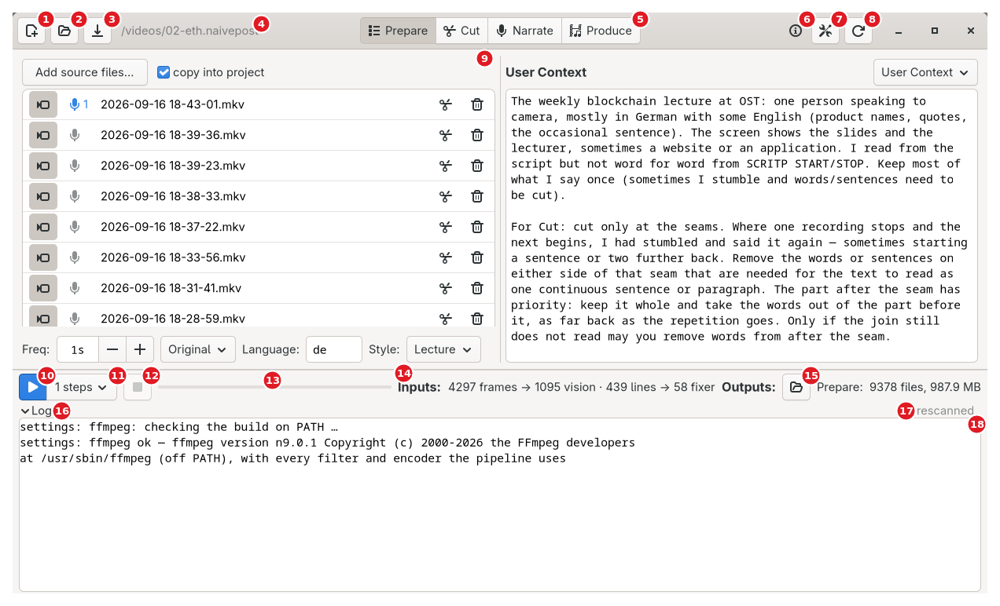

<sub>Screenshot of the prototype on the ETH lecture project.</sub>

**1** New · **2** Open · **3** Save · **4** project name/path · **5** tab row · **6** ⓘ · **7** Settings · **8** Rescan · **9** the visible tab's page · **10** ▶ run / pause · **11** chain (prototype; gone in the rewrite, [§2](#2-the-run-bar)) · **12** ⏹ · **13** progress bar (draws no text) · **14** Inputs readout · **15** Outputs: folder button and count · **16** log expander · **17** status line · **18** the log

- One window, title "Naivepost". Its minimum size is 1240×900: it opens at that size and cannot be made smaller, and at that size every control and lane a page names is on screen at once. No page scrolls as a whole. Above the minimum the layout grows with the window and no part has a fixed pixel size: the video preview scales to the room it is given (keeping its aspect), text boxes, lists and the log take the extra height and get their own scrollbar when their content is longer, the timeline's lanes share the height that is left, and splits keep their proportions. Every screenshot of a page is the whole window at the minimum size: header bar, page, run bar and log header, never the page alone. Header bar: New ("New project — name it, put it where you want it, and start over"), Open ("Load a project — sources, prompts and settings"), Save ("Save this project to a file"), project name/path packed after Save (as the window narrows: path + tab words → file name + tab words → file name + icons only), the tab row as the header bar's title widget, in its centre (not a row of its own under the header), then, packed from the right edge inward (reads ⓘ ⚙ ⟳ on screen): Rescan ("Rescan inputs and outputs"), Settings ("Settings — the LLM and audio.cpp endpoints"), ⓘ (tooltip = current tab's label + help text).
- Tabs: Prepare (view-list), Cut (edit-cut), Narrate (microphone), Produce (multimedia). Drawn as one joined group in the header's centre: a frame round the four, a line between neighbours, the shown tab shaded darker, each tab its icon then its word (first rewrite: libadwaita's flat switcher, four loose words with only the shown one shaded). Locked tab: greyed, not disabled; tooltip = the reason; a click bounces and puts the reason on the status line. Cut locked until a source is marked footage ("Add footage on the Prepare step first — the cut is laid out from the recordings"). Narrate and Produce never locked; their ▶ refuses without a cut.
- Bottom, under the page, top to bottom: one row holding the run bar ([§2](#2-the-run-bar)) and, to its right in the same row, the visible tab's "Inputs:" readout, then the "Outputs:" label, the Outputs folder button and the Outputs count (`Outputs: [📁] Prepare: 5 files, 1.4 MB`); under that row the log expander, its header carrying the status line at the header's right end. Log: read-only monospace; each line is the message alone. New: no `>>> `, `!!! ` or four-space prefix — the level shows by colour (failure red, detail dimmed, progress plain). Prototype: lines start `>>> `, `!!! ` or four spaces. Only one log line is a link — the per-run model exchange page, opened in a browser (GTK's file launcher, `xdg-open` fallback); no other path clickable. New: every path the log names is a link to it, wherever on the line it stands, and a link opens on a click as well as on Enter (first rewrite: Enter alone, and only a link at the line's first character; a path in mid-line never opened); the opener is the same as the Outputs button's: GTK's file launcher, then `xdg-open`, and a launch that fails both ways says so in the log instead of doing nothing.
- Page (above) and bottom bar (below) are the two halves of a draggable divider that splits the area under the header bar top and bottom, not a fixed strip. The open log follows its newest line while the person is at its end (a line arriving while GTK is still measuring the wrapped text keeps the view at the end), keeps their place once they scroll up to read, and follows again from the next line after they scroll back to the end (first rewrite: one scroll right after replacing the text, before it was measured, so the newest lines ran off the bottom). A log that has only grown since its last paint gets the new lines appended, the lines on screen left as they are (first rewrite: the whole text was emptied and refilled at every paint, and the text view moved itself back near the top a moment after the follow had put it at the end; traced on the user's machine as 57 jumps in one session with the log never unpinned). Opening the log shows its newest line, every line written while it was folded included (first rewrite: a folded log was not repainted, and opening it after a run showed the old text or none). The log starts collapsed, and while it is collapsed the bottom half is exactly as tall as the run bar row plus the log expander's header, with no empty space under them: the page takes all the rest of the height. Expanding the log moves the divider up so the log gets room of its own; collapsing it returns that height to the page.
- Margins: nothing on a page or in the bottom bar touches the window's edge or a divider. A page keeps 12 px from the header bar above it (no more: a deeper band reads as an empty border) and at least 12 px from the window's left and right edges and from each side of a column divider; the bottom bar keeps 12 px from the window's left, right and bottom edges and 8 px under the divider above it, with 8 px between the controls of its run bar row and 8 px between that row and the log header under it (so its collapsed height is those two rows plus those gaps); a text box (the User Context, a prompt, the description, the log) keeps 8 px between its frame and its text; controls side by side in a row are at least 6 px apart.
- A page whose prerequisites vanish while open switches silently to Prepare ([F0.1](#f01-switch-tab) S2's bounce is only for a click).
- Closing the window flushes the narration autosave, red line, project and prompts, then closes; no prompt.
- **The window thread never waits** ([00 rule 9](00-principles.md#2-rules-the-prototype-holds-to-keep-them)). Every handler (a button, a slider, a page opening, a tick) does only what returns at once: read and paint state, start a worker. A run's walk (every Prepare stage), its start checks (the policy derivation, the audio.cpp preflight, clearing stale outputs, the describe plan), a settings Test, a model list, a probe of a file's length, a picture cut out of a recording, a preview being built: each runs on a worker, whose log lines reach the log in order and whose answer is applied on the window thread when it lands. A run's bar opens as the press is taken; a refusal its start checks find closes it again with the sentence on the status line. While a worker runs, every batch of its lines or progress that lands repaints the bar, the status line and the log on screen (if it is open), so the walk is seen as it goes (first worker version: painted only when the run ended, an empty log and a still bar meanwhile). A live paint finds the status line, the bar and the log once per window and keeps them, rather than searching the whole window at every worker note (first worker version: a search per note; on a real project's Cut page one paint held the window thread for over 3 s). A worker that dies without an answer says so in the log, and a run it leaves open is closed as soon as no other worker is left in flight, whichever is the last to land (first worker version: asked only at the moment of the death, so a readouts recount busy at that moment left the run standing on ⏸ for good). When a run ends the log keeps the openness the person gave it (first rewrite: folded at every run's end, so the lines that came after were never seen). ⏸ and ⏹ reach the worker between two tasks (⏹ also cancels its calls and kills its children). The watchdog below is the alarm for a breach: a hang report names the handler that waited.
- **A write a person's action asks for never fails silently** (new): a fold, an insert, an edit, a landed suggestion, a prompt edit, the narration flushed on a tab leave or on close, a save. A failure is said in the log as `!!! could not save <what> -- <why>` and, where the action reports on the status line, it is that line's last word; a prompt failing keystroke after keystroke is said once per run of failures. A session with no project folder yet keeps its edits in memory, as before: there is no file to fail to write. Best-effort housekeeping the spec calls quiet (the audio unload, scratch and partial-file removal) stays quiet. First rewrite: those results were dropped, and a person learned of a lost fold or prompt only when it was gone.
- Watchdog: dumps every goroutine's stack after 3 s without a GUI heartbeat (engineering constant). In the rewrite "every goroutine" is every thread, read from outside the hung one (a thread can only backtrace itself, and the watcher's own stack names no hang): a line per thread from `/proc` (`tid <n> (<name>) <state> waiting in <kernel wait>`, the GTK thread marked `<- the gtk thread`), then every thread's frames from elfutils' `eu-stack -p` where it is installed (the process allows the attach for that one call, since Yama lets only an ancestor trace), else "(no frames: <why>)".

### F0.1 Switch tab

<sub><!-- back -->← first flow · [↑ 03 The shell](#03--the-shell-window-tabs-run-bar-log-settings-projects) · [all flows](11-flow-index.md#3-all-flows) · [F0.2 →](#f02-press-)</sub>

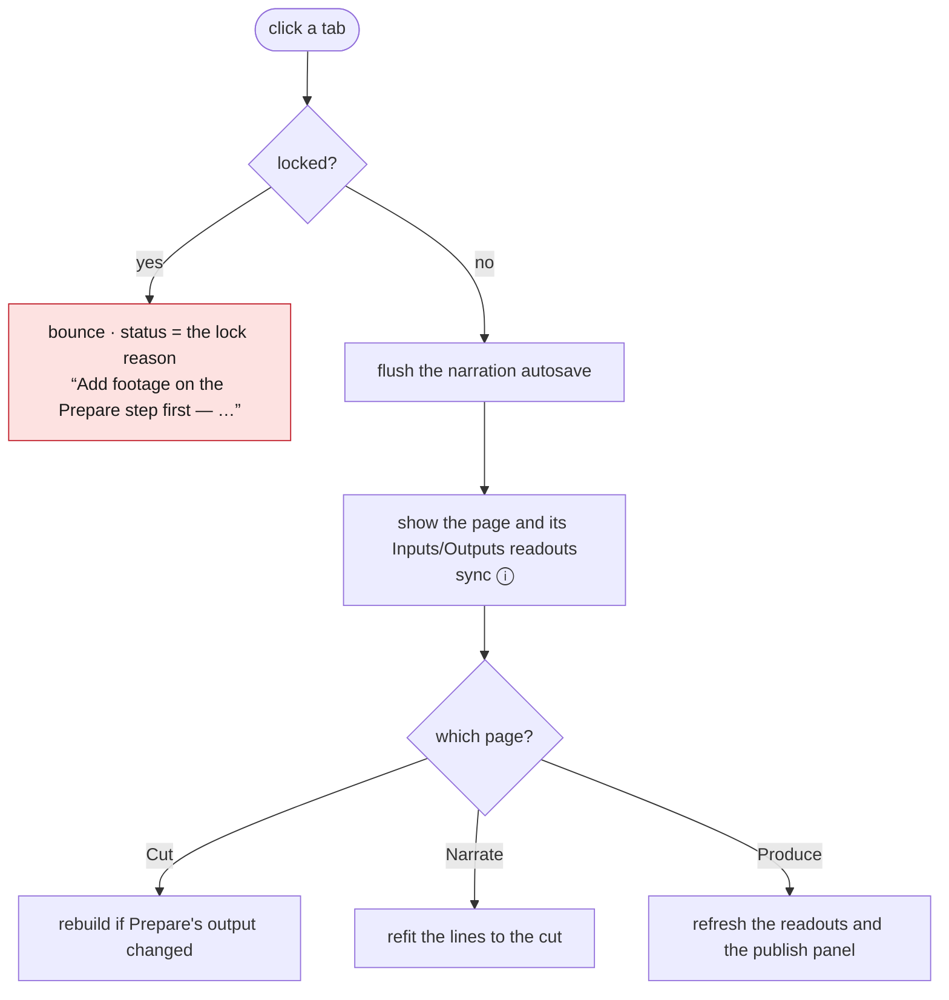

S1 Click a tab. S2 Locked → bounce, status = lock reason; stop. The lock is asked of the session as it stands at the click (sources added or removed since the window was built count), never of the project the window was built with. S3 Flush the narration autosave. S4 Show the page and its Inputs/Outputs readouts; sync ⓘ. S5 Refresh: Cut rebuilds if Prepare's output changed since its build; Narrate refits its lines to the cut; Produce refreshes readouts and publish panel. Where it runs (new, [§1](#1-the-window)): the page and the tabs are painted at once; the Inputs/Outputs readouts are counted on a worker (they walk the page's folders) and painted when they land, the last readout staying up meanwhile, and only the newest of several quick switches is painted (first rewrite: Prepare's outputs walked twice and every frame folder counted on the window thread at each switch).

## 2. The run bar

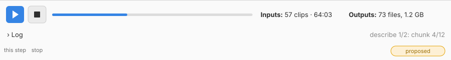

<sub>Proposed screen, drawn in the prototype's style.</sub>

New: one way to run, the visible step, and no step picker. The run bar is one row, left to right: ▶, ⏹, the progress bar (taking the row's free width), then the visible tab's Inputs readout, the "Outputs:" label, the Outputs folder button and the Outputs count ([§1](#1-the-window)).

- ▶ (suggested-action): "Run this step — or resume what is paused"; runs the visible tab's step alone ([F0.2](#f02-press-)). While a run or page transport is busy it shows ⏸ "Pause". Over a page's preview ([11 §2](11-flow-index.md#2-tab-states)) ▶ is that page's own transport press: on Cut the lit one of ▶ / ▶✂ / ▶✂✂, on Narrate the preview's ▶, so the players pause and resume with it (first rewrite: the bar flipped the transport's record only; on Cut the line stopped while picture and sound played on, on Narrate nothing happened under "paused — ▶ plays on from here"). ⏹ ends a started preview, playing or paused, and ▶ is the step's again (first rewrite: ⏹ on Cut kept the preview "started", so ▶ never reached Suggest again).
- ⏹: "Stop the run or the playback — ⏸ is what parks one to carry on later".
- Nothing about which steps run is stored in the project; `run_steps` in an older file is ignored ([01](01-project-and-files.md)).
- Prototype: ▶ runs "the ticked steps"; a chain button joined to its right side (label none / "N steps" / all) opens a popover of four ticks, saved as `run_steps` (fresh project → Prepare alone; a lone tick follows the page). One ticked step reads "1 steps".
- Progress bar: two tracks summed (0 = speech/describe, 1 = frames/fix). It draws **no text of its own**: the tracks' lines, joined by "  ·  " (e.g. "describe 1/2: chunk 4/12", "<job> done" for a finished track), go to the **status line** in the log expander's header, so a run overwrites whatever was last there. The line names the task that is RUNNING, from its first moment (first rewrite: it kept the label of the task that had just ended, "building the word list" through the minutes of the joins repair after it). A task that asks a model for minutes says where it is as it goes, and the bar moves inside its share: the text gate "pass P of 2, M:SS of M:SS, J judge(s)", the merge row "repairing join k of n" (first rewrite: a full bar and a still line for the whole pass). While a run goes, the Inputs and Outputs readouts are recounted as each stage begins, on a worker (first rewrite: counted at the press and at the end only, so "0 lines" stood through a run that had transcribed them). Tooltip per track "<job>: task i of n, k waiting" / "…, none waiting" / "<job>: N task(s), all done"; nothing queued → standing tooltip "The run: the job, which of the run's jobs it is, and the task it is on" stays. A model thinking with nothing countable pulses the bar.

### F0.2 Press ▶

<sub><!-- back -->[← F0.1](#f01-switch-tab) · [↑ 03 The shell](#03--the-shell-window-tabs-run-bar-log-settings-projects) · [all flows](11-flow-index.md#3-all-flows) · [F0.3 →](#f03-press-)</sub>

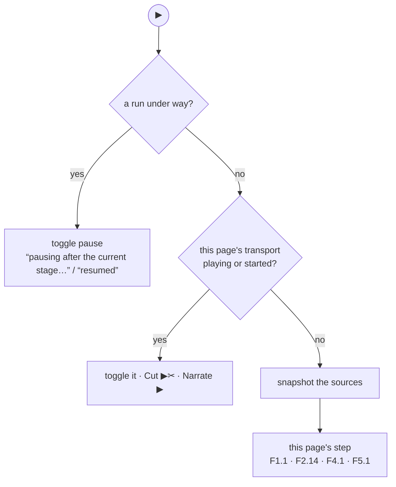

S1 Run under way → toggle pause ("pausing after the current stage…" / "resumed"); stop. S2 Visible tab's transport playing or started (Cut or Narrate: once its preview started) → toggle it; stop. S3 Snapshot the sources. S4 Run the visible tab's step alone (Prepare [F1.1](04-prepare.md#f11--prepare), Cut [F2.14](05-cut.md#f214-suggest-a-cut), Narrate [F4.1](07-narrate.md#f41--write-and-speak), Produce [F5.1](08-produce.md#f51--produce)) under the run bookkeeping ([F0.5](#f05-a-runs-bookkeeping-every-step-uses-it)); its own refusals apply. No "all done" line for one step. The press itself asks no model: every model call belongs to a stage of the run, off the window thread, so the window stays live while a step is asked.

### F0.3 Press ⏹

<sub><!-- back -->[← F0.2](#f02-press-) · [↑ 03 The shell](#03--the-shell-window-tabs-run-bar-log-settings-projects) · [all flows](11-flow-index.md#3-all-flows) · [F0.5 →](#f05-a-runs-bookkeeping-every-step-uses-it)</sub>

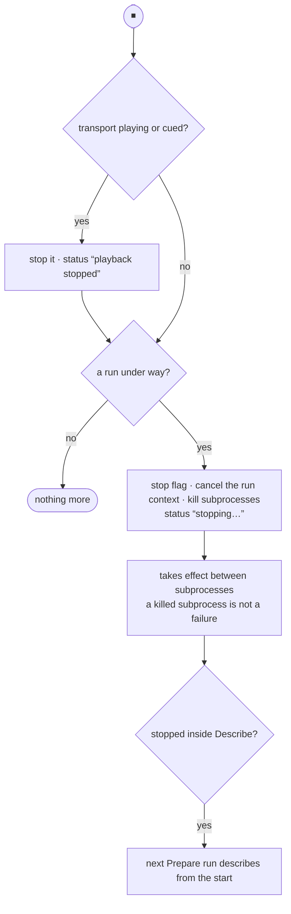

S1 Page transport playing or cued → stop it, status "playback stopped"; does not return — the run stops too, so one press ends both and status reads "stopping…". S2 No run → nothing more. S3 Set the stop flag, cancel the run context (aborts model and audio calls), kill registered subprocesses; status "stopping…". S4 Pause/stop act only between subprocesses; a stopped subprocess is not a failure. S5 A stop that reached Describe arms "describe from the start" for the next Prepare run.

### F0.5 A run's bookkeeping (every step uses it)

<sub><!-- back -->[← F0.3](#f03-press-) · [↑ 03 The shell](#03--the-shell-window-tabs-run-bar-log-settings-projects) · [all flows](11-flow-index.md#3-all-flows) · [F0.6 →](#f06-open-at-start)</sub>

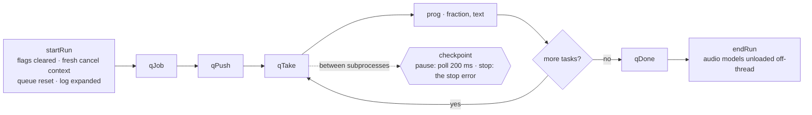

S1 startRun: running, flags cleared, fresh cancel context, queue reset (also closes the model log page), controls, log expanded. S2 Each stage: `qJob(track, name, phase, of)`, `qPush(track, n, kind)`, per task `qTake` (also for tasks skipped as their output exists), `prog(track, fraction, text)`, `qDone(track, share)`. S3 Between subprocesses: `checkpoint()` (pause polls every 200 ms; stop returns the stop error). S4 endRun: running off, controls, audio models unloaded off-thread.

## 3. Projects

### F0.6 Open at start

<sub><!-- back -->[← F0.5](#f05-a-runs-bookkeeping-every-step-uses-it) · [↑ 03 The shell](#03--the-shell-window-tabs-run-bar-log-settings-projects) · [all flows](11-flow-index.md#3-all-flows) · [F0.7 →](#f07-derive-the-editing-policy-new)</sub>

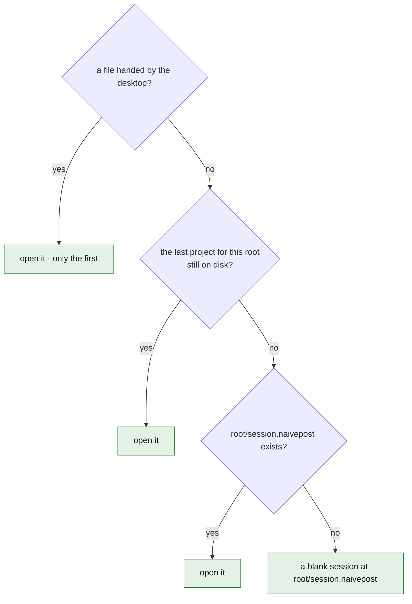

S1 A file handed by the desktop (first only); else S2 the last project remembered for this root in the settings file, if still on disk; else S3 `<root>/session.naivepost` if it exists; else S4 a blank session at `<root>/session.naivepost`. The "root" is the folder the app was launched from. **The folder this decides is THE open project folder**: every step, save, autosave, close flush and read works on it until Open, New or a renaming Save takes another on. Nothing finds the project as `<root>/session.naivepost` unless that is what is open (the first rewrite did, in 66 places, so a remembered or opened project showed its name in the header while every step read and wrote the working copy beside the launch folder).

### F0.7 Derive the editing policy (new)

<sub><!-- back -->[← F0.6](#f06-open-at-start) · [↑ 03 The shell](#03--the-shell-window-tabs-run-bar-log-settings-projects) · [all flows](11-flow-index.md#3-all-flows) · [F0.8 →](#f08-new-project)</sub>

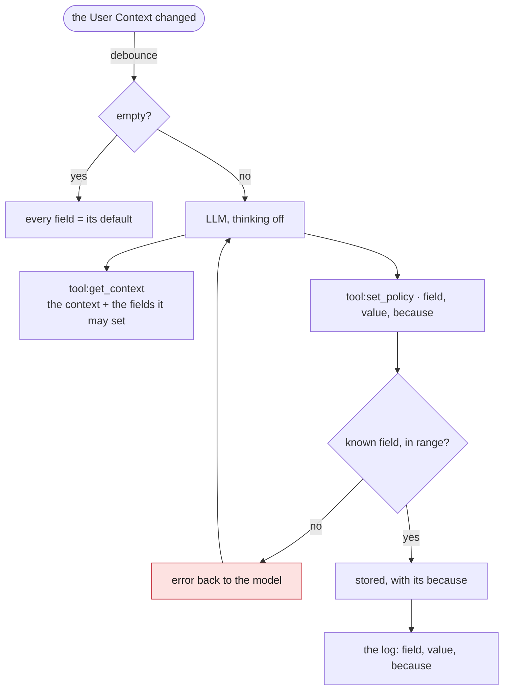

Runs after the User Context changes (debounced; on the next ▶). The debounced derivation asks the model off the window's thread: the window keeps painting and taking keystrokes while the model answers, and an answer lands only if the context is still the one it was asked about (a newer change asks again). The first rewrite asked on the window's thread, so every pause in typing (and every field of a profile) froze the window, "not responding", for as long as the model took. S1 Empty context → every policy field default (markingPass retakes, cutMode model, every pass on, language en — the prototype's blank-project behaviour); stop. S2 Ask the LLM (thinking off) with `tool:get_context` and `tool:set_policy`, system prompt "policy" (new, [`prompts/`](prompts) to add): read the context, set only fields it speaks to. S3 Each `set_policy` validated (known field, in range) and stored with its `because`. S4 Each stored value is said in the log with its field, value and `because`, so what the model decided is visible. There is no policy form: a value changes when the User Context says otherwise.

The pipeline fields decide which flows run: P.policy.markingPass picks [F1.9](04-prepare.md#f19-mark-retakes), [F1.10](04-prepare.md#f110-repair-the-joins) or no marking pass in Prepare; P.policy.cutMode picks the words-derived or the model-chosen cut in [F2.14](05-cut.md#f214-suggest-a-cut); P.policy.captionsPass, speedPass and decorationsPass decide which of [F3.9](06-effects.md#f39-captions-proposed-by-the-model-after-the-cut)–[F3.11](06-effects.md#f311-decorations-proposed-by-the-model) are called at all. A changed context re-derives them before the next run; a changed markingPass invalidates the marks (`retakes.tsv`, `final.txt`), so Prepare re-runs its marking pass.

### F0.8 New project

<sub><!-- back -->[← F0.7](#f07-derive-the-editing-policy-new) · [↑ 03 The shell](#03--the-shell-window-tabs-run-bar-log-settings-projects) · [all flows](11-flow-index.md#3-all-flows) · [F0.9 →](#f09-open-a-project)</sub>

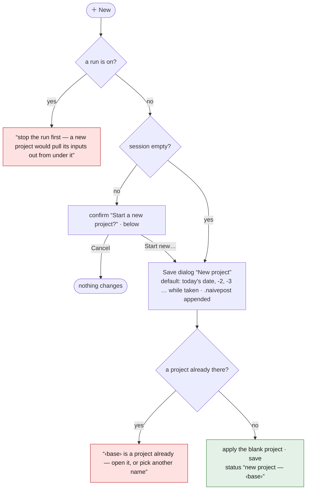

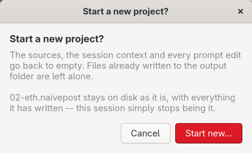

<sub>Screenshot of the prototype on the ETH lecture project.</sub>

S1 Refused during a run ("stop the run first — a new project would pull its inputs out from under it"). S2 Session empty → S4. S3 Confirm "Start a new project?", detail "The sources, the session context and every prompt edit go back to empty. Files already written to the output folder are left alone." (+ "<base> stays on disk as it is…" or "This session has never been saved under a name of its own…"); buttons at the bottom right, left to right: Cancel, "Start new…". S4 Save dialog "New project", default name today's date (-2, -3 … while taken), `.naivepost` appended. S5 Existing project at that name → "<base> is a project already — open it, or pick another name". S6 Apply the blank project via the load's apply list (as Open's S4: the window is built again on the new folder, which becomes the open project folder every step works on; "this root" is the launch folder); chooser folders follow the chosen folder when outside the root; save; status "new project — <base>"; log ">>> new project <path> -- the session is empty; outputs on disk are untouched".

### F0.9 Open a project

<sub><!-- back -->[← F0.8](#f08-new-project) · [↑ 03 The shell](#03--the-shell-window-tabs-run-bar-log-settings-projects) · [all flows](11-flow-index.md#3-all-flows) · [F0.10 →](#f010-save-as)</sub>

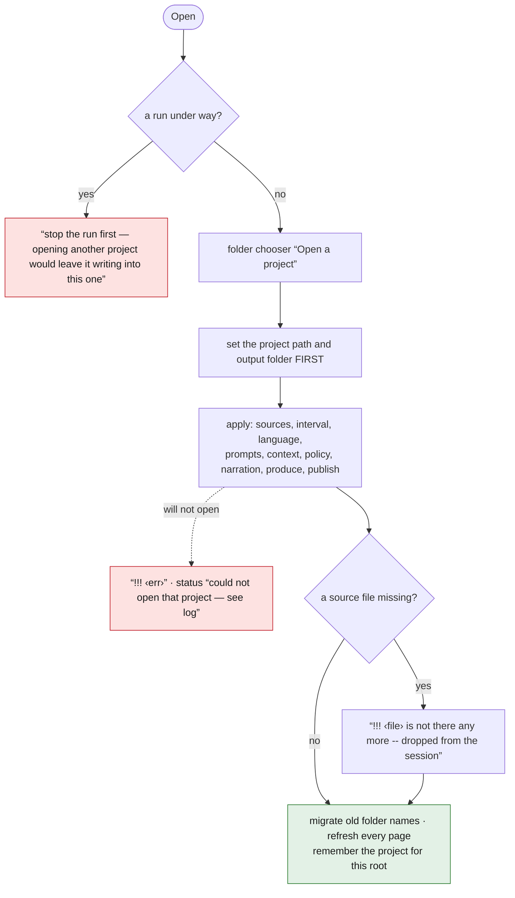

S0 Refused during a run ("stop the run first — opening another project would leave it writing into this one"), like New and Save as. S1 Folder chooser "Open a project"; a path naming `naivepost.json` opens its folder. S2 A single-file project from before project folders is not opened: "!!! <file> is an old single-file project -- not supported", status "not a project folder" (prototype: adopted it into a folder). S3 Set project path and output folder first, then apply the project (sources, missing ones logged "!!! <file> is not there any more -- dropped from the session", interval, language, prompts, context, policy, narration flag, reference flag, hints, produce, publish; the prototype's `frame_scale` and `style` are read once and dropped ([01](01-project-and-files.md))). S4 Migrate old folder names; refresh every page; remember the project for this root. "Refresh every page" is done by closing the window (its close flush writes into its OWN folder) and building it again on the opened folder, at the same size, through the same build the launch uses: every page, the tab locks, the cut, the line and the close hook then belong to the opened project, and nothing of the old one is left on screen (the first rewrite repainted some pages and left Prepare's rows and context, and the tab switch's lock question, on the old project). "This root" is the folder the app was launched from (F0.6 S2's key), not the opened folder; the pair is added to the remembered list in the settings file, and every other root's pair stays. A failed open logs "!!! <err>", status "could not open that project — see log".

### F0.10 Save as

<sub><!-- back -->[← F0.9](#f09-open-a-project) · [↑ 03 The shell](#03--the-shell-window-tabs-run-bar-log-settings-projects) · [all flows](11-flow-index.md#3-all-flows) · [F0.11 →](#f011-rescan)</sub>

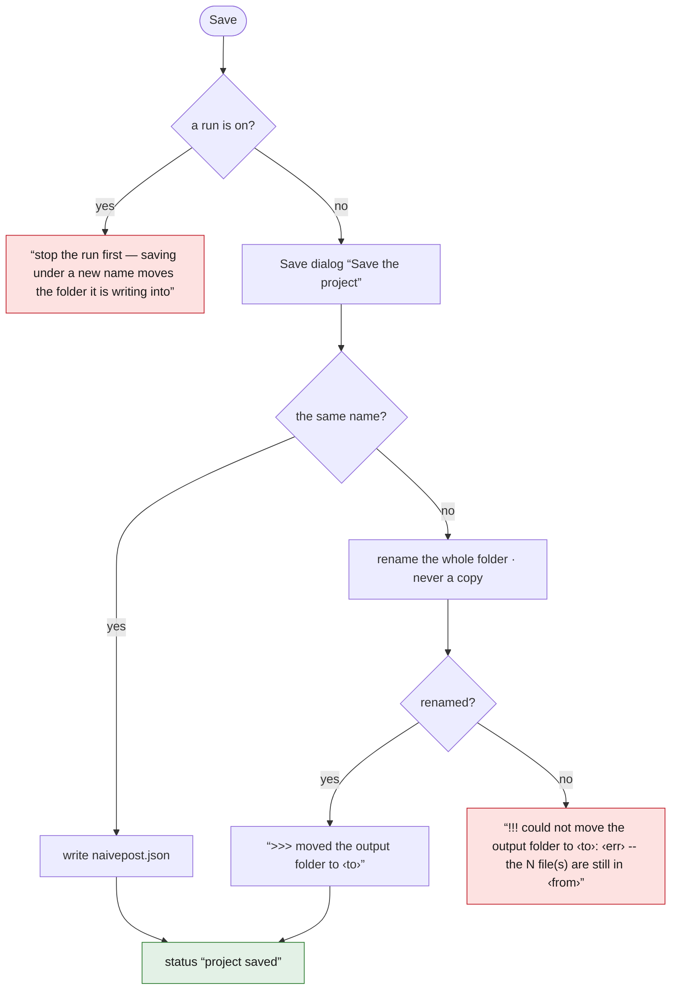

S1 Refused during a run ("stop the run first — saving under a new name moves the folder it is writing into"). S2 Save dialog "Save the project". S3 A different name renames the whole folder (never a copy; renaming onto a non-empty folder fails, files stay, log says where). A successful rename logs ">>> moved the output folder to <to>". S4 Status "project saved".

### F0.11 Rescan

<sub><!-- back -->[← F0.10](#f010-save-as) · [↑ 03 The shell](#03--the-shell-window-tabs-run-bar-log-settings-projects) · [all flows](11-flow-index.md#3-all-flows) · [F0.12 →](#f012-add-sources-from-prepare)</sub>

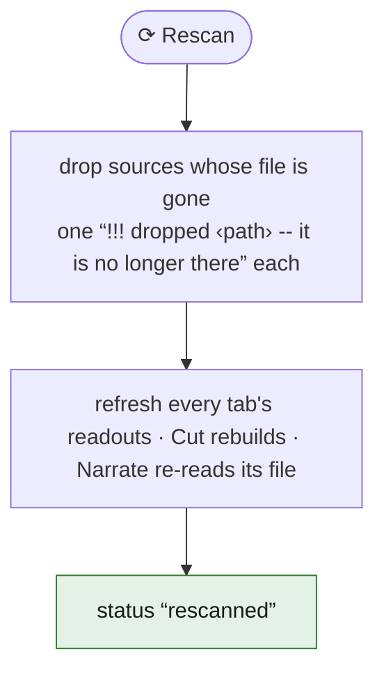

S1 Drop sources whose files are gone ("!!! dropped <path> -- it is no longer there" each); voices are shared, so a dropped row hands its voice to nobody (first rewrite: slot 1 re-assigned when its holder went). S2 Refresh every tab's readouts; Cut rebuilds; Narrate re-reads its file. S3 Status "rescanned". Where it runs (new): the readouts after the scan, and the footage lengths the Cut page's rows need, are read on workers; the rows repaint when the lengths land. A length still being measured is no failure and is not said; a file ffprobe cannot measure is said once, "<base>: no row — ffprobe gave no length" (first worker version: said for every row still being measured, on every open).

### F0.12 Add sources (from Prepare)

<sub><!-- back -->[← F0.11](#f011-rescan) · [↑ 03 The shell](#03--the-shell-window-tabs-run-bar-log-settings-projects) · [all flows](11-flow-index.md#3-all-flows) · [F0.13 →](#f013-tests)</sub>

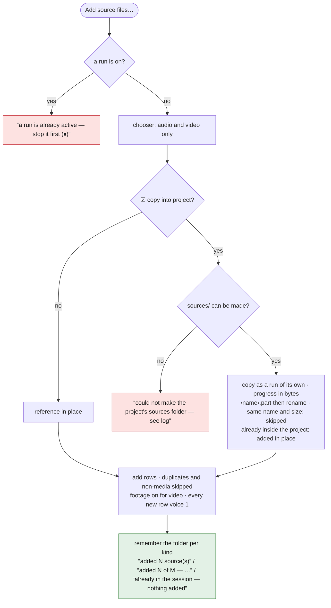

S0 A copy is a run of its own: refuses while anything else runs ("a run is already active — stop it first (⏹)"); abandons with "could not make the project's sources folder — see log" when `sources/` cannot be created. S1 File chooser "Add sources" filtered to audio and video (`.flac .wav .mp3 .m4a .aac .ogg .opus .wma .mp4 .mkv .mov .webm .avi .ts`). S2 "copy into project" on → copy each file into `sources/` as a run of its own (progress in bytes; `.part` then rename; same name + same size not copied again; files already inside the project added in place); else reference in place. S3 Add to the list (duplicates and non-media skipped; footage defaults on for video; every added row starts as voice 1, a session being usually one person (first rewrite: slot 1 to the first untagged row only, the rest on 0)). S4 Remember the folder per kind. S5 Status "added N source(s)" / "added N of M — the rest were already in" / "already in the session — nothing added". Where it runs (new): the copy runs on a worker. The press returns at once with the copy standing as the run (▶ refused, ⏹ ends it between two files, what landed stays: ">>> add sources: stopped -- the files copied so far are in"); each file's row is added and drawn as that file lands, and S5's sentence counts them when the last one has (first rewrite: every byte copied inside the chooser's callback).

## 4. Sources list (lives on Prepare, specified here because the shell snapshots it)

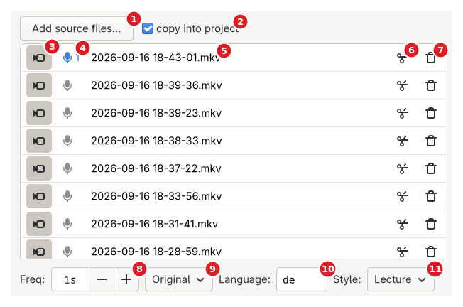

<sub>Screenshot of the prototype on the ETH lecture project.</sub> Not in this project, so not in the shot: the track menu (a file with ≥ 2 audio streams) and ⚠ (a name without a timestamp).

**1** Add source files… · **2** copy into project · **3** 🎥 footage · **4** 🎤 narrator slot · **5** file name · **6** 🗣 split the voice (✂ in the shot) · **7** 🗑 remove · **8** Freq — gone in the rewrite: the text gate decides which frames describe sees ([F1.6](04-prepare.md#f16-frames-per-video) S6) · **9** frame size — gone in the rewrite: frames are stored at the video's own size and scaled for the model · **10** Language — gone in the rewrite: the User Context says it and the policy holds it (P.policy.language, [F0.7](#f07-derive-the-editing-policy-new)) · **11** Style — gone in the rewrite: the policy sets it from the User Context

Row controls, left to right on one line (the file name takes the free width, so the controls after it sit at the row's right end): 🎥 footage toggle (video only; a camera, `camera-video-symbolic`, shaded while on; "Footage — frames come out of this file and it can be cut. Off: it is only listened to…"); 🎤 voice button cycling 1..N and back to 1, never to none: every recording is a voice, a new row starts at 1, and an older file's 0 reads as 1 (first rewrite: 0 meant no voice, which made one 1 among many 0s for a session one person spoke; "1 is the voice the narration is spoken in; 2–4 are the rest of the group"; drawn alike for every number, voice 1 included, since every recording starts there; first rewrite: voice 1 bold in the accent colour), its face always the microphone with the number (a click changes the number, never the face); voices are shared, not slots: the number says which person speaks in the recording, so every recording of one speaker carries the same number and a click moves only its own row; file name (middle-ellipsized; tooltip = path); track menu when the file holds ≥ 2 audio streams — face is an icon and "<on>/<total>", dimmed while any track is out; popover headed "Audio tracks in this file", a three-line explanation over the checks ("Track N — <title> (stereo|mono)"; last ticked track cannot be unticked; a tick stores the stream's place among the file's audio streams, 0-based ([01 §2](01-project-and-files.md#2-naivepostjson) `tracks`, ffmpeg's `0:a:N`), and a row listing none hears its first stream alone, so it opens on "1/<total>" with the first ticked (first rewrite: an empty list drew "0/2" with nothing ticked, and ticks stored ffprobe's file-wide index plus one); each ticked track becomes a lane, mixed like a separate recording); ⚠ when the name has no timestamp (tooltip explains renaming or dragging into place on Cut); 🗣 split-the-voice toggle (greyed on a split product; prototype: ✂, which on Cut means Split, so it is not reused); 🗑 remove from session ("the file itself is left alone"). The four symbol controls (🎥 🎤 ✂ 🗑) end their tooltip with the four-line legend of the row's symbols; track button and ⚠ do not.

Rules: only a video may be footage; a voice number is shared by every recording of that voice; a **narrator microphone** is an audio recording (not footage) with a voice number: the video does not play it, so its words are heard by the app and are not film (no join, no retake is marked in it, the transcript writes it as the commentary), while a video with a voice number is only "this voice speaks here" and its words are the film's (the first rewrite read every tagged row as a microphone and left a tagged camera recording's words out of the joins and retakes); voice 1's recording, for the narration's voice, is its microphone when it has one, else its first recording; two sources with one base name refuse the run ("A and B are both inputs/<base> -- rename one", status "A and B have the same name — rename one"); a missing file is dropped loudly. A load clears what a file cannot mean, each said: a voice past the last one ("‹file›: voice 9 is past the last one -- voice 1") and footage on an audio file; a dropped, removed or rescanned-away row hands its voice to nobody (first rewrite: slot 1 auto-filled on every add, removal, rescan and load, and a second row on one slot stripped); "copy into project" ("Ticked, an added file is copied into the project's sources/ folder, so the project holds everything it needs. Unticked, the file is referenced where it is: nothing is duplicated, and the session breaks if it moves."); the list's tooltip "Every file here is transcribed, and placed on the session clock by the timestamp in its name". Where a row's numbers come from (new): its stream count is probed once per file version (path, size, change time) on a worker, and a repaint draws from what landed; until it lands the row has no track button (first rewrite: one ffprobe per row on the window thread at every repaint, a 🗑 re-probing every other row).

## 5. Settings dialog

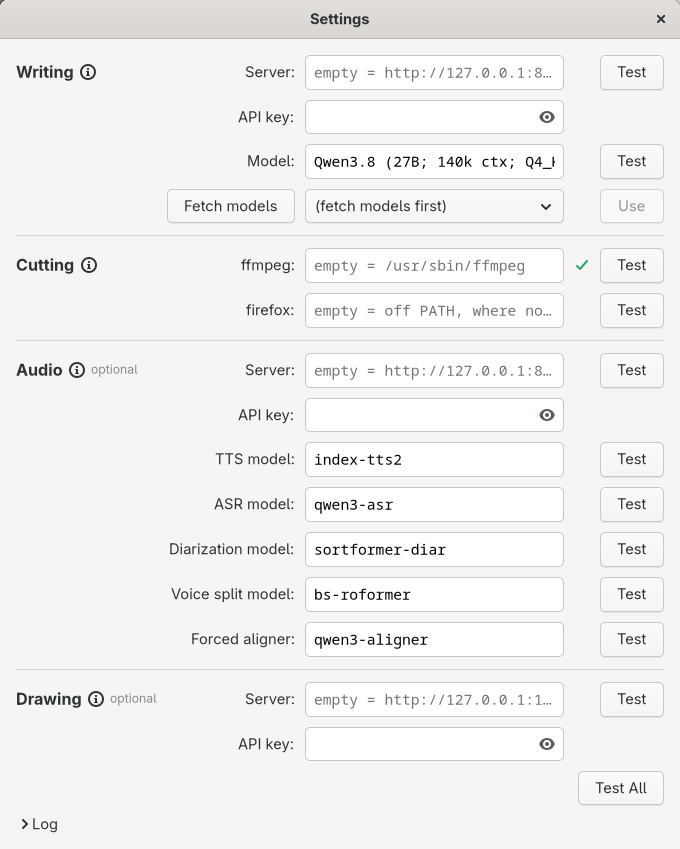

<sub>Screenshot of the prototype on the ETH lecture project.</sub> Server boxes are empty (their placeholders show the loopback defaults); the ✓ is a passed ffmpeg test.

One window "Settings", with a title bar carrying its title and close button; Esc closes it as the close button does (the owed write lands on that close). Top to bottom: the sections Writing, Cutting, Audio (optional), Drawing (optional), divided by separator lines; then Test All at the bottom right; then the log (collapsed) last, ten lines tall however many it holds, scrolling and keeping its newest line in view as the main log does (first rewrite: it grew a line per verdict and pushed the sections up). The sections share one grid of five columns, left to right: section name with its ⓘ (on the section's first line only), field label (right-aligned), the box, the ✓/✗ badge, Test (the Writing section's last line: Fetch models in the label column, the model dropdown in the box column, Use in the Test column). No Save/Cancel: every box written 600 ms after the last keystroke and on close ("settings saved to <path>"). Each Test reads what is typed, shows a spinner then ✓/✗ with the verdict as tooltip, mirrors its lines into the main log as "settings: …". A Test runs off the window's thread (a probe can take minutes: 60 s for the LLM, 120 s for vision, a headless browser for firefox), so the window, the other boxes and the other Tests stay live while its spinner turns; a probe that crashes answers ✗ "the test stopped unexpectedly". Test All runs every test: all twelve rows with a Test button (LLM, vision, Decision, ffmpeg, firefox, audio.cpp, the TTS, ASR, diarization and separation models, the aligner, sd.cpp), started together, each with its own spinner and verdict, the log lines in the order they finish. Fetch models runs off the window's thread the same way. Each section's ⓘ explains at length what the server is expected to speak; a click on it opens that explanation in a popover beside it, and hovering shows the same text. The window opens 960 px wide, so a server address, a model id and the placeholders read whole in their boxes. Each server has an API key box on the line under its Server box (Writing, Audio, Drawing), masked like a password, sent as `Authorization: Bearer …` to that server only. A Test reads every box as typed, not only its own: a model row's box holds a model id, never an address, and its Test asks the server in its section's Server box, with that section's key, for that model. Every box (Server and API key included) is filled from the settings file when the dialog opens and written back with the others.

**Server entries (new).** Writing, Audio (optional) and Drawing (optional) each keep named entries, so a second machine (another audio.cpp while the usual one is busy) is one pick away. Under the section's heading, in the section column: a dropdown of the entries, ＋ New and 🗑 (`user-trash-symbolic`). Cutting has none. An entry holds its section's settings: Writing the LLM server, API key, Model and Decision (Vision types nothing, so it holds nothing); Audio the audio.cpp server, API key, voices folder, the TTS, ASR, diarization and separation models and the aligner; Drawing the sd.cpp server and API key.
- Picking an entry fills its section's boxes and makes its values the ones in use: they go into `llm.conf` on the same 600 ms beat (the voices folder too, which has no box), the file every flow reads. The other sections are untouched.
- Typing into a box changes the entry in use as well, on the same beat and on close. Each Test still reads what is typed.
- ＋ New opens a popover with a name box and Create. An empty name is refused with "give the entry a name", a name the section has with "there is already an entry called <name>", both in the popover. Create makes the entry from what the section's boxes say now and selects it.
- 🗑 asks "Delete the <section> entry <name>?" with Cancel as the default (Esc is Cancel). Delete removes it and selects the next entry (else the one before), filling the boxes from it. 🗑 is greyed while the section has one entry: a section always has one.
- A pick changes no request already sent: flows read the settings per request. While a run is open the dialog says once "the new server is used from the next request; ⏹ and ▶ to restart the run now".

No request count to set: each server is given one of the app's requests at a time, and different servers run side by side ([09 §4](09-llm-and-tools.md#4-liveness-and-the-gate-f63)). Prototype: the LLM held to one request at a time in code, audio and image requests not held at all.

### F0.13 Tests

<sub><!-- back -->[← F0.12](#f012-add-sources-from-prepare) · [↑ 03 The shell](#03--the-shell-window-tabs-run-bar-log-settings-projects) · [all flows](11-flow-index.md#3-all-flows) · [F1.1 →](04-prepare.md#f11--prepare)</sub>

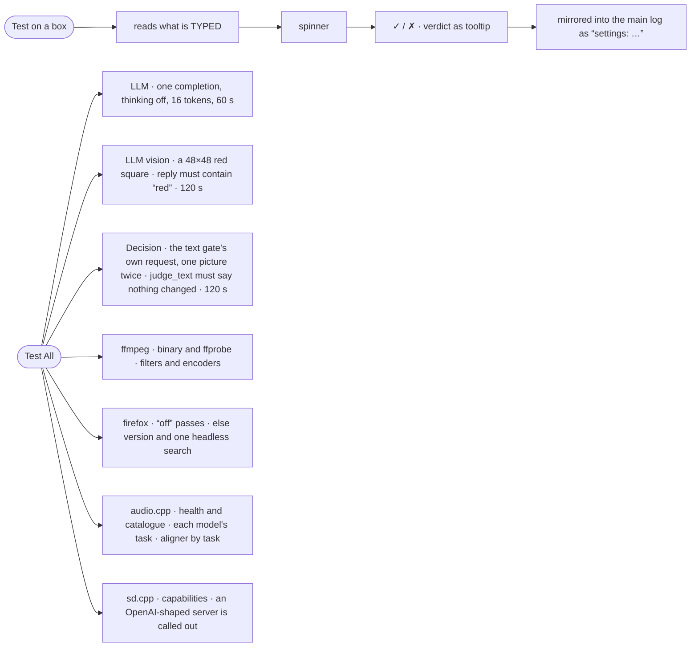

- LLM: one completion "Reply with the single word: ok" (thinking off, max 16 tokens, 60 s) → "<model> answered in X s: “ok”". A server that answers a chat row (LLM, vision, Decision) with a non-2xx fails the row as "<model> answered <status>: <the server's words>" (first rewrite: the error body was read as a reply with nothing in it, so a 500 showed as a model that answered without its tool).
- LLM vision: a generated 48×48 red square with "In one word: what colour is this square?" (120 s); the reply must contain "red", else "…it is not seeing the image. Prepare sends video frames to this model: it needs a vision model, served with its mmproj/vision file".
- Decision (new): the text gate's own request ([F1.6](04-prepare.md#f16-frames-per-video) S6: the `textgate` prompt, thinking off, the `judge_text` tool), with the vision test's red square as both FIRST and SECOND (120 s), sent to the Decision box's model, else the Model box's. Two identical pictures have no text that changed, so the answer must be `judge_text` with `changed` false → "<model> judged two identical frames the same through judge_text in N ms"; `changed` true → "<model> says two identical frames differ -- as the text gate it would split every scene"; no tool call → "<model> answered without judge_text: <its words>"; a server error is said as the server said it. The Vision row's box takes nothing (placeholder "nothing to type: Test shows the Model a red square"; first rewrite: "the model above, shown a red square", read as a question about a red square somewhere in the app).
- Fetch models: GET /v1/models → dropdown; Use copies the id into the model box entered last, Model or Decision (Model until Decision is entered).
- ffmpeg: resolves the binary the steps will run (an empty box is `ffmpeg` on PATH, exactly what every step runs; a box is tested as typed, else as a name on PATH; "not on PATH" only when that lookup finds nothing) and ffprobe beside it, reads the version, scans filters (rubberband, subtitles, loudnorm, atempo, amix, adelay, alimiter) and encoders (libx264, libx265, aac, libopus).
- firefox: "off" is a success ("the model is offered no web search…"); otherwise the browser the search itself launches ([09 §2](09-llm-and-tools.md#2-tool-protocol-f61)'s lookup: the box, else firefox/firefox-esr/firefox-bin on PATH, else the usual install paths; an empty box is that lookup), "will not run: <reason>" when none is found, then its version and one real headless search.
- Audio: health + catalogue → "healthy in N ms, will narrate with <id>"; per model box: id served and declared for its task (clon/asr/diar/sep), with install hints; aligner: what aligns (none is a success: cut points come off the waveform; several: preferred one named).
- sd.cpp: capabilities → "<weights> is loaded and can draw". The reply names the weights as an object, `"model": {"name": "<file>.gguf", "path": "…", "stem": "<file>"}`; the stem is what the line names (else the file name). `supported_modes` must list `img_gen` ("<weights> is loaded, but this server cannot draw images -- it supports <modes>, not img_gen"); a build that reports no modes is an older one and passes. A reply that is not capabilities JSON is "it answered something that is not sd.cpp capabilities: <reason>", never "names no weights". An OpenAI-shaped server is called out as not sd-server.

## 5b. Profiles (new)

A **profile** is a User Context template kept on this machine: the words a project's context is made of, with **fields** a person fills in per project (the episode's title, the course, the language) instead of retyping or hand-editing the whole context every time. The template says which fields there are and which control each one gets; Prepare shows only those controls, never the template; the User Context sent with every request is the template with the fields filled in.

**Where**: one plain-text file per profile, `~/.config/naivepost/profiles/<name>.txt` (UTF-8, 0644; the name is the profile's, with `/` and control characters made `-`). Per machine, like the prompts: a project names the profile it uses and keeps its own values (§01 §3 `profile`), so a project opened where the profile is missing keeps its User Context as it was.

**The template.** An optional field block between two lines that are exactly `---`, then the text. Without the block the whole file is text with no fields.

```text
---
title:    text     required "Title"
episode:  number   required "Episode"
course:   choice+  "Course" = Distributed Systems & Blockchain | Software Engineering
language: choice   "Spoken in" = English | German
notes:    textarea "Notes for the editor"
---
This is "{{title}}", episode {{episode}} of {{course}}. The talk is in {{language}}.
{{notes}}
```

One field per line: `name: kind [required] ["Label"] [= value | value …]`; `#` starts a comment line; blank lines are skipped. `name` is lower case letters, digits and `_`, starting with a letter. The **kind** is the control Prepare shows:

| kind | control | `= …` means |
|---|---|---|
| `text` | one-line entry | its default |
| `number` | one-line entry taking a number (digits, one `.` or `,`, a leading `-`) | its default |
| `textarea` | a box of several lines | its default |
| `choice` | a dropdown of exactly the listed values | the values, the first the default |
| `choice+` | an entry with a ▾ beside it listing the values; any other value may be typed | the values, the first the default |

`required` marks a field Prepare's ▶ will not start without (F0.14 S6); a required `choice`/`choice+` has no default (its dropdown opens on "— choose —"). The label is what Prepare writes beside the control; without one the name is shown. In the text, `{{name}}` is replaced by the field's value (an empty value leaves nothing, and a line left holding nothing but whitespace is dropped); `{{` without a matching field is an error the dialog names. Errors are said with their line ("line 4: `epsiode` in the text is not a field above", "line 2: kind `dropdown` — one of text, number, textarea, choice, choice+") and a profile with errors cannot be saved.

**Per-step sections.** After the User Context, a line `## <step>` (a prompt key: `system` for every request, `policy`, `describe`, `textgate`, `fix`, `retake`, `textedit`, `cut`, `captions`, `speed`, `effects`, `narrate`, `translate`, `youtube`) starts that step's section, and for a project using the profile the section IS that step's prompt, in place of the shipped wording; a step without a section sends the shipped wording. `{{name}}` works there too. A `##` line naming no step is ordinary text and stays in the User Context; a step's section twice is an error. Only that step's request carries its section, so editing one re-asks only that step. A profile is the one place the prompts are configured: the bench's prompt rows are gone, and machine-level prompt files are no longer read. **New** in the Profiles window is one big template holding everything a profile can say: a field, a User Context to fill in, every step's section holding the shipped prompt it replaces (so editing starts from the words the app would send) and the `## produce` rows at their defaults; ⓘ lists the sections and what each step is for. A section copied from the shipped wording is the profile's own from then on: a later build's improved prompt reaches a step only where the profile has no section for it, or once the section is replaced again from New. (A first version added a section after the shipped wording; with every prompt in one profile that sent each twice.)

**Encoder rows.** The Profiles window sets them with the Produce page's own controls, in a form under the template box (the same rows, options, slider and ticks, laid out as on the Produce page); the box never shows them as text. In the file they are a `## produce` section, written whole on Save, holding the Produce page's encoder rows instead of prompt words, one `Row: value` per line, spelled as the page spells them (`Container: mp4`, `Preset: veryslow`, `Subtitles: none in the video`, `Quality (CRF): 24`; the three ticks `Frame timing`, `Channels`, `Frame edges` take `on`/`off`; `Translate` takes `none` or languages separated by commas; `Game audio` a number from 0 to 1); a `#` after a value is a comment. Each value is checked against the page's own list ("line 3: `turbo` is not a Preset -- ultrafast, veryfast, fast, medium, slow, veryslow"). Rows left out keep the project's own value (F0.14 S9).

### F0.14 Profiles

S1 **The Profiles button** in the header, between Settings and ⓘ, wearing the desktop's template icon (`folder-templates-symbolic`, a page with a dashed edge: a profile is a template for a kind of video; tooltip "Profiles — templates for a kind of video: the User Context with fields, every step's prompt and the Produce settings"), opens the **Profiles** window in edit mode, on the profile the open project uses (New when it uses none this machine has): one row, left to right: the profile dropdown (first **New**, always there, a starter template; then every file in `profiles/`, sorted), **Load…**, **Save**, **Save as…**, 🗑 (trash icon), **ⓘ** (a popover with the template syntax: the field block, one line per field, the five kinds and `{{name}}`); under it the template in a monospace box filling the window (without its `## produce` section); under that one line saying what the template declares ("3 field(s): Title (text, required), Episode (number, required), Course (choice+)") or its first error in red; under that "Narrate settings for projects using this profile" (the Narrate page's Game audio slider) and "Produce settings for projects using this profile", the Produce page's encoder rows as controls, seeded from the profile's `## produce` section (New: the defaults), each label with its control one item, as many to a line as the window is wide and stacking as it narrows, every item as wide as the widest so they line up in columns. The template box keeps at least 240 px of height; a window shorter than the template and the form scrolls (on a small window the form once squeezed the template out of sight). S2 **New** cannot be saved over or deleted (Save and 🗑 are greyed on it): it is kept only with Save as…. **Save** writes the profile in the box ("profile ‹name› saved to ‹path›"; refused with the error while the template has one). **Save as…** opens a file chooser in the profiles folder: a `.txt` saved there is a profile named by the file (refused with the template's error; the chooser asks before replacing one), saved anywhere else it is a copy of the box to share ("written to ‹path›"). **Load…** opens a chooser in the same folder: a profile file there selects that profile; any other file comes into the box as New ("loaded from ‹path› — Save as… keeps it as a profile"). 🗑 asks "Delete the profile ‹name›? Projects using it keep their User Context as it is." and goes back to New. (A first draft had New, Save as… asking a bare name, Load file… and Save file… as separate buttons: two ways to save and a New that was a button rather than a starting point.) S3 **On Prepare**, the bench's User Context row (§04 §1 row 0) carries a heading line: "Profile" with a dropdown "(none)" plus every profile, and a **View** button. "(none)" is today's free-text User Context. A profile replaces the box with its **form**: the fields in the template's order, each label with `*` when required; a one-line field (text, number, choice) has its label beside it, a text area has its label on a line of its own and the column's full width under it, a third of the window tall (following the window as it is resized) and scrolling inside itself; the template itself is not shown. S4 Every change to a field (each keystroke) stores the value in the project's `profile.values` and rebuilds the project's `context` from the template, so everything that reads the User Context reads the filled-in text; F0.7's debounced policy derivation follows as it does for a typed context. Choosing a profile keeps the values of fields that exist in both. Switching back to "(none)" keeps the last filled-in text as the free-text context. S5 **View** opens the Profiles window in **view mode**: titled "‹name› — the User Context as sent", the filled-in text read-only, and an **Edit template** button that switches the window to edit mode on that profile. S6 Prepare's ▶ with a required field empty refuses: "fill in ‹Label› first — the profile ‹name› needs it" (the first such field, in the form's order), and the field's control is marked. S7 A project whose profile is not on this machine shows its name in the dropdown as "‹name› (not on this machine)", the stored User Context read-only beneath, and ▶ runs with it as it is. A template edited on this machine reaches a project the next time one of its fields changes or the profile is chosen again; until then the project keeps the context it was given. S9 Choosing a profile whose template has a `## produce` section sets those rows on the project's encoder settings, through the Produce page's own rules (webm still forces vp9 and no subtitle track): kept in `naivepost.json` at once, shown by the Produce page, logged (">>> profile ‹name›: encoder settings Preset veryslow, Channels on"). On the Produce page those rows are then greyed, with the tooltip "Set by the profile ‹name› — change them in Profiles": a profile's settings are changed in one place. A project with no profile, or whose profile has no `## produce` section, sets them on the Produce page as before.

## 6. The settings file

`~/.config/naivepost/llm.conf`, `KEY="value"` lines, written whole: `LLM_SERVER, LLM_MODEL, LLM_API_KEY, AUDIOCPP_SERVER, AUDIOCPP_API_KEY, AUDIOCPP_VOICES, AUDIOCPP_ASR_MODEL, AUDIOCPP_DIAR_MODEL, AUDIOCPP_TTS_MODEL, AUDIOCPP_SEP_MODEL, AUDIOCPP_ALIGN_MODEL, FFMPEG, FIREFOX, SD_SERVER, SD_API_KEY, PROJECT_<n>_ROOT/FILE`; read and dropped, from an earlier build: `LLM_SLOTS`, `AUDIOCPP_ASR_SLOTS`, `AUDIOCPP_DIAR_SLOTS`, `AUDIOCPP_ALIGN_SLOTS`, `AUDIOCPP_TTS_SLOTS`, `AUDIOCPP_SEP_SLOTS`, `SD_SLOTS`. Precedence: dialog box → this file → (legacy `<root>/llm.conf`, migrated once) → built-in default. The audio URL also honours `NAIVEPOST_TTS_URL` and `AUDIOCPP_SERVER` below the dialog; sd `SD_SERVER`. New: `SUBTITLE_LANGUAGES` (code:tag:name list, [`00-principles.md` §6](00-principles.md#6-generalisations)); `DECISION_MODEL`, the decision model on the LLM server (Settings → Decision; empty = the main model judges, the gate always runs, [F1.6 S6](04-prepare.md#f16-frames-per-video)).

**`servers.json` (new).** §5's server entries live beside it in `~/.config/naivepost/servers.json`: one object per section (`writing`, `audio`, `drawing`), each holding `active` (the entry in use) and `entries` (name → its settings, keyed by the `llm.conf` names above):

```json
{
  "writing": { "active": "ai.jos.li", "entries": { "ai.jos.li": { "LLM_SERVER": "https://ai.jos.li", "LLM_API_KEY": "…", "LLM_MODEL": "…", "DECISION_MODEL": "" } } },
  "audio":   { "active": "gpu2", "entries": { "audio1": { "AUDIOCPP_SERVER": "…", "…": "…" }, "gpu2": { "…": "…" } } },
  "drawing": { "active": "default", "entries": { "default": { "SD_SERVER": "", "SD_API_KEY": "" } } }
}
```

It holds the keys, so it is written like `llm.conf`: whole, to `servers.json.part` at 0600 and renamed over the file, never readable by another user even for a moment; no log line ever shows a key. `llm.conf` stays the one file every flow reads; the entry in use mirrors it (an `llm.conf` edited by hand since the last open is taken into the entry in use when the dialog opens). With no `servers.json`, the dialog makes one entry per section from `llm.conf`, named after the server's host without its port (`http://alpha.lan:8080/v1` → `alpha.lan`), or `default` when the server box is empty, and writes the file. A `servers.json` that does not parse is said in the dialog's log and the main log ("… could not be read (<why>) -- kept as …/servers.json.bad; the entries come from llm.conf"), put aside as `servers.json.bad`, never overwritten, and the dialog carries on from `llm.conf` as on a first open.

## 7. The model exchange log (llm/)

One HTML page per run named `MMDD-HHMMSS-<first step>.html`; each call a numbered section (meta line: model, thinking/execute mode, duration; each message with inline images; the reply, reasoning folded in a details block; tool calls and results; notes when cut off or empty). The app log gets two lines per call (">>> <step>: 451.4 kB of text and 0 image(s) went to the LLM"; ">>> <step>: 28.6 kB came back in 2m39s — cut off at the model's token limit" + ">>>   the reply begins: …") and, once per run, the clickable link ">>>   this run's exchanges, images included: llm/<name>". Recording never fails the call.

## 8. Details confirmed against the code (verification pass)

- **Subprocess logging**: every subprocess is logged before it runs, as a shell would take it (quoted arguments), at the four-space indent; a failure repeats the command and the last 400 characters of its output in the error.
- **[F0.9](#f09-open-a-project) open**: a path naming `naivepost.json` opens its folder. Prototype only, dropped in the rewrite: adopting a single-file project (`<root>/project.json` at start, or a file handed over) into a folder, staged via `<name>.data` and `.adopting`. A project with a legacy `out_dir` other than the project folder loads with "!!! this project used to write into A and now writes into B -- the old folder is untouched". Folder migration: two passes (step1..step6 → named folders; inputs/ and understand/{describe,transcript} → prepare/…), one log line per move, failures logged and left in place, emptied `understand/` removed.
- **[F0.10](#f010-save-as)**: a failed rename logs "!!! could not move the output folder to <to>: <err> -- the N file(s) are still in <from>"; nothing logged when nothing to move.
- **Settings file**: rewritten whole with its explanatory comments; a cleared box is written back as the shipped default for exactly five fields — voices folder and the ASR, diarization, TTS and separation model ids; everything else (three server URLs, aligner id, LLM model, all three keys, ffmpeg, firefox) written as typed, empty included. Legacy `~/.config/naivepost/settings.json` (`{"projects": {root: file}}`) is read, never written, only when `llm.conf` has no `PROJECT_*` lines. Legacy keys `AUDIOCPP_MODELS` (its `voices/` subfolder is the voices folder when `AUDIOCPP_VOICES` is absent), `PROMPT_*`, `SD_MODEL`, `AUDIOCPP_LANGUAGE` are read and ignored.
- **Settings dialog log**: collapsed until a test fails, which opens it.
- **Icons**: icons/ tree searched beside the binary, under the app root and in the working directory; when the desktop entry or MIME package is (re)written, the path is logged once and `update-mime-database` / `update-desktop-database` run in the background.
- **Exchange page**: written when the request goes out, appended as the reply streams, then rewritten whole; verdicts "…came back in T[, after X of thinking]", "— cut off at the model's token limit", "— the model answered nothing at all", "the call failed after T: …"; run link logged once, on the first call.
- **Audio server messages**: a missing model is reported with the catalogue the server does serve and, only when the id is the shipped default, the exact `docker compose exec audio python3 tools/model_manager_v2.py install <pkg> --models-root models` command; a model served under another task is refused by name ("\"X\" on <url> is declared task \"Y\", but Prepare needs \"Z\" there"). A server refusing uploads (403) gets the fix (start with `--ui-management`, or mount the folder into the container); an upload answering 200 without a `path` is a failure.
- **Duration probing**: a file whose header has no duration (recorder killed mid-write) is measured by decoding once; cached per path+size+mtime like every probe.

<!-- nav -->
---
[← 02 Services and the tool catalogue](02-services.md) · [↑ top](#03--the-shell-window-tabs-run-bar-log-settings-projects) · [↑ Contents](README.md) · [04 Prepare →](04-prepare.md)
<!-- /nav -->
