# 04 — Prepare

<!-- nav -->
[← 03 The shell](03-shell.md) · [↑ Contents](README.md) · [05 Cut →](05-cut.md)

**Flows:** [F1.1](#f11--prepare) · [F1.2](#f12-voice-separation-rows-with-) · [F1.3](#f13-per-source-audio--text--word-times--speakers--segments) · [F1.4](#f14-asr-in-chunks) · [F1.5](#f15-forced-alignment) · [F1.6](#f16-frames-per-video) · [F1.7](#f17-describe-per-footage-source-chunks-of-pmachinedescribeframesperreq--4) · [F1.8](#f18-fix-the-transcripts-blocks-of-pmachinefixblocklines--25-lines) · [F1.9](#f19-mark-retakes) · [F1.10](#f110-repair-the-joins) · [F1.11](#f111-place-the-edges-of-a-mark) · [F1.12](#f112-hand-edit-the-text) · [F1.13](#f113-the-sessions-word-list-shared-by-retakes-joins-finaltxt-and-subtitles)
<!-- /nav -->

Sources, transcripts, frames, and what the models make of them. One ▶ runs the whole step; each stage skips when its output exists.

## 1. Screen

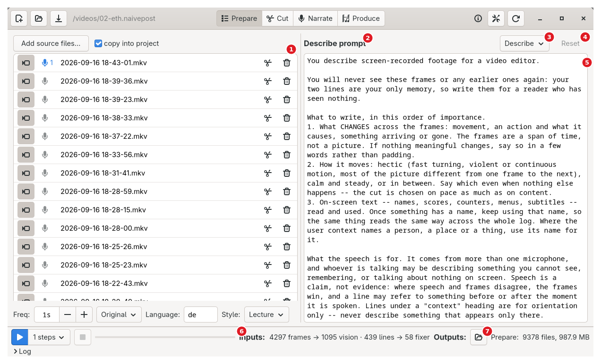

<sub>Screenshot of the prototype on the ETH lecture project.</sub>

**1** sources list and frame controls ([`03-shell.md` §4](03-shell.md#4-sources-list-lives-on-prepare-specified-here-because-the-shell-snapshots-it)) · **2** row title, "‹Name› prompt" · **3** row picker · **4** Reset (live only while this machine holds an edit) · **5** the prompt or the User Context · **6** Inputs readout · **7** Outputs: folder button and count

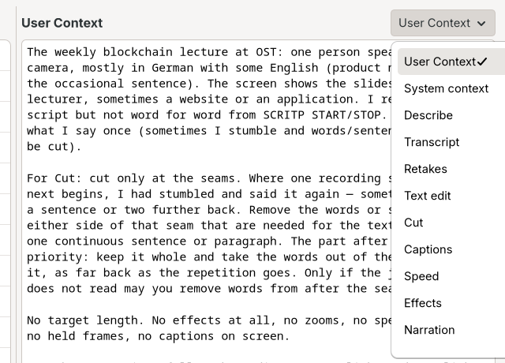

<sub>Screenshot of the prototype on the ETH lecture project.</sub> The list scrolls: Translate and Upload text sit below Narration.

The page is split left and right by a draggable divider opened at half: two columns side by side, not one above the other. At the minimum window size the whole page is on screen at once with nothing scrolled out of view: the "Add source files…" row and the sources list at the top of the left column, the bench's heading row at the top of the right column. Left column, top to bottom: one row with "Add source files…" and the "copy into project" tick, the sources list ([`03-shell.md` §4](03-shell.md#4-sources-list-lives-on-prepare-specified-here-because-the-shell-snapshots-it); it scrolls, the rows above and below it stay), and nothing under it. New: **no Freq control**. Frames are extracted on a fixed P.eng.frameGridSeconds (250 ms) grid restarted at every scene change ([F1.6](#f16-frames-per-video)), so the Cut timeline has a picture down to its deepest zoom; which of them the model sees is the text gate's changes plus a 20 s heartbeat ([F1.6](#f16-frames-per-video) S6, [F1.7](#f17-describe-per-footage-source-chunks-of-pmachinedescribeframesperreq--4) S0), so there is no cadence left to choose (first rewrite: Freq, 0.25 to 5 s, default 1 s, one frame to the model every Freq seconds per scene; a slide up for three minutes went to the model about 180 times). Prototype: under the list, Freq is the extraction interval ("Seconds between frames — type 0.1 to 5, or 'each' for every frame"; stops each, 0.1, 0.2, 0.5, 1s … 5s), so zoomed in the picture band shows black between frames, Frame size (Original, 896w (LLM), 480p, 720p, 1080p; "Frame size — Original keeps the video's own size"; **gone in the rewrite** — frames are stored at the video's own size and scaled to P.machine.describeFrameWidth only on their way to the model, [F1.7](#f17-describe-per-footage-source-chunks-of-pmachinedescribeframesperreq--4) S1), New: **no Language control**. The language the recordings are spoken in (what ASR and alignment are told, and what the voice speaks) is said in the User Context and set by the policy ([F0.7](03-shell.md#f07-derive-the-editing-policy-new)): P.policy.language, English when the context does not say. Prototype: a Language box (ASR code; "…the wrong one transcribes into gibberish. Empty means en"). New: **no Style control**. What the prototype's Style dropdown chose (Lecture: joins repaired, cut by the words; Gaming: retakes marked, cut chosen by the model) is set from the User Context by the policy ([F0.7](03-shell.md#f07-derive-the-editing-policy-new)): P.policy.markingPass and P.policy.cutMode. Prototype: a Style dropdown (Lecture / Gaming; a blank project stores "" = Gaming while the dropdown opens on "Lecture").

Right column: the User Context, top to bottom: one heading row (the title "User Context", then the profile row), then one text box filling the rest of the column (it scrolls). New: the bench's prompt rows (the row picker, the twelve prompts, ✎ and Reset) are gone: the prompts are configured per step in a profile's sections ([03 §5b](03-shell.md#5b-profiles-new)), each in place of the shipped wording. The **User Context** (per project, sent with every request, outranks the prompts; empty sends nothing). New: its heading line carries "Profile" with a dropdown ("(none)" and every profile on this machine) and **View**; with a profile chosen the box is replaced by the profile's form, the template's fields and nothing else, and the context is the template filled in ([F0.14](03-shell.md#f014-profiles)). Prototype and first rewrite: rows 1–12 = the twelve prompts in pipeline order, per machine; ✎ = edited on this machine; Reset restores the shipped wording. Every keystroke is stored. REVIEW: add a row "Editing policy" opening the form of [F0.7](03-shell.md#f07-derive-the-editing-policy-new).

Inputs readout (in the bottom bar's run-bar row, [`03-shell.md` §1](03-shell.md#1-the-window), not on the page): "N frames → M vision · L lines → K fixer", per-file tooltip. Outputs: one folder button for `prepare/`, label "Prepare:" + count; its tooltip names the three subfolders.

## 2. Flows

### F1.1 ▶ Prepare

<sub><!-- back -->[← F0.13](03-shell.md#f013-tests) · [↑ 04 Prepare](#04--prepare) · [all flows](11-flow-index.md#3-all-flows) · [F1.2 →](#f12-voice-separation-rows-with-)</sub>

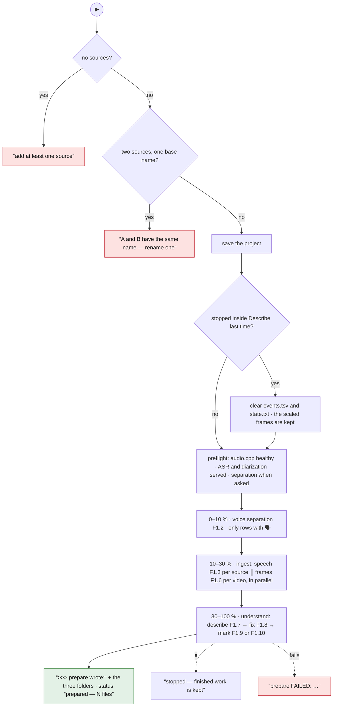

S1 Ignore when running. No sources → "add at least one source". Two sources with one base name → refuse (log "!!! A and B are both inputs/<base> -- rename one", status "A and B have the same name — rename one"). S2 Save the project. S3 Last run stopped inside Describe (a ⏹ that cut through it, F0.3) → remove every `events.tsv`/`state.txt`; any other run keeps them, since an `events.tsv` is Describe's finished output, and resumes off them (F1.7 S2) (first rewrite: also started over whenever an `events.tsv` was on disk, taking it for an unfinished run's working file, so every ▶ deleted every event log and paid for the description again wherever its cache could not answer) (">>> stopped last time — describing from the start again: … (scaled frames kept)"); a failed clear is logged (">>> could not clear the last run (…) -- resuming it") and the run resumes from disk. S4 startRun; log ">>> prepare: N input files", each file, the inputs summary, ">>> prepare: sending the session context from Prepare (N characters)". S5 Check the audio server; ASR and diarization models (and separation when asked) served. Said before it goes (">>> prepare: asking audio.cpp at <url> whether it is up and serves what Prepare needs (a server loading a model can take minutes; ⏹ stops the wait)") and when it lands (">>> prepare: audio.cpp answered in N.N s"); no time limit, since a router loading a model answers when it is done (first rewrite: silent, so a 5-minute answer read as a hung run). S6 Phases, share of the bar: voice separation ([F1.2](#f12-voice-separation-rows-with-)) 0–10 % when asked; ingest ([F1.3](#f13-per-source-audio--text--word-times--speakers--segments) + [F1.6](#f16-frames-per-video) in parallel) to 30 %; understand = describe ([F1.7](#f17-describe-per-footage-source-chunks-of-pmachinedescribeframesperreq--4)) → fix ([F1.8](#f18-fix-the-transcripts-blocks-of-pmachinefixblocklines--25-lines)) → marking ([F1.9](#f19-mark-retakes)/F1.10) 30–100 %. A phase's slice is split evenly among the stages planned in it, in plan order (understand: text gate, describe, fix a third each), so the bar only moves forward and is full only when the last row of the last stage is done (first rewrite: each phase's end was read as its width, so understand ran from 30 % to 130 % and the bar stood full once a stage was 70 % through; and each stage swept the whole phase, so the bar fell back to 30 % at every stage). S7 Success: fraction 1, ">>> prepare wrote:" + tree of the three folders, status "prepared — N files"; stopped → "stopped — finished work is kept"; failed → "prepare FAILED: …" / "prepare failed — see log". S8 Refresh the page, gates and Cut page; unload audio models. Where it runs (new, [03 §1](03-shell.md#1-the-window)): S1's two checks are asked on the window thread before the bar opens (they read only the session); S2 onward, the derivation the ▶ door owes ([F0.7](03-shell.md#f07-derive-the-editing-policy-new)) first, run on the run's worker, with the bar open, ⏸ and ⏹ reaching it between two tasks. A refusal S2 to S5 find (an unsaved project, a server not serving Prepare) closes the opened bar with its sentence on the status line. First rewrite: all of it inside the ▶ handler, the window frozen until the last stage.

### F1.2 Voice separation (rows with 🗣)

<sub><!-- back -->[← F1.1](#f11--prepare) · [↑ 04 Prepare](#04--prepare) · [all flows](11-flow-index.md#3-all-flows) · [F1.3 →](#f13-per-source-audio--text--word-times--speakers--segments)</sub>

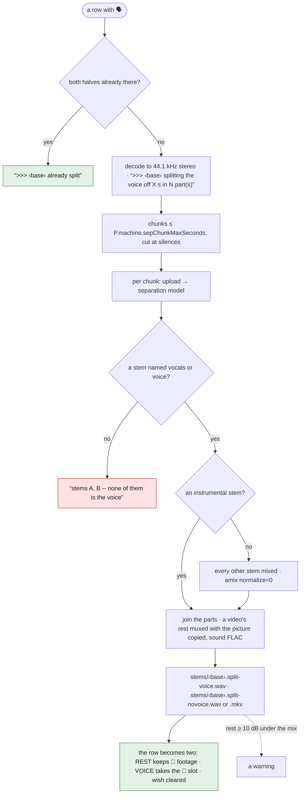

S1 Decode to 44.1 kHz stereo pcm. S2 Chunk at P.machine.sepChunkMaxSeconds (300 s) on silences. S3 Per chunk: upload, run the separation model; voice = `vocals|voice` stem, rest = `instrumental` stem (or every other stem mixed with amix normalize=0). S4 Join the parts; a video's rest muxed as mkv, picture copied. S5 Write `stems/<base>.split-voice.wav` and `<base>.split-novoice.wav|.mkv` (names keep the timestamp). S6 Log ">>> [base] splitting the voice off X s in N part(s) (<sep model>)" before the first chunk goes up, then ">>> [base] split into A and B" and a loudness report; warn when the rest is ≥ 10 dB under the mix. S7 Source row → two rows: rest keeps footage, both keep the row's voice (there is no "no voice" to give the rest; first rewrite: the rest went to 0); wish cleared; project saved. Skip when both halves exist.

### F1.3 Per source: audio → text → word times → speakers → segments

<sub><!-- back -->[← F1.2](#f12-voice-separation-rows-with-) · [↑ 04 Prepare](#04--prepare) · [all flows](11-flow-index.md#3-all-flows) · [F1.4 →](#f14-asr-in-chunks)</sub>

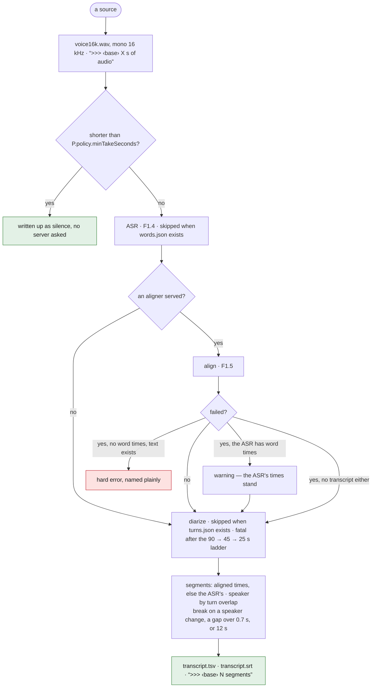

S0 Every source is heard, a video's own sound as well as a microphone's ("Every file here is transcribed"; a video's words are the film's): one speech row per source (first rewrite: only the rows that were not footage, so a project of videos alone got no transcript and its fix wrote empty files). S1 `voice16k.wav` (mono 16 kHz) unless present; log ">>> [base] X s of audio". S2 **Short take**: < P.policy.minTakeSeconds (2.0) → written up as silence, no server asked (">>> [base] X s long -- a start/stop, not a take: written up as silence"). S3 ASR ([F1.4](#f14-asr-in-chunks)) unless `words.json` exists. S4 Alignment ([F1.5](#f15-forced-alignment)) when an aligner is served and `words.aligned.json` absent, and with it on disk the aligner is asked nothing (first rewrite: the aligner was asked on every ▶ and its answer thrown away after it had rewritten the file, so a resumed Prepare logged "ASR already done" and then "aligning speech 1/1" for every recording); failure = warning if the ASR gave word times, hard error if not, silent with no transcript either (nothing to align). S5 Diarization unless `turns.json` exists (fatal after the window ladder). S6 Segments: words from aligned or ASR times; speaker by greatest turn overlap, else nearest turn within 1 s, else SPEAKER_00 when no turns, else "?"; word end clamped to start + 2 s; segment breaks on speaker change, gap > 0.7 s, or 12 s; write `transcript.tsv`, `transcript.srt`; log ">>> [base] N segments".

### F1.4 ASR in chunks

<sub><!-- back -->[← F1.3](#f13-per-source-audio--text--word-times--speakers--segments) · [↑ 04 Prepare](#04--prepare) · [all flows](11-flow-index.md#3-all-flows) · [F1.5 →](#f15-forced-alignment)</sub>

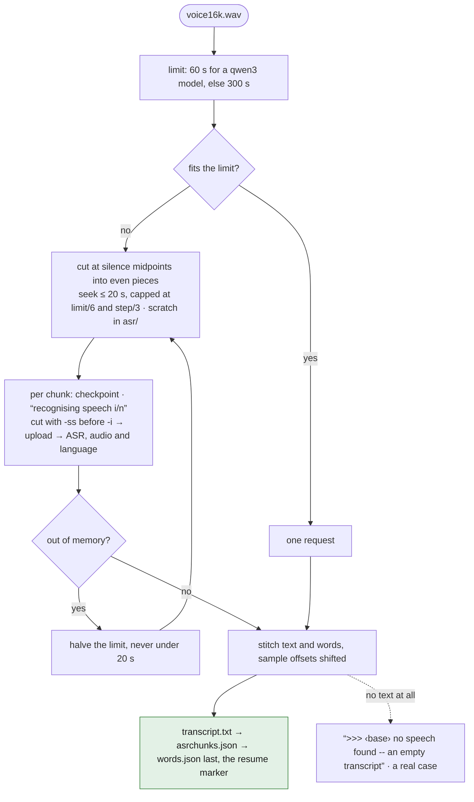

S1 Chunk limit 60 s for a qwen3-family model, else 300 s; out-of-memory → halve down to 20 s, retry (logged). S2 File fits → one request; else cut at silence midpoints into even pieces (seek ≤ 20 s, capped at limit/6 and step/3); scratch in `asr/`, removed on success. S3 Per chunk: checkpoint, progress "recognising speech i/n", cut with -ss before -i, upload, run ASR with `{audio, language}`. S4 Stitch `{text, words}`, sample offsets shifted; write `transcript.txt`, `asrchunks.json`, `words.json` last. Empty text is a real case (">>> [base] no speech found -- an empty transcript").

### F1.5 Forced alignment

<sub><!-- back -->[← F1.4](#f14-asr-in-chunks) · [↑ 04 Prepare](#04--prepare) · [all flows](11-flow-index.md#3-all-flows) · [F1.6 →](#f16-frames-per-video)</sub>

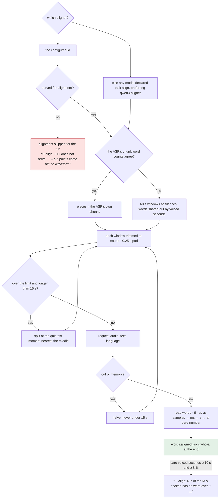

S1 Aligner = configured id, else every model declared task align, preferring qwen3-aligner; the first to answer serves the rest of the run. A configured id not served for alignment is not replaced: alignment skipped for the run with "!!! align: <url> does not serve \"X\" for alignment -- cut points come off the waveform". S2 Pieces = the ASR's own chunks when word counts agree, else 60 s windows cut at silences, words shared by voiced seconds. S3 Each window trimmed to sound (0.25 s pad); over the limit and > 15 s → split at the quietest moment nearest the middle (inside the middle three quarters); out-of-memory → halve, ≥ 15 s. S4 Request `{audio, text, language}`; reply words from `words|alignment|segments|result.*`; times read as samples, then milliseconds, then seconds, then a bare number (samples when > 120 s); words stored lower-cased, written form restored by the word list ([F1.13](#f113-the-sessions-word-list-shared-by-retakes-joins-finaltxt-and-subtitles)). S5 Write `words.aligned.json` whole at the end. S6 Warn "!!! align: N s of the M s spoken has no word over it -- the times are wrong, and the cut will drop that footage" when bare voiced seconds ≥ 10 s and ≥ 8 %.

### F1.6 Frames per video

<sub><!-- back -->[← F1.5](#f15-forced-alignment) · [↑ 04 Prepare](#04--prepare) · [all flows](11-flow-index.md#3-all-flows) · [F1.7 →](#f17-describe-per-footage-source-chunks-of-pmachinedescribeframesperreq--4)</sub>

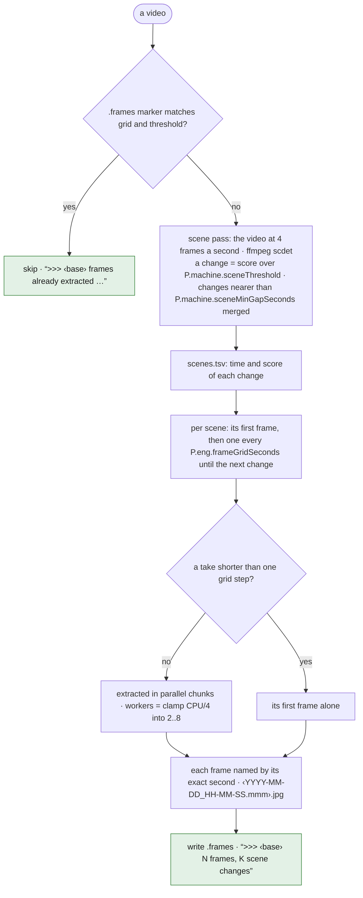

S1 The marker `.frames` = "<grid>|<threshold>" matches → skip (">>> [base] frames already extracted (…), skipping"); a folder the first rewrite named in session seconds (1970-01-01_…) is renamed in place to the real instants, its `.llmframes/` copies with it (">>> [base] N frame(s) renamed from session seconds to the recording's own date and time"). S2 Scene pass over the whole video: `fps=4,scale=640:-2,scdet=threshold=0`; a scene change is a frame whose score exceeds P.machine.sceneThreshold (1.0); changes nearer than P.machine.sceneMinGapSeconds (0.5 s) merge into the first; written as `scenes.tsv` (`time\tscore`). The start of the file is always a scene start. S3 Frames: in each scene, its first frame, then one every P.eng.frameGridSeconds (0.25 s) until the next change; the grid restarts at every change, so the first picture of a new slide is always there. The grid ends at the picture's end, the scene pass's last scored second, not at the container's duration (which counts the sound too, and a recording whose sound outlasts its picture by a fraction of a second named a step past the last picture: ffmpeg wrote nothing and the first rewrite failed the whole stage); a frame ffmpeg cannot write within the last second is skipped with ">>> [base] no picture at the very end (…) -- skipped". Every frame at the video's own size: no scaling here (the model's copies are made in [F1.7](#f17-describe-per-footage-source-chunks-of-pmachinedescribeframesperreq--4) S1; prototype: scaled by the Frame size preset). Parallel chunks (workers clamp(CPU/4, 2, 8); one for a tiny job); a take shorter than one grid step → its first frame alone; progress from ffmpeg's `-progress`. S4 Each frame named by its exact second on the file's clock: `<start + t>` as `YYYY-MM-DD_HH-MM-SS.mmm`, where `start` is the recording's real instant (its file-name stamp; the session's zero for an unstamped file), so a frame of `2026-10-25 10-35-44.mkv` 3.25 s in is `2026-10-25_10-35-47.250.jpg` (first rewrite: `start` was the session offset alone, so every name read `1970-01-01_…`). Its `.llmframes/` copy carries the same name. A reader turns a name back into a session second by subtracting the session's zero; a name before 2001 is a first-rewrite one and already counts session seconds. S5 Write the marker; log ">>> [base] N frames, K scene changes". The scene pass is run on the real ffmpeg in a test: the first rewrite's command ended `-f null` with no output (`-`), which ffmpeg refuses, so every real recording failed here while the stubbed walk passed.

S6 (new) **The text gate**, a stage of its own after the frames and before describe, for every recording first (the decision model and the describe model may share a server that holds one model at a time; alternating per recording would load each again for every one). Always planned. The judge is the **Decision** model when Settings names one (a fast vision model, `DECISION_MODEL`), else the main model, which describes the same frames anyway (first rewrite: planned only with a Decision model, and Freq spaced describe's frames without one). The pixel pass (S2) catches every hard switch, but a bullet added to a slide, a column added or a menu closing scores under its threshold, and a scroll or a webcam person moving scores over it. The gate asks the decision model one question about two frames of the same recording, [prompt textgate](prompts/textgate.md), thinking off, answered by `tool:judge_text(changed, what)` ([02 §3.12](02-services.md#312-text-gate-f16-s6)): did the TEXT of the main content change? (1) Each pixel-pass change is judged across (the frame before against the frame after); SAME drops it. (2) Each scene left is probed at its first and last frame and at most every 20 s between; each neighbouring pair is judged, and a CHANGED pair is halved and each half judged again down to 1 s, the change placed at the later frame, so two changes inside one pair are both found. (3) Changes no more than 1 s apart are one run (a scroll), kept as its last point, the settled view. Probes and halving land on the frames the source has (the 250 ms grid, or an older extraction's spacing). A judge that fails keeps a pixel-pass change and finds nothing; three failed calls with none answered end the gate for that source ("!!! [base] text gate: the decision model did not answer (…) -- the pixel pass's scenes stay"). Every answer is in the LLM cache under the two pictures' bytes, so a rerun asks nothing. Written as `textscenes.tsv` beside `scenes.tsv` (`seconds\tpixel|text`); log ">>> [base] text gate: N scene change(s) -- K of the pixel pass's kept, D dropped as the same text, T found in the text; J judge(s)". After every judge the gate says how far it has got: the bar moves inside the recording's share (pass 1 fills its first half, pass 2 its second, each by how far into the recording the last judged frame is), and the status line reads "textgate 2/2: reading the text of <base> -- pass P of 2, M:SS of M:SS, J judge(s)" (first rewrite: the line stood on the recording's name and the bar did not move for the many minutes a long recording's judges take). Measured on the 06-news footage (2026-10-25, webcam overlay over web pages and slides): 9 of 9 text changes, no false alarm, 54 judges for two recordings; the pixel pass alone missed a menu closing and cut one scroll into three.

Measured on the ETH lecture (2026-09-18), against the slide changes the describe log records: on a slide recording, the 4-per-second pass at threshold 1.0 found 6 of 8 changes, where the frame-by-frame pass at the source rate found 3 — the slide transitions are animated, so no single frame-to-frame step stands out; it missed a blank page one second after another change and a quote building into the same slide. On a browser demo it found 6 of 8 and added about 15 triggers from scrolling and typing. A false trigger costs one extra frame; a missed change is caught at the next grid step for the timeline and at the next heartbeat (20 s) for the model.

Prototype: a uniform `fps=1/interval` grid (interval = Freq; 0 = every frame, "…extracting EVERY frame -- gigabytes"), `f000001.jpg…` renamed to `<start + (n−1)·interval>` stamps (-1, -2 within one second), marker `.interval` = "<interval>|<scale>", no scene detection.

### F1.7 Describe (per footage source, chunks of P.machine.describeFramesPerReq = 4)

<sub><!-- back -->[← F1.6](#f16-frames-per-video) · [↑ 04 Prepare](#04--prepare) · [all flows](11-flow-index.md#3-all-flows) · [F1.8 →](#f18-fix-the-transcripts-blocks-of-pmachinefixblocklines--25-lines)</sub>

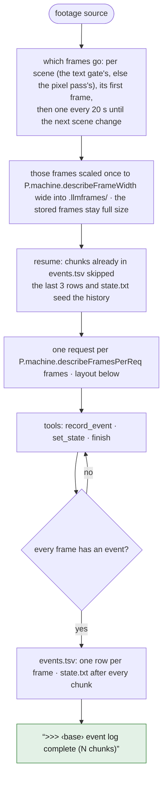

```text
User Context
STATE so far: …
Frames cover t=As to t=Bs. A frame marked NEW SCENE is the first after a scene change.
Just before this: ‹the last events›
--- context before (do not describe) ---
--- spoken during these frames ---
--- context after (do not describe) ---
[+0.0s] FRAME 1 of 4  ‹image›
[+0.8s] FRAME 2 of 4, NEW SCENE  ‹image›
…
```

S0 Which frames go (new): from the 250 ms grid, per scene its first frame, then one every 20 s (the gate's heartbeat) until the next change; the scenes are the text gate's (F1.6 S6, `textscenes.tsv` no older than `scenes.tsv`), each starting at its first settled frame, or the pixel pass's where the gate could not run, the gate's logged ">>> [base] describing the text gate's N scene change(s), one frame each and one every 20 s between" — a scene shorter than 20 s sends its first frame only, and the first picture of every new slide always reaches the model. An every-frame folder (the prototype's: the video's own frames, spaced finer than the grid, e.g. 1/30 s) is refused: "<base> was extracted as every-frame; describe needs the 250 ms grid -- rerun Prepare"; a folder on the grid is what Prepare writes and is described (first rewrite: refused any folder whose frames sat one grid step apart, which is every folder Prepare writes, so nothing was ever described and every clip reached the upload text as "nothing was seen"). Prototype: every extracted frame, evenly spaced, and the refusal read "…describe needs a fixed interval — rerun Prepare with e.g. 1s". S1 Frames sorted by stamp (missing or empty folders refused, when the stage reaches the source: ">>> [base] no frames to describe -- the frames folder is empty"). At ▶, after F1.1 S5's audio check, each footage source whose folder already holds frames is said with its plan (">>> [base] describe: N frames -> M requests") or S0's every-frame refusal; a source with no frames yet says nothing there, since this run's frames stage is about to extract them (first rewrite: said the empty-folder refusal at ▶ for every source not extracted yet, so a fresh project opened with a refusal per recording that was no error). each frame that goes is scaled once to P.machine.describeFrameWidth (896) wide, height by aspect, into `.llmframes/`, and the scaled copy is what is sent; the frames on disk stay the video's own size (new: one rule for every video; prototype: scaled unless the Frame size preset was 896w (LLM) or 480p, which were sent as stored). Measured on the ETH lecture: a 1080p frame is 147 kB and its 896-wide copy 55 kB, so the 250 ms grid at the video's own size is about 2.7 GB for 71 minutes, against about 0.9 GB had it been stored at 896. Each recording heard alongside the video logged with its offset (">>> [video] hearing X alongside it, starting Y s in"). S2 Resume: chunks whose start is in `events.tsv` skipped; last 3 rows seed the rolling window; `state.txt` seeds the STATE ("Recording just started."). S3 Message: User Context; "STATE so far: …"; "Frames cover t=As to t=Bs. A frame marked NEW SCENE is the first after a scene change."; "Just before this:" + last events; speech block (always three sections: context before, spoken during, context after; before/after within 10 s, ≤ 2 per source); then per frame "[+N.Ns] FRAME i of n" (", NEW SCENE" on a scene's first frame) + image; the stamps are no longer evenly spaced. S4 Cache on the whole content (images inline). S5 **Tools** ([`02-services.md` §3.2](02-services.md#32-describe-per-chunk-of-frames)): `record_event(frame, text, calm)`, `set_state(text)`, `finish`. A reply in that prose shape, or with only a bare `finish` beside it, is read by §3.2's prose floor ([`02-services.md` §3.2](02-services.md#32-describe-per-chunk-of-frames)). Prototype: one "EVENT [+Ns]: …" line per frame + "STATE: …", parsed leniently. S6 One `events.tsv` row per frame (no event → "same"; a batch's first frame with no history must not be "same"); `state.txt` after every chunk. S7 Log ">>> [base] event log complete (N chunks)", or "(N chunks, M answered from the cache)" when any were.

### F1.8 Fix the transcripts (blocks of P.machine.fixBlockLines = 25 lines)

<sub><!-- back -->[← F1.7](#f17-describe-per-footage-source-chunks-of-pmachinedescribeframesperreq--4) · [↑ 04 Prepare](#04--prepare) · [all flows](11-flow-index.md#3-all-flows) · [F1.9 →](#f19-mark-retakes)</sub>

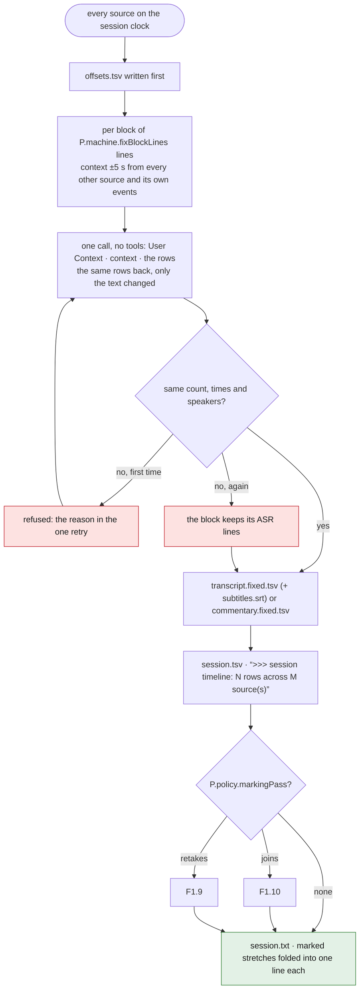

S1 Place every source on the session clock; load transcripts and event logs. S2 Per block: checkpoint; context ±5 s from every other source (events and lines) + own events; message: the User Context block without its script (the block between SCRIPT START and SCRIPT STOP; first rewrite: sent it, as where the spellings of names come from, and the model took what was said for a mishearing of the script and rewrote the line to match, wording in every prompt notwithstanding; 08-dex 18-40-10, said USDC, script DAI, 12 asks: with the script 3 of 8 kept USDC, without it 12 of 12, the request 8 kB instead of 40, and across 12 name-heavy blocks names were spelled the same) then "Context around these lines:\n…\nTranscript lines to clean (N lines, return exactly N):\n…" with each row as `start⇥end⇥speaker⇥text` and no line number (first rewrite: built the context and asked without it, numbered the rows, and sent no User Context). S3 One chat call per block with no tools, as the prototype asked it: the answer is the same N rows with only the text changed, refused unless the count, the times (±0.01) and the speakers are identical and no row is emptied; the refusal's reason goes into the one retry; a block refused twice, or whose server does not answer, keeps its ASR lines, loudly (first rewrite: offered `fix_line`/`flag_line` and reads with nothing behind them; the model asked for an empty context and answered nothing, 4 blocks of 5, and the subtitles kept "my name is thomas bocek"). Only valid first answers are cached. S4 Write `<source>/transcript.fixed.tsv` (+ `subtitles.srt` for a video) or `commentary.fixed.tsv`. (`offsets.tsv` is written earlier, in S1's placement pass, before any block goes out.) S5 Merge into `session.tsv` (sorted by start; events labelled EVENT); log ">>> session timeline: N rows across M source(s)". S6 Run the marking pass P.policy.markingPass names — retakes ([F1.9](#f19-mark-retakes)), joins ([F1.10](#f110-repair-the-joins)) or none; failure leaves the timeline unmarked ("!!! retakes: … -- the timeline stands unmarked"). S7 Write `session.txt` exactly as the cut model sees it (marked stretches folded to one line each: "<stamp> (abandoned attempt to <stamp>, said again at <stamp> -- already removed, read straight past it)").

### F1.9 Mark retakes

<sub><!-- back -->[← F1.8](#f18-fix-the-transcripts-blocks-of-pmachinefixblocklines--25-lines) · [↑ 04 Prepare](#04--prepare) · [all flows](11-flow-index.md#3-all-flows) · [F1.10 →](#f110-repair-the-joins)</sub>

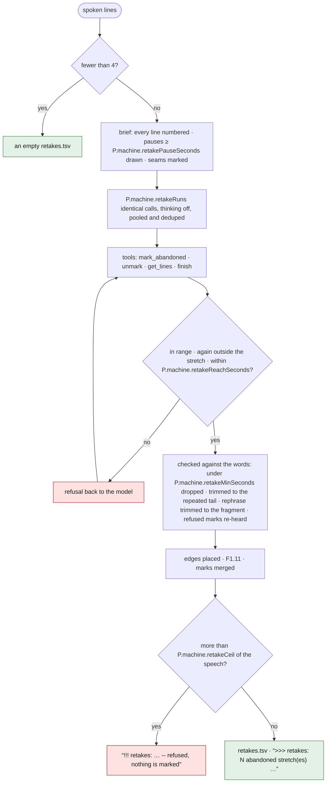

S1 Runs as the fix stage's merge row ([F1.8](#f18-fix-the-transcripts-blocks-of-pmachinefixblocklines--25-lines) S6), never at the ▶ press. Spoken lines (< 4 → empty `retakes.tsv`). S2 Brief: spoken lines numbered, "(N.Ns pause)" at gaps ≥ P.machine.retakePauseSeconds (1.5 s), "--- the recording stops here; the next one begins ---" at source changes. S3 P.machine.retakeRuns (3) identical calls (thinking off), each its own cache slot (run index in the key), answers pooled, deduped. Prototype: strict JSON `{"abandoned":[{"from","to","again"}]}`, 1-based line numbers. **Tools**: `mark_abandoned(from, to, again)`, `unmark`, `finish` (tool validates: range, `again` inside the stretch, beyond the timeline, farther than P.machine.retakeReachSeconds 180 s). S4 Verify against the words: removal < P.machine.retakeMinSeconds (0.3 s) dropped; `again = 0` only for a whole take; repeated tail found by fuzzy match (≥ 70 % run, ≤ 3 skips; words equal, prefix ≥ 3 bytes, or one edit), mark trimmed to it; rephrase trimmed to the broken-off tail (fragments ≤ 6 s); refused marks re-heard by a second ASR pass on both attempts. S5 Place edges ([F1.11](#f111-place-the-edges-of-a-mark)), merge marks. S6 > P.machine.retakeCeil (40 %) of the speech would go → refuse everything: "!!! retakes: <m:ss> of <m:ss> of speech called abandoned -- refused, nothing is marked"; empty `retakes.tsv` written. S7 Write `retakes.tsv` (empty on purpose when none); log ">>> retakes: N abandoned stretch(es), m:ss of speech, kept out of the cut".

### F1.10 Repair the joins

<sub><!-- back -->[← F1.9](#f19-mark-retakes) · [↑ 04 Prepare](#04--prepare) · [all flows](11-flow-index.md#3-all-flows) · [F1.11 →](#f111-place-the-edges-of-a-mark)</sub>

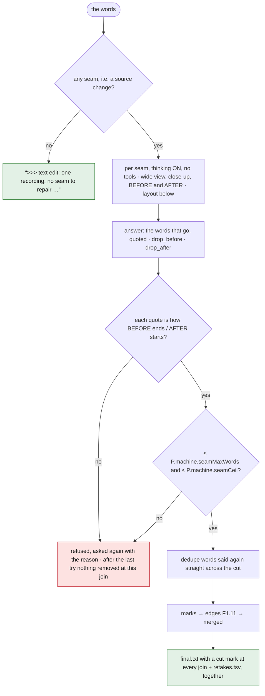

**What decides the cut at a join.** One call per seam; everything the model gets is below. The system message is [`prompts/system.md`](prompts/system.md) followed by [`prompts/textedit.md`](prompts/textedit.md); the user message:

```text
USER CONTEXT -- written by the person who made this recording and is editing it. It outranks
anything you infer from the material, and it outranks the rules of the job you were given
wherever the two disagree; only the mechanics of the answer -- its shape, its clock, what may
be invented -- are not its to change:
<the whole User Context, verbatim; left out when empty>

JOIN k of n.

WIDE VIEW (this join is at [CUT]; every [another take starts] is another join, not yours):
<60 words either side, [CUT] at this seam, [another take starts] at every other seam in view>

CLOSE TO THE CUT:
<15 words> [CUT] <15 words>

BEFORE (the end of the take that was interrupted):
...<its last 25 words; the quote is matched against P.machine.seamReachWords of them>

AFTER (the whole take that follows, up to where the next one starts):
<that take's words, at most P.machine.seamReachWords>

Answer {"drop_before":"...","drop_after":"..."} and nothing else: the last words of BEFORE and the
first words of AFTER that go, copied exactly, or empty.

<on a retry: Your previous answer at this join was refused: <reason>. Answer again.>
```

- **The words** are the session's word list ([F1.13](#f113-the-sessions-word-list-shared-by-retakes-joins-finaltxt-and-subtitles)): every word the aligner heard, on the session clock, the narrator mic left out, and the words an earlier join already took out left out too; BEFORE runs across earlier takes when the seam is near one, AFTER stops where the next take starts (first rewrite: it ran on into the next take, whose stumble the model took for this join's). Each is printed as the fix pass ([F1.8](#f18-fix-the-transcripts-blocks-of-pmachinefixblocklines--25-lines)) spelled it — case and punctuation — or, where the fix pass left it no spelling, as heard: lower case, no punctuation. So fillers the fix pass dropped still show ("eben", "version also"); heard words the fix pass wrote as one compound show once, as the compound (the prototype showed "Block-Level level" until 2026-09-18); a transcript word the aligner never heard rides on the next heard word; and a sentence end the fix pass did not mark is not marked.
- **Not given:** word times, pauses, the sound, the frames, the fixed transcript's own lines, the other joins' answers.
- **The answer** names the words that go, quoted, matched against the end of BEFORE and the start of AFTER (S3). From them: marks, then edges placed by the sound ([F1.11](#f111-place-the-edges-of-a-mark)), then `final.txt`, from which the cut is built ([F2.14](05-cut.md#f214-suggest-a-cut), `cutMode` words).
- **The log:** every call, its thinking and its reply are on the run's page `llm/<MMDD-HHMMSS>-<first step>.html` — for a ▶ on Prepare that is the page named `…-describe.html`.

Worked example (ETH lecture, join 23 of 57, recordings 17-52-23 → 17-53-10, session 27:57):

```text
BEFORE ends:  … und Block-Level level Access Lists, die parallele Ausführung ermöglichen
              und den Weg zu einer Gas-Limit
AFTER starts: was die Gas-Limits nochmals nach oben setzen sollte Und die Native Account
              Abstraction, eben das ist für das übernächste version also für das …
Reply:        … die parallele Ausführung ermöglichen Und die Native Account Abstraction, …
Cut:          27:57.6 → 28:12.1: the false start and the restart both gone
By hand:      27:57.6 → 28:04.9: only "und den Weg zu einer Gas-Limit" gone
```

The model's thinking weighed the right answer ("ermöglichen, was die Gas-Limits …") and turned it down: no comma in what it was shown, and the User Context's script reads "… ebnen sollen. Und die Native Account Abstraction?", so the restart looked off-script. The prompt now says both: WHAT WAS SAID, NOT THE SCRIPT — the script is what the speaker meant, words said in its place stay — and PUNCTUATION IS A HINT — a sentence end is not always marked ([`prompts/textedit.md`](prompts/textedit.md)). The fix pass's own line has no full stop there, so the words cannot carry one.

A harder join (join 22 of 57, recordings 17-52-02 → 17-52-23, session 27:10). The recording before already restarts inside itself, and the join before (21) has taken out the first saying:

```text
BEFORE ends:  … bei Fusaka. Das ist der aktuellste Release und Das ist der aktuellste
              Release und wurde im Dezember 2025 aktiviert, und das Kernstück hier, Peer
              Data Availability Sampling, und betrifft
AFTER starts: und wurde im Dezember 25 aktiviert und führte dazu, dass die
              Transaktionskosten auf dem Mainnet gesenkt werden konnten. …
Reply:        … bei Fusaka. Das ist der aktuellste Release und wurde im Dezember 25
              aktiviert und führte dazu, …
Matched back: left out "Das ist der aktuellste Release und" (21 words from the join)
              and "und wurde im Dezember 2025 … und betrifft" (the 16 at the join)
Result:       refused, "2 separate stretches left out, not one at the join" -- |cut|
By hand:      the 16 at the join -- exactly the second stretch
```

Fixed in the prototype (2026-09-18): the window leaves out words an earlier join already took out. It used to show them, and the one-stretch check counted them: the first stretch above was join 21's, and without it the answer is one stretch at the join and exactly the hand cut. Measured by feeding the unchanged answer through: accepted, the 16 words at the join.

Fixed in the prototype (2026-09-18): two stretches that both reach within P.machine.seamSnapWords of the join are two stretches, and refused. The later one used to overwrite the earlier and the answer was applied as the later alone — join 52 left out "kompiliert, und jetzt kann ich mir anschauen, was er" and "hat. 啊", one kept "kompiliert" between them, and only "hat. 啊" went.

Fixed in the prototype (2026-09-18): a word the fix pass wrote into the compound before it is shown once, as that compound, and goes with it. It used to be shown again bare ("Proof-of-Concept-Serie, of concept serie"), and an answer that kept the compound and left out the bare words took out the compound's own sound — join 17 cut "die letzte Proof-" off from its end. Only words that are part of the compound's letters count; a word the fix pass took out (a filler, a word said twice inside a take) is still shown bare, as before.

**Refused, then asked again.** A refused answer is asked once more (P.machine.seamRetries), with its own cache slot; the log says "-- asking once more", and "-- nothing removed there" after the last. A refusal still keeps the stumble.

**A whole take removed is flagged, not refused.** When the words a join takes out include every word of a recording, the mark names it (`retakes.tsv`, sixth column), the log says ">>> text edit: all of ‹base› goes (m:ss-m:ss) -- marked yellow on Cut, worth a look", `final.txt` marks that join `|cut N|whole take|`, and the Cut page tints the recording yellow ([05](05-cut.md#1-screen)). A take that was nothing but a false start should go whole; a join that misread its window looks the same — on the ETH lecture join 41 took all 15 s of a take whose first eight words were wanted.

**How `final.txt` is built** (S4–S6):

1. The words: every word the aligner heard, on the session clock, the narrator mic left out, each with the spelling the fix pass gave it, or none where it folded the word into a neighbour.
2. The joins in order, each answer matched back; its words marked dropped, or none when refused.
3. Dedupe: at every join left, words said twice straight across it (up to 3 either side) lose the earlier saying.
4. Written out: the words in order; a dropped word is counted and skipped; at every change of recording `|cut N|` (N words dropped there) or `|cut|` (none), `|cut N|whole take|` when the dropped words hold a whole recording; each kept word printed as spelled; a folded word prints nothing but stays in the video.
5. `retakes.tsv` in the same step: the dropped runs as marks, their edges placed by the sound ([F1.11](#f111-place-the-edges-of-a-mark)). The cut is built from them ([F2.14](05-cut.md#f214-suggest-a-cut)).
6. `final.txt` edited by hand is read back on the next cut, `|cut|` marks included, with no model ([F1.12](#f112-hand-edit-the-text)).

S1 Runs as the fix stage's merge row ([F1.8](#f18-fix-the-transcripts-blocks-of-pmachinefixblocklines--25-lines) S6), never at the ▶ press. Each seam says itself before it is asked ("merging the timeline -- repairing join k of n" on the status line, the bar moving through the row's share): every ask thinks, and one can take three minutes. Words of every recording except the narrator mic (< 4 → empty). S2 Seams = source changes; none → ">>> text edit: one recording, no seam to repair -- every word stands". S3 Per seam (thinking ON, no tools): "JOIN k of n." and the join shown three ways: a WIDE VIEW of 60 standing words either side with this join marked `[CUT]` and every other join `[another take starts]`; CLOSE TO THE CUT, 15 words either side of `[CUT]`; then BEFORE (its last 25 words; the window it is matched against is P.machine.seamReachWords, 140) and AFTER (the whole take that follows, up to where the next one starts, at most 140 words). The answer quotes what goes, `{"drop_before":"<the last words of BEFORE>","drop_after":"<the first words of AFTER>"}`, both empty for nothing removed; each quote is matched bare (case and punctuation ignored) against the end of BEFORE and the start of AFTER, so the model never counts. Refusals, logged "!!! text edit: join k: <reason> -- …": a quote that is not how BEFORE ends / AFTER starts; no fields in the answer; > P.machine.seamMaxWords (40) or > P.machine.seamCeil (60 %). A retry is told the reason its previous answer was refused. Joins that end with no usable answer are kept as recorded and said once at the end: "!!! text edit: N of M join(s) got no usable answer -- kept as recorded". Cached only when usable. First rewrite: `drop_words`/`keep_join`/`finish` tools offered beside a prompt asking for `{"joined": "…"}`, AFTER running on into the next take, and no refusal reason to the retry; on 07-news (18 joins, 2026-10-26) it answered nothing usable at 125 of 127 asks and kept every stumble. Measured on the same 18 joins against what should go (qwen3.8-flash-next): quoted answer, thinking on 17/18 three runs in a row (about 12 s a join) with examples taken from the test joins; tools, thinking on 15/18; quoted, thinking off 11/18 (0.4 s a join). One ask per join: a second ask that showed the cut with more context and could move it on either side was measured on the same joins and left out (16/18 to 16/18 and 16/18 to 17/18, about twice the time; the one join it fixed, a cut reaching too far back, did not occur with the real prompt). Prototype: `{"joined": "…"}` matched backwards (preferring the later saying). S4 Dedupe words repeated straight across a cut (3 words either side; earlier goes). S5 Marks from dropped runs; edges ([F1.11](#f111-place-the-edges-of-a-mark)); merge. S6 Write `final.txt` (surviving words as written; `|cut N|` / `|cut|` at every join) and `retakes.tsv` together; log ">>> text edit: N of M words removed in K stretch(es)".

### F1.11 Place the edges of a mark

<sub><!-- back -->[← F1.10](#f110-repair-the-joins) · [↑ 04 Prepare](#04--prepare) · [all flows](11-flow-index.md#3-all-flows) · [F1.12 →](#f112-hand-edit-the-text)</sub>

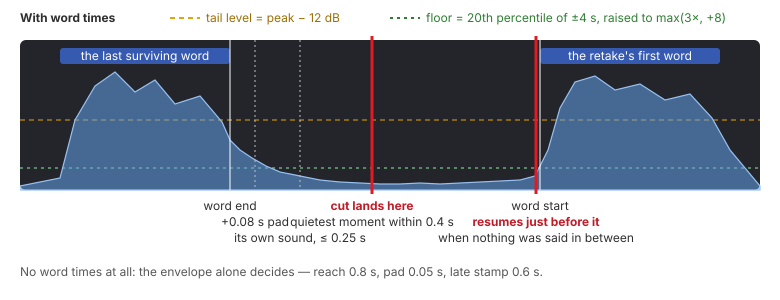

<sub>Illustration of the rule, not a measurement.</sub>

The aligner returns words back to back — each ends where the next begins — so where the word after a kept word was dropped, the fence has no width: the edge lands on the aligner's time and the sound is never asked. Measured on the ETH lecture: 72 of the 114 proposed edges sit exactly on an aligned word time.

Which recording's envelope a session second reads is the one playing then, whatever order the project lists its sources in (first rewrite: the last in the list starting at or before that second, which on a list written newest first is always the session's first recording, so every later second found nothing and fell back to the word pad, silently; 08-dex: none of its 95 recordings' edges was placed by the sound). A recording's first word followed by a gap of at least 0.2 s that holds sound at half the recording's median word peak or more and half as loud again as the word's own span is stamped ahead of its sound: it runs from the first sound at half that gap's peak to the next word, in the word list and in the words cut alike (08-dex 17-54-32: "Dass" stamped on a breath at 0.58 s, the word at 1.10 s; 1 first word in 94 has this, and the only other first word followed by a gap had silence in it). With word times: cut ends after the last surviving word (0.08 s pad; follows the word's own sound up to 0.25 s, then the quietest moment within 0.4 s), resumes just before the retake's first word when nothing was said between. Without: mono envelope alone (reach 0.8 s, pad 0.05 s, late stamp 0.6 s). Envelope floor = 20th percentile of ±4 s raised to max(3×, +8); tail level = peak − 12 dB. Known and kept: the edge cache holds linear peaks (a byte = peak × 255 of full scale), but the tail level and the floor treat it as a −70…0 dBFS meter; everything under about −30 dBFS reads as silence, and a single silent 5 ms bucket at a word's end stops the tail there. Scored against three hand-cut projects (ETH, admin, rep), the placement as it is still beat every alternative tried — a dB envelope, a fade-to-room rule — so the rewrite keeps it as it is; a change needs to score better on all three: fewer edges that cut off sound the hand cut kept, without more that keep sound it dropped.

### F1.12 Hand-edit the text

<sub><!-- back -->[← F1.11](#f111-place-the-edges-of-a-mark) · [↑ 04 Prepare](#04--prepare) · [all flows](11-flow-index.md#3-all-flows) · [F1.13 →](#f113-the-sessions-word-list-shared-by-retakes-joins-finaltxt-and-subtitles)</sub>

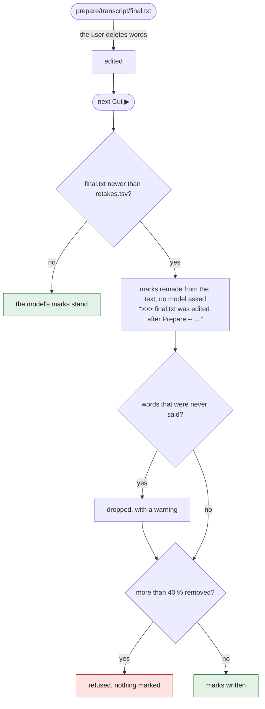

S1 User edits `prepare/transcript/final.txt` (deletes words; join marks may stay or go). S2 Next Cut ▶, if its mtime is after `retakes.tsv`'s: marks remade from the text, no model (">>> final.txt was edited after Prepare -- the marks are remade from it, no model asked"); never-said words dropped with a warning; > 40 % removed refused. No editor in the app: the file is edited in any text editor.

## 3. Data written

See [`01-project-and-files.md` §1](01-project-and-files.md#1-layout) (prepare/…). A file exists only when it says something: a transcript, its fixed copy, its subtitles, `session.tsv`, `session.txt`, `offsets.tsv`, and `final.txt` with its `retakes.tsv` are not written when they would be empty, and one an earlier run left is removed; a reader takes the missing file as "nothing here" (first rewrite: a run whose speech never ran wrote every one of them at 0 bytes, which looked like finished work).

## 4. Parameters used

Parameters ([10](10-parameters.md)): minTakeSeconds, retakePause, retakeRuns, retakeReach, retakeMin, retakeCeil, retakeFrag, againReach, seamReach, seamMaxWords, seamCeil, seamSnap, seamNoise, describeFramesPerReq, describeRecentEvents, describeCtxSegs, describeCtxWindow, fixBlock. P.audio: chunk sizes, silence threshold, diarization windows and anchor sizes, merge gap/length. Engineering: frame workers, quality, scratch handling. Full list in [`10-parameters.md`](10-parameters.md).

## 5. Rules

- Every stage skips when its output exists; resume markers written last and whole; scratch dirs survive failure, go on success.
- Server's own documents never rewritten; derived files live beside them.
- Only usable answers are cached; the fix pass changes text only; the retake pass answers in line numbers; the join pass can only delete; "prefer the later saying" is the direction of the match, not a request to the model.
- Marks are markings, never deletions; an empty marks file means "asked, none".
- No aligner is a working setup; no ASR word times and no aligner is a hard failure named plainly; diarization failure is fatal after the ladder; no speech is a real case at every layer.
- ⏸ resumes; ⏹ restarts only the describing, and only on the next ▶.

### F1.13 The session's word list (shared by retakes, joins, final.txt and subtitles)

<sub><!-- back -->[← F1.12](#f112-hand-edit-the-text) · [↑ 04 Prepare](#04--prepare) · [all flows](11-flow-index.md#3-all-flows) · [F2.1 →](05-cut.md#f21-play-the-recording-)</sub>

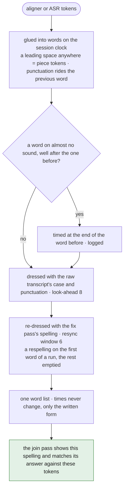

After the fix pass, one word list for the whole session: aligner (or ASR) tokens glued into words on the session clock, each word at its recording's place on that clock (the aligner counts from the recording's own first sample; first rewrite: those own seconds were stored, every take starting near 0, so the joins' marks ended before they began and no stumble left the cut), the recordings in the order the timestamps in their names place them, whatever order the rows were added in (first rewrite: row order, which for a project added newest first gave every join the later take as BEFORE); a word whose loudest moment is under 1/P.machine.strayWordRatio of its recording's median word and which starts more than P.machine.strayWordGapSeconds after the word before it is taken as put on the wrong sound and timed at that word's end, logged ">>> words: "‹word›" was placed on almost no sound, well after the word before it -- timed at the end of that word instead (m:ss)" (new 2026-09-18; on the ETH lecture "Geld." had been put on a breath 3.4 s late, and the clip ending on it carried the silence; the only such word in three lectures, 18 155 words); (a leading space anywhere → piece tokens, none → whole words; punctuation-only tokens ride the previous word without moving its end), dressed with the raw transcript's case and punctuation (look-ahead 8), then re-dressed with the fix pass's spelling (resync window 6; a whole respelling printed on a run's first word, the rest emptied; a line with no word in common left alone). Times never change, only the written form. The join pass shows the model this spelling and matches its answer back against exactly these tokens (a word printed as two owns both; survives if either does). The fix pass's line re-dresses the words whose middle falls inside THAT LINE, each word once (first rewrite: the window ended at the line's first word, so each word took the rest of the line as its spelling and every word carried its whole sentence; the join model was shown one sentence eighteen times over and thought for minutes on each join).

## 6. Details confirmed against the code (verification pass)

- **Diarization ([F1.3](#f13-per-source-audio--text--word-times--speakers--segments) S5) is a two-pass anchored scan**: pass 1 scans windows at hop ⅔ window (min 10 s) — "finding voices i/n"; anchor window = most voices with ≥ 4 s of speech, ties → best-represented quietest voice; up to min(12, win/4) s of each voice cut and concatenated into an anchor (">>> [base] anchor: N voice(s) in X s of a Y s window -- Z s of new audio each"); pass 2 prepends the anchor to every (win − anchor − 1) s window — "placing speakers i/n" — as one file cut from `voice16k.wav` with one ffmpeg call (each anchor piece, then the span, joined with nothing between), and reads its answer on that file's clock: a turn wholly inside the anchor is the reference and is not placed again, and a turn t s into the file lands at span start + (t − anchor) s on the recording (first rewrite: cut one stretch starting anchor-length before the span, so the server never heard the anchor, a span at 0 asked for `-ss -12`, a span at 77 s was sent 65..67.5 s of silence and failed Prepare, and every placed turn was moved by the anchor's start and width instead); and matches slots to anchor blocks one-to-one by overlap ≥ 0.5 s, strongest claim first, a slot's claim made of its turns that start inside the anchor only (first rewrite: a turn past the anchor stretched the claim to the anchor's end, so a voice heard again in the new audio claimed the next voice's block and that voice came back as a stranger); unmatched slots get their own ids; < 15 s of new audio per window → error "anchor too long (X s of Y s window)"; no voice long enough → ">>> [base] diarization: no voice long enough to anchor -- no turns" and `[]`.
- **Segments**: a word between turns takes the running segment's speaker; a segment started unknown is renamed once one word identifies it; `transcript.srt` prefixes each cue with `[<speaker>] ` unless unknown. Hard failures: "N words carry no usable start_sample/end_sample -- the answer changed shape"; "<ASR> transcribed this recording but timed no words, no aligner is registered to time them -- register one (task \"align\") -- or use an ASR that answers with word timings" (or "…and the aligner left no times either, which the line above this one says why").
- **meta.env**: VIDEO_FILE/BASE only when there is footage; AUDIO_FILE/BASE from the recording tagged narrator 1; INTERVAL (the 0.25 s extraction grid the frames sit on; first rewrite: Freq) and SCALE always.
- **Separation**: refusals "stems A, B -- none of them is the voice" and "only \"vocals\" came back -- the recording without the voice is the other half of this, and there is no other half"; ">>> [base] already split" on resume; a video's rest muxed with picture copied, sound as FLAC.
- **Describe**: the speech block's literal headings `--- context before (do not describe) ---`, `--- spoken during these frames ---`, `--- context after (do not describe) ---` with `(none)` / `(no speech during these frames)`; a frame matches the event stamped within half an interval; a batch's first frame with no history is written "Calm; same view."; a reply with no label stored "(no event line: …)"; an old-shape single EVENT becomes the first frame's line.
- **Fix**: ">>> [base] block i/n failed validation, keeping original lines"; ">>> [base] N block(s) answered from the cache"; `offsets.tsv`: one row per footage/recording pair, each logged ">>> offset: A starts X s into B". `session.txt` lines read `[<start>s-<end>s | mm:ss] LABEL: text` with LABEL = EVENT, NARRATOR (the narrator's mic) or the speaker id.
- **Retakes**: "!!! retakes: run i: … -- its answer is set aside"; "… -- going on with N"; ">>> retakes: N of M run(s) answered from the cache"; ">>> retakes: none".
- **Joins**: refusals also "the stretch left out (\"…\") stops N words short of the join" / "…starts N words past the join" beyond seamSnap; ">>> text edit: N join(s) repaired, M from the cache"; one line per mark ">>> text edit: a-b goes (\"…\")"; dedupe note "<t>: \"…\" said again straight after the cut -- the earlier one goes"; one recording still writes `final.txt` with every word and an empty `retakes.tsv`. Hand edit: "!!! text edit: N word(s) in the text were never said -- left out, there is no sound for them"; "!!! text edit: N of M words removed -- refused, that is not an edit, nothing is marked" (the same 40 % ceiling as retakes).
- **Prompt bench** (first rewrite; the rows are gone, see §1): each row's tooltip says what the job gets and answers; the mark's tooltip "Your wording is kept in ~/.config/naivepost/prompts, so a newer built-in prompt will not replace it. Reset puts it back."; Reset live only while this machine holds an edit ("Put the built-in wording back" / "This is the built-in wording, unchanged"); legacy [`prompts/<key>/General.txt|Default.txt`](prompts) are read once and rewritten as [`prompts/<key>.txt`](prompts); an empty prompt file is no prompt.
- **Readouts**: "no input files — add some above" (tooltip "(no sources)"); Outputs "nothing yet" / "N files, size" with "newest <ago>".

<!-- nav -->
---
[← 03 The shell](03-shell.md) · [↑ top](#04--prepare) · [↑ Contents](README.md) · [05 Cut →](05-cut.md)
<!-- /nav -->
