# 05 — Cut

<!-- nav -->
[← 04 Prepare](04-prepare.md) · [↑ Contents](README.md) · [06 Effects →](06-effects.md)

**Flows:** [F2.1](#f21-play-the-recording-) · [F2.2](#f22-play-the-cut-) · [F2.3](#f23-review-every-cut-) · [F2.4](#f24-place-and-step-the-line) · [F2.5](#f25-hush-and-mix-what-the-preview-hears) · [F2.6](#f26-select) · [F2.7](#f27-add-split-remove-) · [F2.8](#f28-trim-and-move) · [F2.9](#f29-copy-paste-lane) · [F2.10](#f210-cameras-and-hearing) · [F2.11](#f211-folds-and-rows) · [F2.12](#f212-insert-a-card-still-video-or-sound) · [F2.13](#f213-undo-redo-revert-clear) · [F2.14](#f214-suggest-a-cut)
<!-- /nav -->

The session on a timeline: thumbnails per camera row, a waveform lane per sound, kept material tinted green. Unfilmed time takes no width. Opens once there is footage.

## 1. Screen

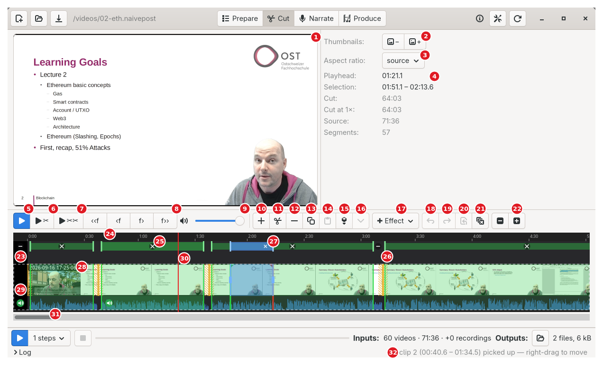

Screenshot of the prototype on the ETH lecture project.

**1** preview · **2** thumbnail size · **3** aspect ratio · **4** readings: playhead, selection, cut, cut at 1×, source, segments · **5** ▶ the recording · **6** ▶✂ the cut · **7** ▶✂✂ review every cut · **8** frame steps · **9** preview volume · **10** Add · **11** Split · **12** Remove · **13** Copy · **14** Paste · **15** Insert · **16** Lane · **17** Effect ▾ · **18** Undo · **19** Redo · **20** Revert · **21** Clear · **22** zoom − + · **23** fold-all badge · **24** ruler · **25** green bar of a kept scene, with its ✕ · **26** fold badge in a dropped gap · **27** the selection, with its ✕ · **28** row name plate · **29** the row's sound switch · **30** the red line · **31** scrollbar · **32** status line

Red playhead: 2 px line on its own layer across both bands. **There is one red line**: the second ▶ plays from, the second the preview picture shows and the second the band paints are the same number, whichever door moved it (a click, a frame step, the restored `line.json`, ▶'s tick); while ▶ runs the line moves and the picture follows it. No timeline tooltips, by design; status line and cursor shapes say what a press would do.

**Page**: split top and bottom by a draggable divider (opened with the upper part 380 px tall). Above it, side by side and split left and right by a second draggable divider (opened with the preview 660 px wide): the preview on the left, the form column on the right. Below it, top to bottom: the toolbar (one row), the tracks, the scrollbar.

**Toolbar groups** (left to right): transport (▶ recording, ▶✂ cut, ▶✂✂ review, frame steps); preview volume; verbs (＋ Add, | Split, － Remove, ⧉ Copy, ⧉ Paste, Insert/Edit, ⇲ Lane); effects dropdown (✚ Effect: ⊕ Zoom, ❝ Text, ▨ SVG, ⏩ Speed, 🔊 Volume, 🏷 Label; a pick closes the menu, as a menu does: first rewrite: the menu stayed open, and being modal it swallowed the next press, so the drag a picked ⊕ Zoom waits for never reached the preview); history (Undo Ctrl+Z, Redo Ctrl+Shift+Z **or Ctrl+Y**, Revert, ✗ Clear); zoom (−, +). Each group is one linked control and the groups stand 6 px apart, with a separator after the preview volume (inventory §A); the verbs, history and zoom wear the prototype's symbolic icons (`list-add`, `edit-cut`, `list-remove`, `edit-copy`, `edit-paste`, `go-down`, `edit-undo`, `edit-redo`, `document-revert`, `edit-clear-all`, `zoom-out`, `zoom-in`), the volume a speaker icon beside its slider, the transport its glyphs (▶, ▶✂, ▶✂✂, ‹‹f ‹f f› f››, ⏸ while its preview runs), each transport button at least 36 px wide and every other toolbar button at least 32 px, all with 6 px of padding, so a hand finds them without looking and linked icons do not touch (the first rewrite's 2 px padding and 16 px floor packed the verbs' icons edge to edge; the row still fits §1's 1240 px floor, 1147 of the 1182 px bar); a ▶ face is sized for both of its glyphs, since ⏸ comes from another font and is taller, so pressing it never resizes the button; of the three ▶ exactly the one in use is lit (accent). Wheel over the transport bar **and over the preview picture** steps frames (Shift = 5); over the tracks it zooms around the cursor; Shift+wheel or a trackpad sideways swipe pans an eighth of the view (a notch down pans later, up earlier, as a scrolled list does). A wheel zoom keeps the second under the pointer where it is (the pointer is read off the band's own hover, since a wheel notch on X11 carries no position), the − and + buttons the red line: it stays where it stands on screen, and a line scrolled off screen comes to the middle of the view (prototype and first rewrite: the buttons kept the view's centre, and a few presses of + pushed a line near an edge off screen) (first rewrite: both solved the scroll with its sign reversed, so a zoom away from the session's start jumped back to 0:00; the wheel always zoomed about the centre; and Shift+down panned back). Tooltips and greyed rules: [`inventory/cut.md`](inventory/cut.md) §A, normative.

**Form column** (right of the preview): idle readings, one per line, label left and value right (thumbnail size, aspect, playhead clock, selection, cut length, cut at 1×, source length, segments; the thumbnail size's 🖼− / 🖼+ step it ×3/4 / ×4/3 within 40..160 px, and it IS the height every picture row of the tracks band is drawn, fitted and pressed at: a press re-fits and repaints the band and re-seats the gutter's row switches, the readout shows the size the band is drawn at, and at either end the status line says "thumbnails at their smallest, 40 px" / "… largest, 160 px"; kept for the session, not saved; first rewrite: the ladder rewrote its own label and nothing read the size) or the form of what is being placed or edited (insert, effect); forms are live (kept as you type; one Undo reverts the whole edit); top to bottom: a pinned heading (title left, ✕ at its right end, closes) shown only while a form is open (the idle column starts with the readings, no heading), then the readings or the form in a scroller, never both: an open form (the insert, an effect, the zoom drawn by hand) stands in for the readings and scrolls inside the column, and every form pins the heading, the zoom form included (first rewrite: the effect forms sat under the scroller with the readings still shown, the column outgrew the 380 px pane, and the heading with its ✕ was painted above the window; the zoom form drawn by hand pinned no heading at all); every form ends with its own buttons, left to right "Insert it" (or "Apply" when editing) and "Cancel", and an effect form has its note "Kept as you type — ↶ Undo takes the whole edit back." under them.

**Pictures**: the thumbnails are cut from the recording itself, on the fly, at the seconds the zoom asks for: a grid of 0.25 s doubled until one step covers a cell (so zooming in by two reuses every second picture, and a scroll asks only for the new edge), one ffmpeg seek per picture (about 0.15 s on 1080p h264), three at a time, newest ask first, each kept at 180 px tall in the temp folder (`<temp>/naivepost-thumbs/<file id>/<ms>.jpg`, the id from the file's path, size and mtime, so an edited file gets new pictures; written under a temporary name and renamed, so no half picture is read). Until a cell's picture lands it shows the frame Prepare extracted for that second, else the slate; the band repaints as pictures land. A snapshot paints Prepare's frames only. New: the band has a picture before Prepare ran and at every zoom; first rewrite: Prepare's frames only, so a recording Prepare had not reached was blank film; prototype: one frame every Freq seconds, black between them. Each recording's stretch of its row is a film strip: cells at the picture's own shape (the row's height × 16:9), each showing the frame at the second the cell stands on, every recording on its own row and at its own place on the clock. A recording is named by its file's stem, the name Prepare files its frames under (`inputs/frames/<source>/`); a frame's name is an instant on its file's clock, so the frame for second `t` of a recording is the last one named at or before the file's first frame plus `t − start`, compared as instants (whole-second names from an older extraction read too). The live tape decodes in a worker, "in batches of 6 at the row height" (P `preview.thumbBatch`), never in a draw: a cell shows the slate placeholder until its frame lands, and each landed batch repaints the band. Each row carries one pinned name plate naming the recording that row shows at the view's left edge. A project opened with a cut opens on it: the readings (Cut, Cut at 1×, Source, Segments) and the preview's frame at the restored line are painted when the page is built, not after the first edit. The picture at the line is the recording on the preview's row that holds the line's second (else the nearest on that row). A line move and a playback tick never wait (new, [03 §1](03-shell.md#1-the-window)): a recording's frame folder is listed on a worker and held until the folder changes, the frame at the line is decoded on a worker (one at a time, the newest wanted frame next, so playback never queues frames it has passed), and a card's frames are rendered on one; until the wanted frame lands the picture that is up stays up. The band's film rows paint from the same held listings, and the trim strip's envelope is read once per file version: a paint reads a folder's or a file's change time and nothing else. First rewrite: every line move listed the folder twice and decoded up to three full frames, ten times a second while playing, and every band paint listed every recording's folder.

**Tracks**: gutter (a 30 px column down the left edge of every band, not a band of its own: fold-all badge, per-lane and per-row sound switches, empty-row ✕); then, top to bottom: ruler (ticks on the ladder 0.2, 0.5, 1, 2, 5, 10, 30, 60, 120, 300, 600 s, the first at least 70 px apart, labelled `mm:ss`; under a second each label carries its tenth, `00:00.5`, so no two ticks read the same; first rewrite: `00:00 00:00 00:01 00:01`), selection band (green bar per kept scene with ✕ and draggable ends; blue selection with ✕ and ends; fold −/+ badges), effects lane (one row per overlapping group), picture rows (thumbnails; amber striped edges where a recording starts/ends; a yellow wash and frame over a recording the join pass took out entire — flagged for a look, not an error ([F1.10](04-prepare.md#f110-repair-the-joins)); each row's first audio track as a strip below; camera and speaker badges on the scene under the line or held; pinned name plate per row — recording base name, "from m:ss" for a cut lane windowing a file, "+1.23 s" when the source has a hand correction; in/out marks as 3 px lines with flag triangles across the whole band, green in, red out; every insert a violet band across every row, hatched when spliced, with a plated `card` mark naming the file, plus own marks on the wave strips if sound-only; rose wash over the picture under any speed effect; dashed white outline around the row a click set the preview to watch, gone when ▶ hands the preview back), then the separate recordings' lanes, then the scrollbar (hidden when everything fits; the thumb is the view's share of the tape, and at high zoom a drag on it is geared so one screenful is always 40 px of drag).

**Drawn on the tape**: the tape starts after the gutter (second 0 at x = 30); the ruler, the red line, every bar and mark are placed through the one layout a press reads back. The tape is dark, as in the picture: each recording's ground in the selection band, translucent green bars with light grips at their ends (the scene under the line or held a little fuller), each kept scene's own pictures tinted green on its row with a green line down either end, and the wave strip drawn from `cache/waves/<base>.wave` (read against the recording it was measured from, §01 §6) on the IEC 60268-18 meter curve. Every mark a hand presses there (the ✕ on a bar and on the selection, the fold badges, the fold-all badge, the sound switches, the empty row's ✕, the lens and speaker badges on the scene under the line or held) is a round plate drawn on the band and answered by a press on it; a press on a mark places no line and starts no selection. Nothing of the tracks is a widget below them.

## 2. Model (summary; full schema in `01-project-and-files.md` §3)

Session clock; rows by greedy interval colouring with pins; filmed runs and cells; folds have zero width; x↔time through the cells (half-open on the right), and every press on the band is read back through those same cells with the scroll added back, so a press lands on the second drawn under it (new: first rewrite: presses were measured as `(x − gutter − scroll) / zoom`, the scroll's sign reversed and no fold or gap between recordings counted, so on a scrolled band, or past a gap, a click put the line seconds away from the pointer); zoom 4 px/s at open, floor = fit the filmed length, ceiling 240 px/s (new: the floor is the fit on the band the person sees, measured once for the toolbar's −/+ and the wheel alike, and every press steps from the zoom the band is drawn at: + deepens it by one step, the first press from under the fit going straight to the fit, until "zoom … px a second -- as close as it goes"; − widens it until "zoom … px a second -- the whole session is on screen", and never widens a band already showing the whole session at less than the fit; at the floor the film exactly fills the view, so the scrollbar hides (the pinned gutter is weighed on neither side); first rewrite: the buttons floored over an old 480 px placeholder strip and also wrote a second zoom nothing painted with, and the scrollbar weighed the gutter on one side only, so it stayed up at the floor with a gutter's width to scroll); scenes `[s,e)` on a row with inserts, lanes, quiet lists; effects; undo snapshots (segments, effects, aspect, shift, rows, lanes, nrows), depth 50; base = the last suggestion or what the page opened with.

## 3. Transport flows

### F2.1 Play the recording (▶)

<!-- back -->[← F1.13](04-prepare.md#f113-the-sessions-word-list-shared-by-retakes-joins-finaltxt-and-subtitles) · [↑ 05 Cut](#05--cut) · [all flows](11-flow-index.md#3-all-flows) · [F2.2 →](#f22-play-the-cut-)

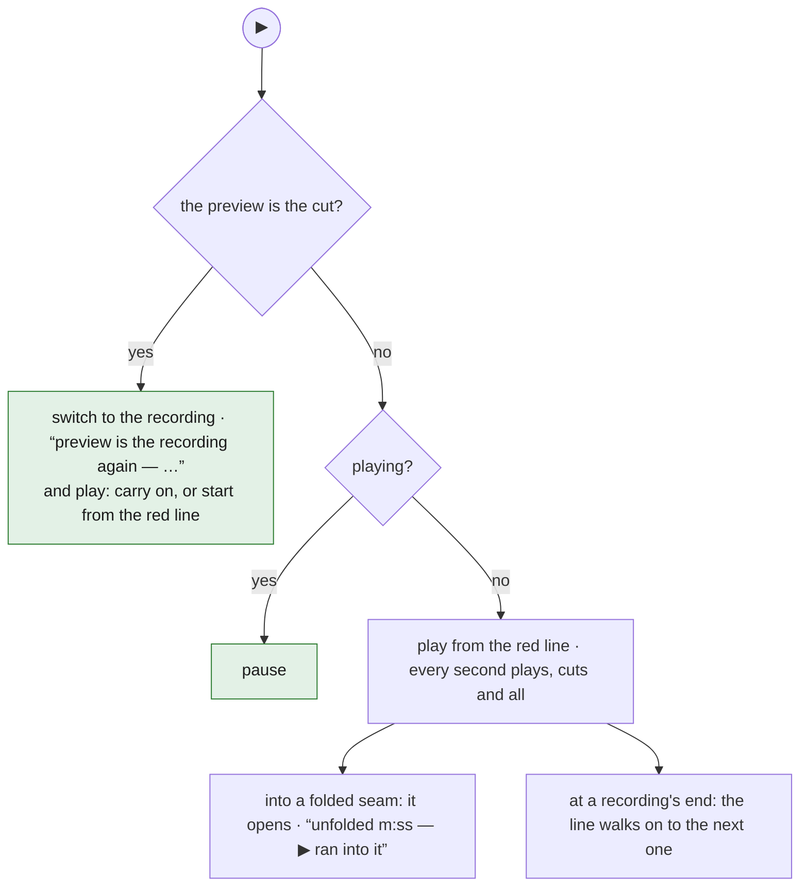

S1 Preview is the cut → switch to the recording ("preview is the recording again — everything plays, cuts and all") and play: if it was playing it carries on, if it was paused it starts from the red line, in the same press (the prototype's `playAs`: switching is why a play button was pressed and not ⏸; first rewrite: a paused switch only switched, and ▶ took two presses). S2 Else toggle: playing → pause; else play from the red line. A click on the preview picture is this press (press and release without passing GTK's drag threshold), whatever is placed under it, a caption, a drawing or a zoom's box; a drag on the picture is framing and never plays ([06 F3.1](06-effects.md#f31-zoom-by-hand) after S5). First rewrite: a click on the picture also ran the zoom-framing press, so it played and took the zoom (or opened a zoom form) at once, and where no overlay stood it opened a zoom form and did not play. S3 While playing every second plays, cuts and all; into a folded seam → it opens ("unfolded m:ss — ▶ ran into it"); at a recording's end the line walks on to the next one (or a camera still rolling then). S4 Clock shows session time; line follows the player ten times a second, smoothed live clock in between. S5 The player is the preview itself: the recording under the line plays IN the preview's picture (a `playbin` into the GTK4 sink, inventory §A's GtkPicture), its sound through the box's own output, and the line reads its second off that player, so line and picture never drift; once ▶ has played, a line moved by hand is sought in that player (held on its frame when paused), and the extracted frames come back only where it cannot follow (a card, nothing filmed). A cue never waits (new, [03 §1](03-shell.md#1-the-window)): it sets the pipeline going and returns, and a 20 ms poll finishes it as GStreamer gets there (preroll, seek, preroll again, play, each still bounded by 3 s, a pipeline that will not start said in the log); meanwhile the player answers the cued second and the play state it was asked for, so the line does not walk back. First rewrite: two waits of up to 3 s inside every cue, on every seek. A player program named by `NAIVEPOST_PLAYER` plays in a process of its own instead. The same player serves ▶✂ and ▶✂✂: each tick starts from the player's second, and a jump of the line (a dropped stretch, the next run-up) lands in it (a seek, or the spare F2.2 S5 prerolls).

### F2.2 Play the cut (▶✂)

<!-- back -->[← F2.1](#f21-play-the-recording-) · [↑ 05 Cut](#05--cut) · [all flows](11-flow-index.md#3-all-flows) · [F2.3 →](#f23-review-every-cut-)

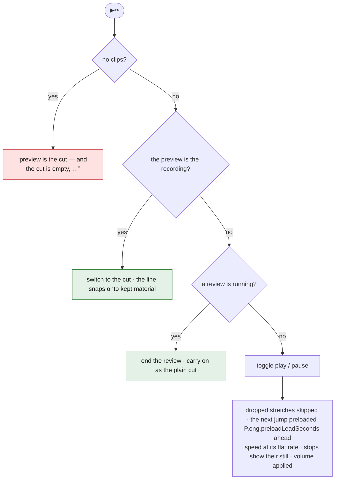

S1 Greyed with no clips. S2 Preview is the recording → switch to the cut (line snaps onto kept material; "preview is the cut — the clock reads the finished video", or with no clips "preview is the cut — and the cut is empty, so ▶✂ has nothing to play until a clip is added") and play: carry on if it was playing, else start from the line, in the same press (first rewrite: a paused switch only switched, and ▶✂ took two presses). Other ways in (Space, a click on the preview picture, run bar) refuse an empty cut (a click on the tracks, picture rows included, is no way into playback: it places the line, F2.4 S1, cut or no cut; first rewrite: an empty cut refused every click on the picture rows, so on a session with no cut yet the line never moved): "the cut is empty — add a clip to play it, or press ▶ to play the recording instead". S3 Review running → end it, carry on as the plain cut, playing (a paused review starts as the plain cut). S4 Else toggle: playing → pause, and a paused cut holds its line and its frame (the cut's tick moves nothing while paused; the first rewrite's tick walked on under a lit ⏸✂, so the picture played on behind a pause sign). S5 While playing: removed stretches skipped (line jumps to the next clip's first playable second; past the last clip → pause); next jump preloaded three seconds ahead in a spare pipeline so the join does not freeze (P.eng.preloadLeadSeconds; the same spare arms the review's next run-up and the walk-on at a recording's end, in every mode); speed effects at their flat rate; stops show their still; volume effects apply; clock reads the cut's own time. S6 Dropped stretches dimmed on the tracks.

### F2.3 Review every cut (▶✂✂)

<!-- back -->[← F2.2](#f22-play-the-cut-) · [↑ 05 Cut](#05--cut) · [all flows](11-flow-index.md#3-all-flows) · [F2.4 →](#f24-place-and-step-the-line)

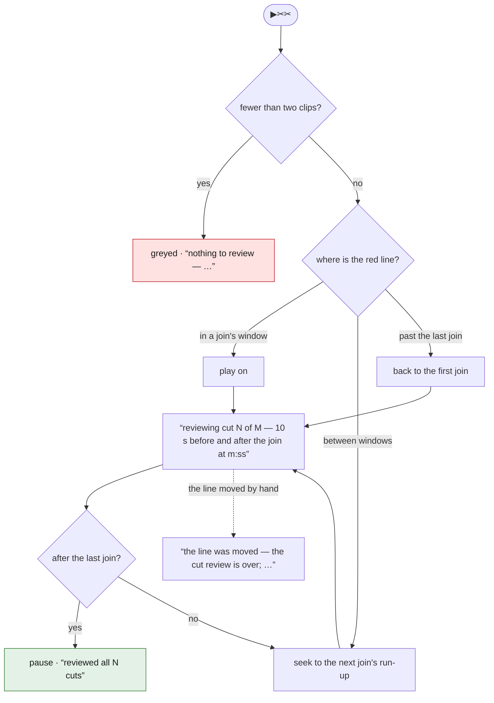

S1 Greyed with fewer than two clips ("nothing to review — a cut needs two clips to have a join between them"). S2 Start from the red line: inside a join's window (P.policy.reviewPadSeconds = 10 s either side of the join, clamped to the clips) → play on; between windows → seek to the next join's run-up; past the last → first join. S3 Play as the cut; once the seconds after a join have played, seek to the next run-up, or play on into it if already behind the line. S4 Status "reviewing cut N of M — 10 s before and after the join at m:ss"; after the last: pause, "reviewed all N cuts". S5 ▶✂✂ while running pauses and ends the review; ▶ or ▶✂ switch over without stopping; moving the line by hand ends it ("the line was moved — the cut review is over; ▶✂✂ starts it again").

**One rule for the three buttons**: each wears ⏸ only while its own thing runs; pressing it pauses; pressing another switches the preview without stopping; exactly one is lit (▶ recording, ▶✂ cut, ▶✂✂ review). What a face says, the media does (new): a pause pauses the player (and the cut's spare and the lanes), not only the page; every press, frame step, ⏹ and tick that changes the preview paints all three faces and the run bar, so ⏹ is live while any preview plays; ⏹ stops the media and, like a frame step's pause, ends a review (a paused review is an ended one, S5). First rewrite: ▶✂✂'s second press ended the review on the page and left the video playing behind a ▶ face; ▶✂ ending a review left ▶✂✂ wearing ⏸; ⏹ stayed grey under a playing preview and, pressed, only flipped the page's flag.

### F2.4 Place and step the line

<!-- back -->[← F2.3](#f23-review-every-cut-) · [↑ 05 Cut](#05--cut) · [all flows](11-flow-index.md#3-all-flows) · [F2.5 →](#f25-hush-and-mix-what-the-preview-hears)

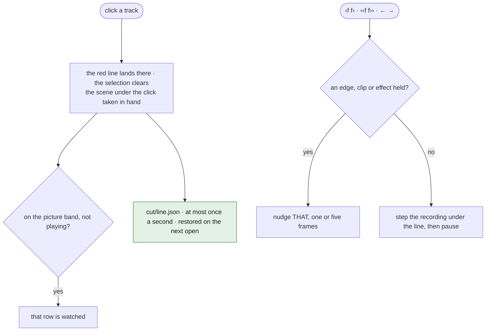

S1 Click on a track → red line there, selection cleared (a release that comes after the hand moved past the drag slop ended a drag, a selection or a trim, and places no line; first rewrite: the release of a selection drag also placed the line and cleared the selection it had just drawn), scene under the click in hand; also watches that row, but only on the picture band, while nothing plays, with sources loaded (a gutter click does neither). S1b A second left press on the picture band (clear of the green and the effects lane) picks up by the wider 12 px reach: held edge, then any border, then the whole clip — how to take a clip or card whose green sits on another row. S2 ‹f f› step one frame (Shift/‹‹f f›› five) of the recording under the line, then pause; with an edge, clip or effect held they nudge that instead, the buttons as well as the keys (first rewrite: the buttons ignored the hold). A nudge is unsnapped and one ↶ each: a held edge is the border of its clip nearest the red line (the pickup lands the line on it), moved as a trim drag moves it; a held clip slides along its recording with its length kept, clear of its neighbours; a held effect moves as F3.8 S2 says. The keys: `,` is ‹f (one frame back) and `.` is f› (first rewrite: both stepped forward). S3 ←/→ same, ← back and → forward, only while something is held (first rewrite: a held edge or clip was answered "nudged" and not moved); Space toggles play. S4 Line position kept in `cut/line.json` (written at most once a second while moving, flushed on close); restored once per project on next open if a recording still covers it, cued to that frame and scrolled into view.

### F2.5 Hush and mix (what the preview hears)

<!-- back -->[← F2.4](#f24-place-and-step-the-line) · [↑ 05 Cut](#05--cut) · [all flows](11-flow-index.md#3-all-flows) · [F2.6 →](#f26-select)

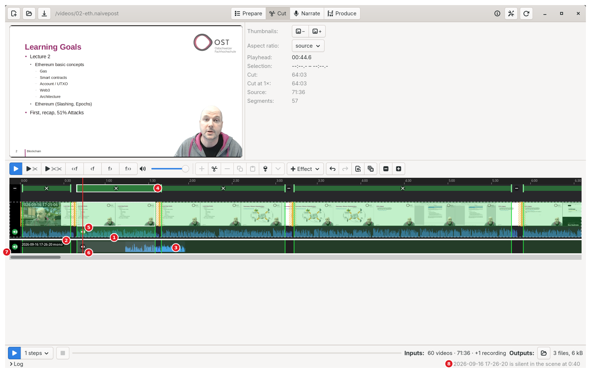

Screenshot of the prototype on the ETH lecture project, staged: the lecture has no separate recordings, so 45 s of another day's recording was added to a copy of the project as `2026-09-16 17-26-20.wav`, placing it at 1:14–1:59 on the session clock.

**1** the camera row's own sound strip · **2** the recorders' band: one lane per separate recording or extra track, name plate with the channel layout ("mono") · **3** the lane's sound over footage that has its own: both play unless a scene silences one · **4** the held scene (clip 2, picked up) · **5** its speaker badge on the camera sound: heard · **6** its speaker badge on the lane: silenced · **7** the lane's gutter switch: the lane for the whole cut · **8** status "2026-09-16 17-26-20 is silent in the scene at 0:40"

Sound overlaps whenever two sources were recording at once: a camera's own sound, a separate recording (a narrator mic, a phone, a second recorder), each extra ticked track of a multi-track file, and a second camera's sound. Each is one lane, placed by the time stamp in its name and slid by a right-drag ([F2.8](#f28-trim-and-move)). Every lane is heard by default. A scene's speaker badges decide what that scene hears; a gutter switch turns a lane off for the whole cut ([F2.10](#f210-cameras-and-hearing)). The render mixes what each scene hears, the same way ([08](08-produce.md)).

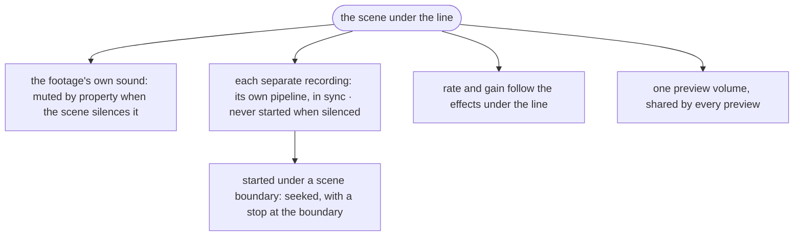

Separate recordings overlapping the footage play as their own pipelines, in sync; a lane the scene under the line silences is never started; silenced footage sound is muted by property; a lane started under a scene boundary is seeked, with a stop at it. Rate and gain follow the effects under the line. Preview volume: one number shared by every preview.

## 4. Editing flows

### F2.6 Select

<!-- back -->[← F2.5](#f25-hush-and-mix-what-the-preview-hears) · [↑ 05 Cut](#05--cut) · [all flows](11-flow-index.md#3-all-flows) · [F2.7 →](#f27-add-split-remove-)

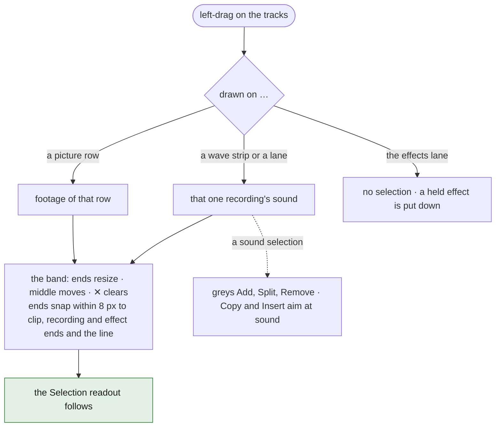

S1 Left-drag on any track area no control claims (picture row, wave strip, lane, ruler, empty part of the selection band) draws a selection scoped to what it was drawn on (that row's footage, or one recording's sound). Only the effects lane refuses: a press on empty lane puts a held effect down instead. S2 Ends resize, middle moves, ✕ clears; ends snap within 8 px to clip borders, recording ends, effect ends, the playhead. S3 In/out marks and the Selection readout follow the band. S4 A sound selection greys Add/Split/Remove and re-aims Copy and Insert at sound.

### F2.7 Add, Split, Remove, ⌦

<!-- back -->[← F2.6](#f26-select) · [↑ 05 Cut](#05--cut) · [all flows](11-flow-index.md#3-all-flows) · [F2.8 →](#f28-trim-and-move)

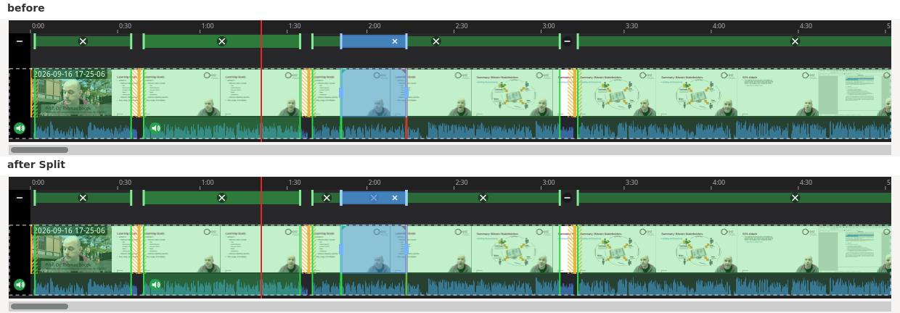

Screenshot of the prototype on the ETH lecture project. Nothing is removed; the selection stays up.

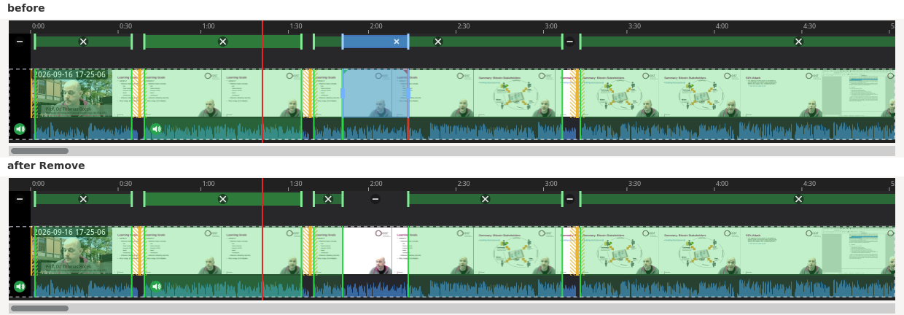

Screenshot of the prototype on the ETH lecture project. The gap gets a fold badge.

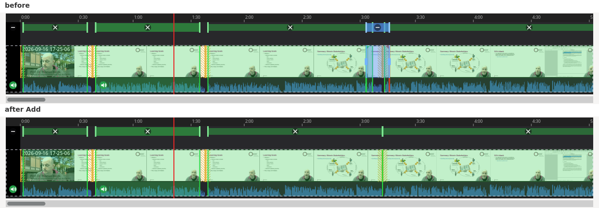

Screenshot of the prototype on the ETH lecture project. The gap at 3:05 is filled; both ends snapped.

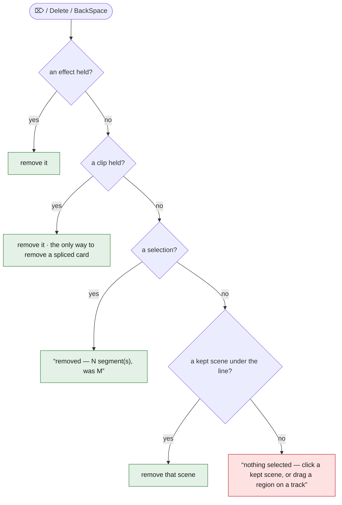

- **Add**: keep the selection as scenes (one per filmed run; under P.policy.minSceneSeconds = 1 s refused: "nothing to add: X s selected, a scene is 1 s or more"; no band: "drag a region on a track first"; sound band: "＋ Add keeps footage — the selection is <base>'s sound"); both ends snap to word edges, silences, line edges, visual cuts within 5 s; span taken off every other row. Status: "added — ↶ Undo (Ctrl+Z) takes it back" (one row), "added on <cam> — …" (more rows, nothing stolen), "added on <cam>, and taken off the other camera — …" (stolen).
- **Split**: a border at each end of the selection, nothing removed (halves ≥ 0.04 s; right half marked so coalescing does not undo it); the selection deliberately stays up; "split at <a> and <b> — N scenes, was M", naming only borders actually drawn. No selection → one border at the red line, right half taken in hand. Refusals: "| Split cuts footage — the selection is <base>'s sound", "nothing to split: the cut keeps nothing between a and b", "nothing to split at a – b", "| Split cuts at the red line — click a track to put it somewhere", "nothing to split at m:ss".
- **Remove**: drop exactly the selection — "removed X s — N scene(s), was M (↶ Undo takes it back)", or "…the scene it went through is two now…" if the count rose; remainders ≥ 0.04 s survive. Refusals: "drag a region on a track first", "－ Remove drops footage — the selection is <base>'s sound", "nothing to remove: the cut keeps nothing between a and b".
- **⌦ / Delete** (and BackSpace): in order: a held effect; a held clip (the only way to remove a spliced card; a footage clip says "removed the clip m:ss – m:ss" with the Undo tail, and the hand is empty after); a selection ("removed — N segment(s), was M", cut exactly as － Remove cuts it); the scene under the line; else "nothing selected — click a kept scene, or drag a region on a track". Each branch takes what it names out of the cut, an emptied cut included (first rewrite: every branch said "removed" and kept the cut as it was).
- **Esc**: after the copy (F2.9 S2), a held effect, an arm and an open form have had theirs, Esc puts down a held edge or clip ("the edge in hand is put down" / "the clip in hand is put down"), and with nothing in hand clears the selection ("the selection is cleared"), one layer per press (new: first rewrite: Esc left a held clip and the selection alone, against inventory §keys).
- **✕ badges**: on a green bar (drop that scene), on the selection, on a cut lane, on an empty row, on an effect.

### F2.8 Trim and move

<!-- back -->[← F2.7](#f27-add-split-remove-) · [↑ 05 Cut](#05--cut) · [all flows](11-flow-index.md#3-all-flows) · [F2.9 →](#f29-copy-paste-lane)

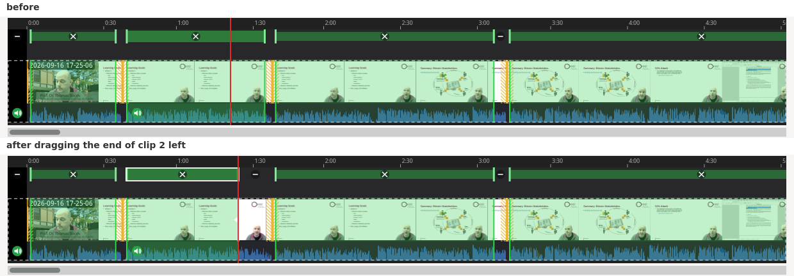

Screenshot of the prototype on the ETH lecture project. Status afterwards: “clip 2: 00:40.6 – 01:24.1 (43.5 s)”.

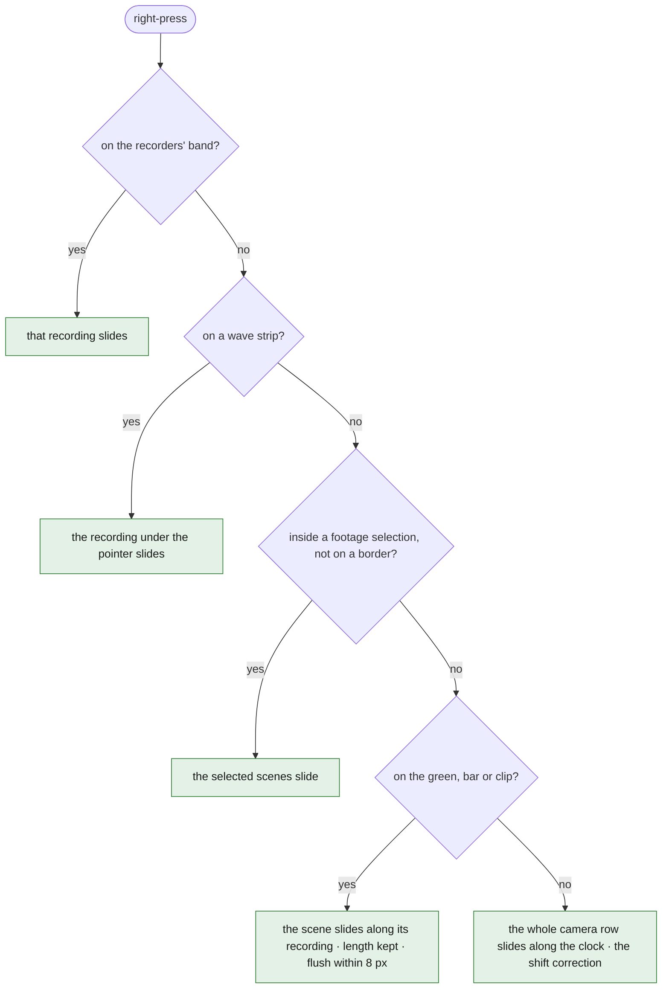

The pointer over the band shows what a press there would take, asked of the same rules the press asks: a badge (✕, fold) the pointing hand; within 6 px of a clip border on the pictures or a green bar the resize arrow; the rest of a scene's green bar the open hand (a drag moves the scene); anywhere else the page's own pointer (first rewrite: the pointer never changed, so a border could be dragged but nothing showed where). S1 Where the pointer shows a resize arrow (within 6 px of a clip border on the pictures or green bar), either button drags that border: an end not below start + 1 s, past the next clip or the recording's end; a start not above end − 1 s, below the previous clip or the recording's start; picture scrubs live (throttled); on release a neighbour within 0.04 s merges (same camera only, never an insert), the drag clears a Split border between them ("joined into one scene, a – b (X s) — ↶ Undo puts the border back"), and the picture lands on the edge ("clip N: a – b (X s)"). S2 The right button moves; what it takes, in order: recorders' band → wave strip under the pointer (that one recording) → **a footage selection the press falls inside** (the selected scenes, even over a green bar, unless on a border) → green, bar or clip (scene slides along its recording, length kept, clear of neighbours, flush within 8 px) → else the whole camera row along the clock (shift correction). Row change when the recording fits ("<what> moved to row N — its kept scenes came along"); folds near the grab open for the drag, refold after; sideways travel counts from 3 px, a vertical row change needs none; one Undo per gesture; status "<what> moved +1.23 s", or "<what> is back where it started" if it ends where it began. S3 An unmoved press is a click; a right click never moves the line. Both buttons work on the painted band itself: a left press within reach of a border takes that border at once (the selection drag and the line click stand down), a right press takes S2's answer once it has travelled 3 px, so an unmoved right click still reaches the card hold and S3 (first rewrite: trims and moves were wired only to a placeholder strip under the band, so on the band no border could be dragged and no clip moved). A scene slides by moving its own start and end; selected scenes slide together by one amount, the least any of them can travel, each fenced only by neighbours that stay put (first rewrite: the landing was worked out and said, "the scene moved +1.00 s", and dropped, so nothing moved). Every update of a hold measures its travel from the cut as the press found it, and its one Undo step redoes to where the hand let go (first rewrite: the travel was added to the last update's cut, so a drag compounded, and Redo brought back the drag's first tick).

### F2.9 Copy, Paste, Lane

<!-- back -->[← F2.8](#f28-trim-and-move) · [↑ 05 Cut](#05--cut) · [all flows](11-flow-index.md#3-all-flows) · [F2.10 →](#f210-cameras-and-hearing)

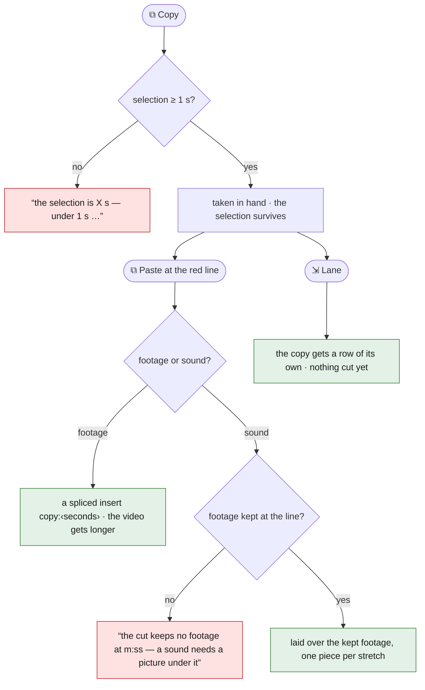

S1 Copy takes the selection in hand (≥ 1 s; "copied m:ss – m:ss (X s) — click where it goes, then ⧉ Paste"); the selection survives. S2 Paste at the red line ("click the timeline where the copy goes first"; on success "pasted X s from m:ss at m:ss — the cut is a, was b"): footage → spliced insert `copy:<seconds>` (cut opened there, those seconds play again, video gets longer); sound → laid over the kept footage at the line, one piece per kept stretch, replacing the recording it was copied from ("laid X s of <base> over the footage at m:ss", or "…over N stretches of footage at m:ss" across holes; refused: "the cut keeps no footage at m:ss — a sound needs a picture under it"). Pasting consumes the copy; Esc drops it. S3 ⇲ Lane: footage copy on its own row (a cut lane windowing the file), nothing cut yet ("X s from a is now the <name> lane, starting at b"). With nothing in hand the footage file is measured by ffprobe on a worker (new, [03 §1](03-shell.md#1-the-window)): "measuring <file> …" at once, the row filed and its sentence said when the length lands.

### F2.10 Cameras and hearing

<!-- back -->[← F2.9](#f29-copy-paste-lane) · [↑ 05 Cut](#05--cut) · [all flows](11-flow-index.md#3-all-flows) · [F2.11 →](#f211-folds-and-rows)

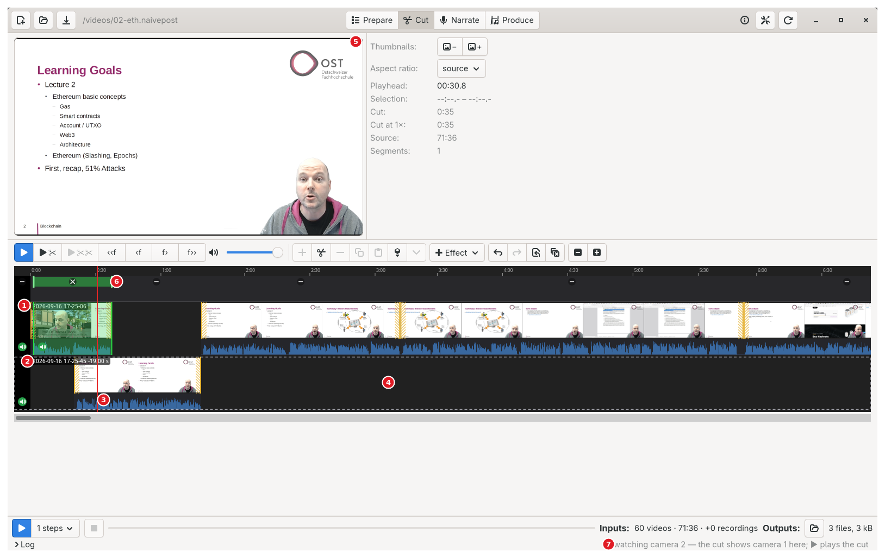

Screenshot of the prototype on the ETH lecture project, staged: the lecture has no simultaneous recordings, so the second file was shifted 19 s back in a copy of the project and the cut cleared, to show two cameras running at once.

**1** camera 1 (17-25-06, 0:00–0:37) · **2** camera 2 (17-25-45) with its shift correction "−19.00 s" in the name plate · **3** the overlap 0:20–0:37: both cameras filmed it · **4** dashed outline: the watched row · **5** the preview shows the watched row, not the cut · **6** the one kept scene, taken from camera 1 · **7** status "watching camera 2 — the cut shows camera 1 here; ▶ plays the cut"

Recordings that run at the same time (by the time stamps in their names, or after a shift) are laid out on rows by greedy interval colouring: a recording goes on the lowest-numbered row free for its whole span (row 1 at the top, each further row below the one before), so one camera's files share a row and a second camera gets its own. Overlapping time is laid out once; each row shows its own pictures and sound. A kept scene takes its picture from one row (the lens badge, S1) and hears the lanes its speaker badges allow (S2). Clips never overlap: in the staged shot, ＋ Add over the same seconds on camera 2 added nothing.

Prototype: a right-drag that slides a recording pins **every** recording to the row it is on (`rows` in `cut.json`), so a drag that creates an overlap leaves both recordings on one row, the later drawn over the earlier, and the earlier one's overlapped seconds cannot be seen or picked. The rewrite pins only the recording dragged and re-run the colouring, so an overlap made by a drag gets a row of its own, as the same overlap does when read from the file names.

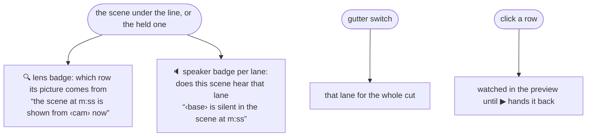

S1 Lens badge on a scene picks the row its picture comes from ("the scene at m:ss is shown from <cam> now"). S2 Speaker badges per lane on the held/current scene toggle whether that scene hears that lane ("<base> is silent in the scene at m:ss"); the gutter switch toggles a lane for the whole cut. S3 A click on a row watches it in the preview until ▶ takes the preview back to the cut; if the line is in a kept scene shown from another row, status says once "watching camera N — the cut shows camera M here; ▶ plays the cut".

### F2.11 Folds and rows

<!-- back -->[← F2.10](#f210-cameras-and-hearing) · [↑ 05 Cut](#05--cut) · [all flows](11-flow-index.md#3-all-flows) · [F2.12 →](#f212-insert-a-card-still-video-or-sound)

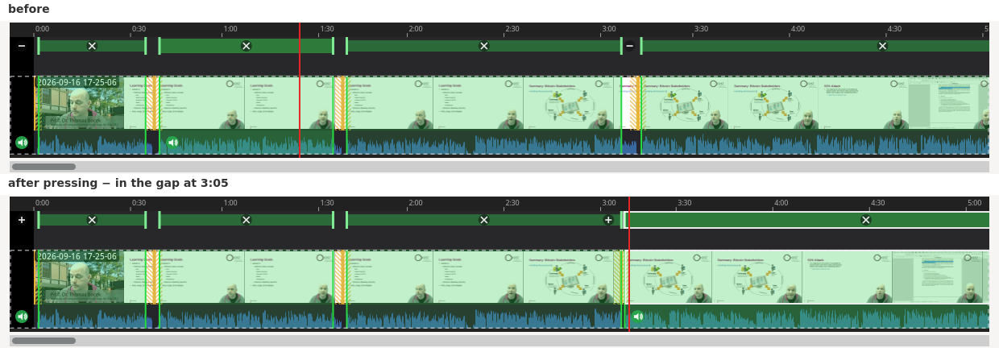

Screenshot of the prototype on the ETH lecture project. The fold is a view: nothing in the cut changes, and it is saved in cut.json.

S1 Folds cover stretches **the cut drops** (holes between kept clips; each filmed run's head and tail), not unfilmed time, which is never laid out. − in such a gap folds it to a seam; + on the seam unfolds; the gutter badge folds/unfolds all. Gaps under 20 px get no badge; badges sit just inside the neighbouring bars, not mid-gap. A fold is a view, never an edit, never used to measure a drag — but it **is** saved: `folds` in `cut.json`, written on every toggle, read back on open, no undo step. S2 An emptied bottom row stays until its ✕; a cut lane's ✕ removes the lane, its pins, shift, pictures and sound.

### F2.12 Insert a card, still, video or sound

<!-- back -->[← F2.11](#f211-folds-and-rows) · [↑ 05 Cut](#05--cut) · [all flows](11-flow-index.md#3-all-flows) · [F2.13 →](#f213-undo-redo-revert-clear)

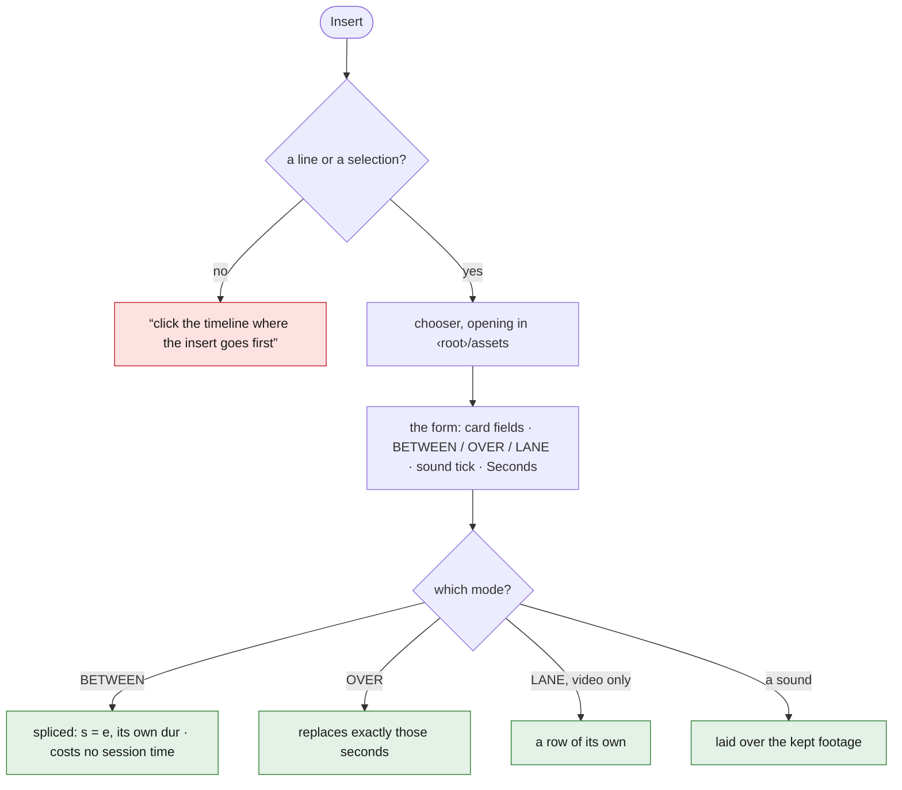

S1 Needs a line or a selection ("click the timeline where the insert goes first"). S2 Chooser "Insert a clip, image, animation or sound" (or "Insert a sound over the selected seconds" for a sound-scoped selection), opening in `assets/`, where the built-in SVG cards and `CARDS.md` are written on first use. S3 Defaults: selection → its length, overwrite; none → splice, the file's own length (video/audio duration, SVG animation length, else P.policy.insertDefaultSeconds = 4). S4 Form in the form column (right of the preview, in place of the idle readings), top to bottom: one entry per declared card field (Logo… picker for logo fields: an image chooser over the insert folder, png/jpg/jpeg/webp/gif/bmp/svg, several at once, whose picks are added to the field's comma-separated items after what was typed, each a bare path (an item that is only its logo), relative to the project when inside it and absolute otherwise, as the prototype's `pickLogos`; first rewrite: the button was drawn and wired to nothing); radios Insert BETWEEN the footage / Play OVER the footage / Put it on a LANE of its own (video only); sound tick — shown only when there is a sound to answer for (the insert's own, or seconds it lands over have one), greyed while LANE is chosen: "Play it SILENT — the insert's own sound is not used" when spliced, "Keep the sound running under it — only the picture is replaced" when over; Seconds. S5 Placed: spliced → `s == e` with `dur`; overwriting → replaces those seconds; sound → over kept footage; lane → adds a row. Status "<file> inserted at m:ss for X s, <how> — the cut is now a (was b) — ↶ Undo takes it back". S6 Right-click or double left click a card on the track to hold it; Insert becomes Edit, re-opens the form ("that card is no longer in the cut" if gone); switching modes returns or takes footage. Where it runs (new, [03 §1](03-shell.md#1-the-window)): the chosen file's two ffprobe questions (its length, whether it brings a sound) run on a worker, and the form opens when they land.
S7 Preview: cards render at 8 fps (one frame for stills) via ffmpeg, nearest rendered frame shown (the render on a worker, new: until it lands the panel keeps what it showed); a spliced card holds the footage while it plays on the wall clock; card sound is its own pipeline.

### F2.13 Undo, Redo, Revert, Clear

<!-- back -->[← F2.12](#f212-insert-a-card-still-video-or-sound) · [↑ 05 Cut](#05--cut) · [all flows](11-flow-index.md#3-all-flows) · [F2.14 →](#f214-suggest-a-cut)

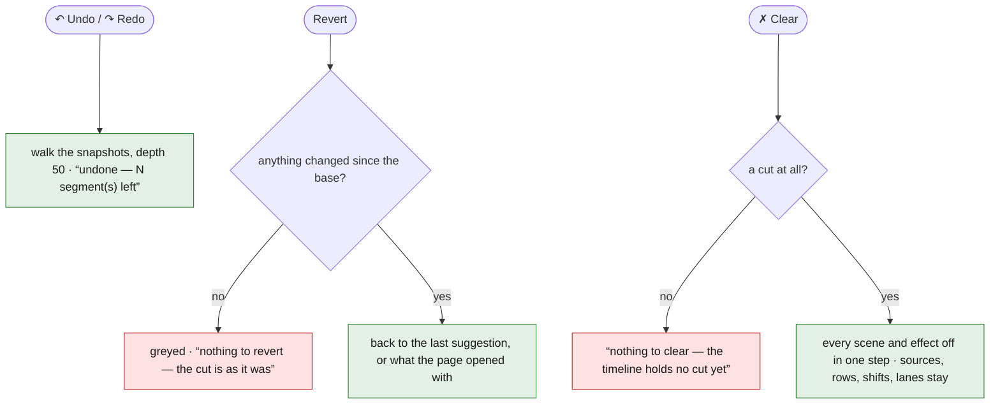

Undo/Redo walk the snapshots ("undone — N segment(s) left"); Revert restores the base ("reverted to the N segment(s) of the last suggestion (↶ Undo brings your edits back)", or "reverted — N hand-made segment(s) gone, the cut is empty" if the base is empty; greyed and refused with "nothing to revert — the cut is as it was" if nothing changed); Clear removes every scene and effect in one step ("cleared N scene(s) and M effect(s)"; before any undo step refused: "nothing to clear — the timeline holds no cut yet"; sources, rows, shifts, lanes stay).

## 5. Suggest (▶ on the run bar while the preview is not started)

### F2.14 Suggest a cut

<!-- back -->[← F2.13](#f213-undo-redo-revert-clear) · [↑ 05 Cut](#05--cut) · [all flows](11-flow-index.md#3-all-flows) · [F3.1 →](06-effects.md#f31-zoom-by-hand)

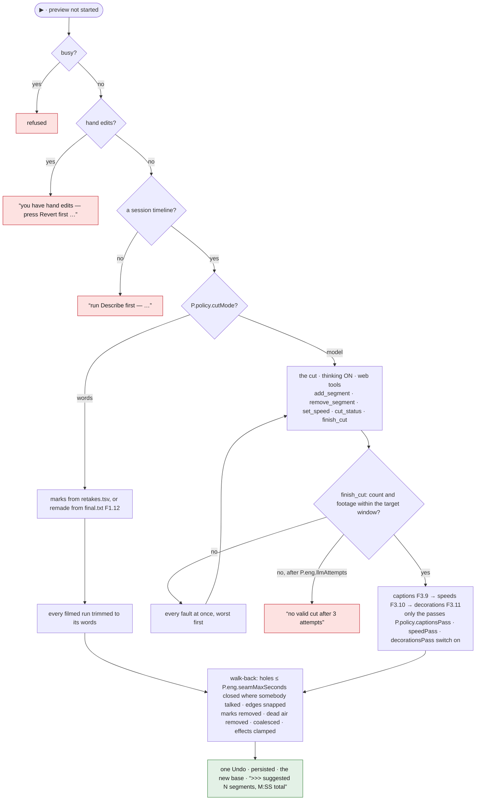

S1 Guards: busy; hand edits ("you have hand edits — press Revert first for a fresh suggestion"); no session timeline ("run Describe first — the suggestion reads the session timeline, and there is none").
A suggestion that lands is on screen at once: the band, its scrollbar, the effects lane and the timeline readings repaint as they do after ↶ (first rewrite: the cut was stored and nothing repainted, so it appeared only when the window was resized). S2a **P.policy.cutMode = words** (the prototype's Lecture): no model. "Every filmed run" is the page's tape: every footage recording under its own name, on the session clock, its words read under that name (first rewrite: the runs came from the cut on screen, named `cam<N>`, so a fresh project with no cut, and every real project, whose words are filed under the recording's name, got "cut by the words: 0 segments"; 07-news, 2026-10-26). Marks from `retakes.tsv`, or remade from `final.txt` if edited later ([F1.12](04-prepare.md#f112-hand-edit-the-text)). Cut = hand-placed inserts + every filmed run trimmed to its words (just before the first to just after the last, placed by the sound within 0.4 s, never outside the run) → marked stretches removed → dead air removed (silences over P.policy.deadAirMaxSeconds = 8 inside a clip cut, leaving P.policy.deadAirKeepSeconds = 0.5) → coalesce → persist → base. Status "cut by the words: N segments"; log ">>> cut by the words: N stretch(es) taken out, m:ss of silence, N segments, M:SS total".
S2b **P.policy.cutMode = model** (the prototype's Gaming): up to four jobs in the run, each shown in the run bar's progress and none with a button of its own — the cut, then only the passes the policy switches on (P.policy.captionsPass, speedPass, decorationsPass; a context that says "no captions, no speed changes, no effects" means those jobs are never called, not called and told to return nothing). (1) The cut: target length from P.policy.targetLengthSeconds (derived from the context by [F0.7](03-shell.md#f07-derive-the-editing-policy-new); prototype: a regex over the context); message = User Context + "SESSION LENGTH: N seconds…" + the target block ("KEEP between A and B seconds of footage, in at most K segments…" or "NO TARGET LENGTH…") + "SESSION TIMELINE:" + `session.txt`; thinking on; web tools offered (dropped after a first rejection). **Tools**: `add_segment`, `remove_segment`, `set_speed`, `finish_cut` ([`02-services.md` §3.6](02-services.md#36-cut-model-chosen)); the prototype's whole-reply checks (timestamps past the end, with the mm:ss hint; fewer than min(1 + target/30, 4) segments; more than max(target/5, 40); footage outside target × [0.6, 1.2 | 1.5] × [1, 4]) become `finish_cut`'s answer. Up to P.eng.llmAttempts = 3 rounds of correction; "no valid cut after 3 attempts". Streaming progress counts segments. (2) Captions, (3) speeds, (4) decorations: [`06-effects.md`](06-effects.md) [F3.9](06-effects.md#f39-captions-proposed-by-the-model-after-the-cut)–[F3.11](06-effects.md#f311-decorations-proposed-by-the-model). Where it runs (new, [03 §1](03-shell.md#1-the-window)): ▶ reads the page, opens the run's bar and returns; the cut's model call runs on a worker, the walked-back cut lands on the window thread when it answers, then the passes the policy switches on ask on a worker of their own, each over the cut the one before it left, and land in that order, one undo step each. ⏹ cancels the calls; the run closes with the sentence of what landed. First rewrite: the whole suggestion, minutes of model calls, inside the click with no bar open.
S3 Apply: one Undo; hand-placed inserts kept; holes ≤ P.eng.seamMaxSeconds (1.5) closed only if somebody talked in them; both edges of every segment snapped (silence midpoint 0.8, word edge 0.9, line edge 0.95, visual cut where nobody talks; within 5 s; outward preferred); marked stretches removed; dead air removed; coalesce; effects clamped to the footage kept and replaced as a list; persist; base. Log ">>> suggested N segments, M:SS total" and ">>> …and N effect(s): the speeds, the captions and the decorations".

## 6. Parameters used

Parameters ([10](10-parameters.md)): minSceneSeconds (1.0), minPieceSeconds (0.04), snapToleranceSeconds (5.0), talkPadSeconds (0.2), deadAirMaxSeconds (8), deadAirKeepSeconds (0.5), seamMaxSeconds (1.5), reviewPadSeconds (10), targetLengthSeconds (0 = none), suggestMinSegments/maxSegments formulas, footageWindow factors, maxSpeedRate (4), insertDefaultSeconds (4), captionBatch (5). P.preview: playTick 100 ms, preloadLead 3 s, rateSeekGap 250 ms, thumb batch 6, card fps 8. Engineering: pixel reaches (6, 8, 10, 12 px), band heights, colours, zoom limits, undo depth, waveform cache format.

## 7. Rules

- One thing held at a time; picking up is not an edit; one Undo per drag; an unmoved press is a click.
- A border belongs to both buttons; moving is the right button's verb; a selection is of what it was drawn on.
- Unfilmed time has no width; the seam second belongs to the later take; preview and render agree on half-open ranges.
- Inserts are files: never trimmed, merged, dropped by a re-suggest or given a hearing answer; a spliced insert costs no session time.
- A clip may not leave its recording; clips never overlap; Remove takes exactly the selection.
- Suggest replaces the footage half and the effects, keeps inserts, and sets the base; every model reply is walked back onto the timeline.
- `cut.json` is written by one function; its existence unlocks Narrate and Produce.
- Nothing decodes inside a draw; the tracks are a window drawn under a translate (by the same scroll a press and the playhead subtract; the gutter and the row plates stay pinned); the page is rebuilt only when Prepare's output changed.

## 8. Details confirmed against the code (verification pass)

- **Refusals** (normative strings, full list in [`inventory/cut.md`](inventory/cut.md) §E): Copy "select a stretch of the pictures or of a lane first — ⧉ Copy takes the selection in hand" / "the selection is X s — under 1 s there is nothing worth copying"; sound copy "copied X s of <lane> (a – b) — click where it goes, then ⧉ Paste"; Lane "click the timeline where the new lane starts first" / "nothing is rolling at m:ss any more" / "that copy is too short to be a lane of its own"; Paste "<base> is not in the session any more — the copied sound has nowhere to come from"; ⌦ "⌦ drops footage — the selection is <base>'s sound" / "the playhead is not on a kept scene — click a green one, or drag a region". A sound copy starting before its recording is read from the lane's first second; a paste with nowhere to go leaves the copy in hand.
- **Preview sound**: each change of the footage's own mute logs one line naming the reason (">>> preview: the footage's own sound is heard again" / "… is muted -- a card or a stop stands over the picture" / "… is muted -- the scene under the line does not hear it"); gain and mute go to an app-owned element, never the player's per-application stream volume (the sound server remembers it between runs), which is reset to full once at build; a failing pipeline says so ("!!! <page>: playback failed — <reason>", status "<page> would not play — see log"; a mix lane "!!! preview: <base> will not play — …").
- **Suggest**: thinking on for the first attempt, off after an all-reasoning reply (">>> suggest: the model spent the whole call thinking and wrote nothing — asking again with thinking off"); web tools withdrawn on the first rejection (">>> suggest: asking again without the web tools"); progress "N moments, at m:ss of m:ss" placed by the last closed segment's end, never below 0.02 nor backwards, pulsing under "thinking over the whole session" until the first segment closes; segments with no recording at either end dropped before the length is judged (">>> suggest attempt N: M segment(s) dropped for having no footage"); the checks answer with every fault at once, worst first, joined by "; ", and the past-the-end fault shows the conversion on the model's own number ("2804 is not a second: a stamp [28:04] is mm*60+ss, 1684"); a `speed`/`rate` on a segment is a speed effect over it, exempt from any decorations cap. Streamed progress everywhere = objects closed inside the text's last `"<key>": [` (braces inside strings ignored) and the last closed object's `end`.

<!-- nav -->
---
[← 04 Prepare](04-prepare.md) · [↑ top](#05--cut) · [↑ Contents](README.md) · [06 Effects →](06-effects.md)
<!-- /nav -->
