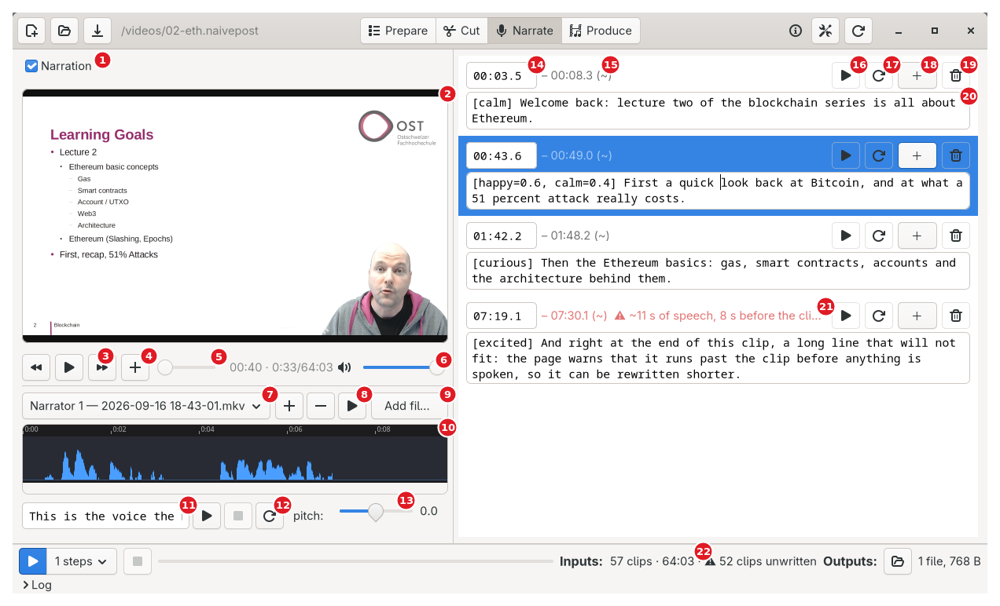
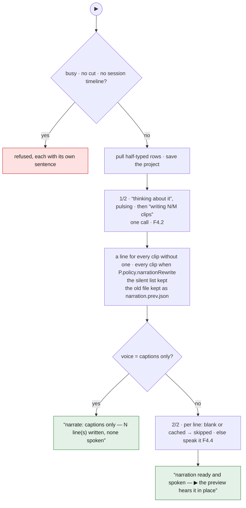
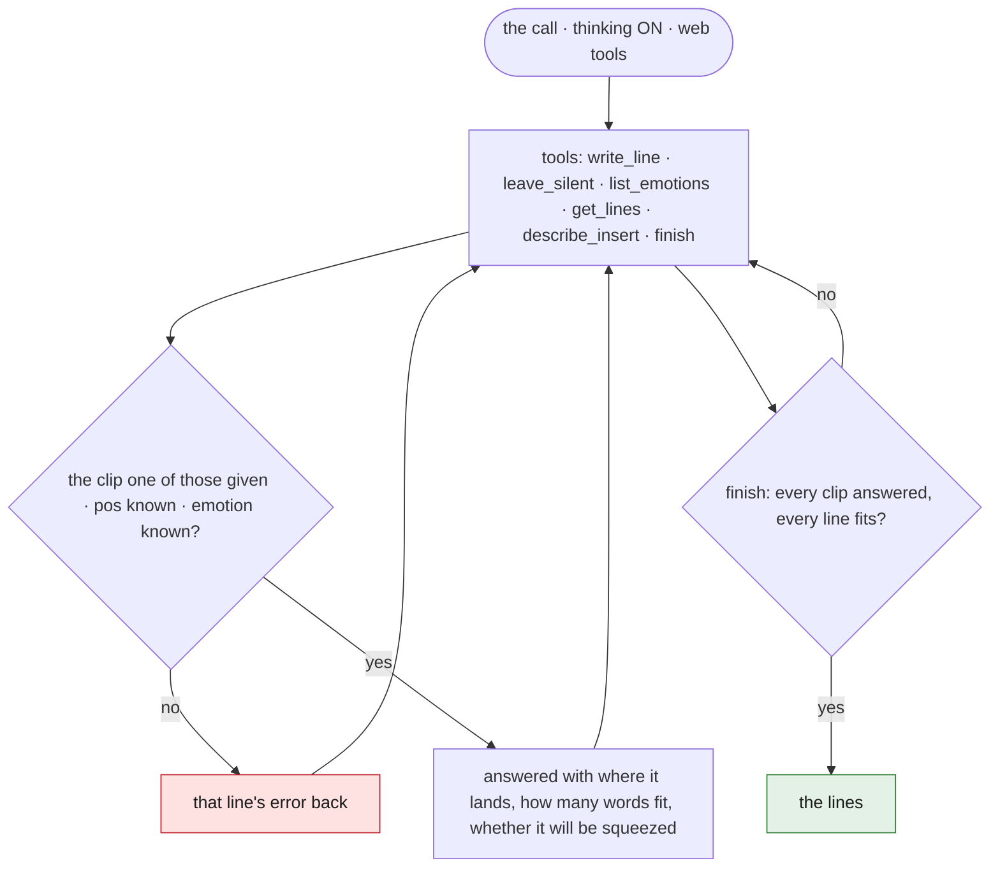
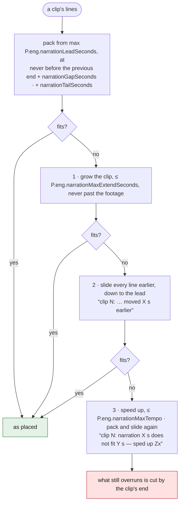
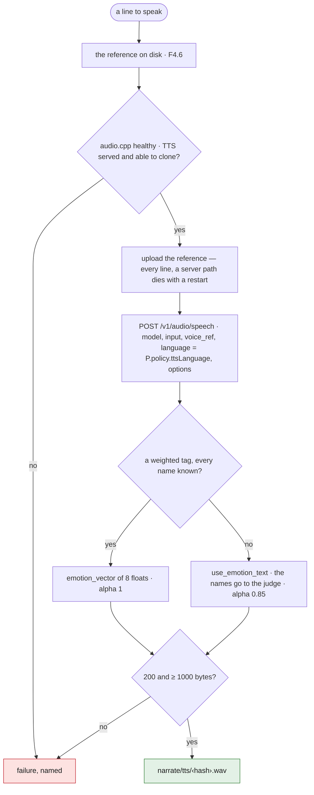
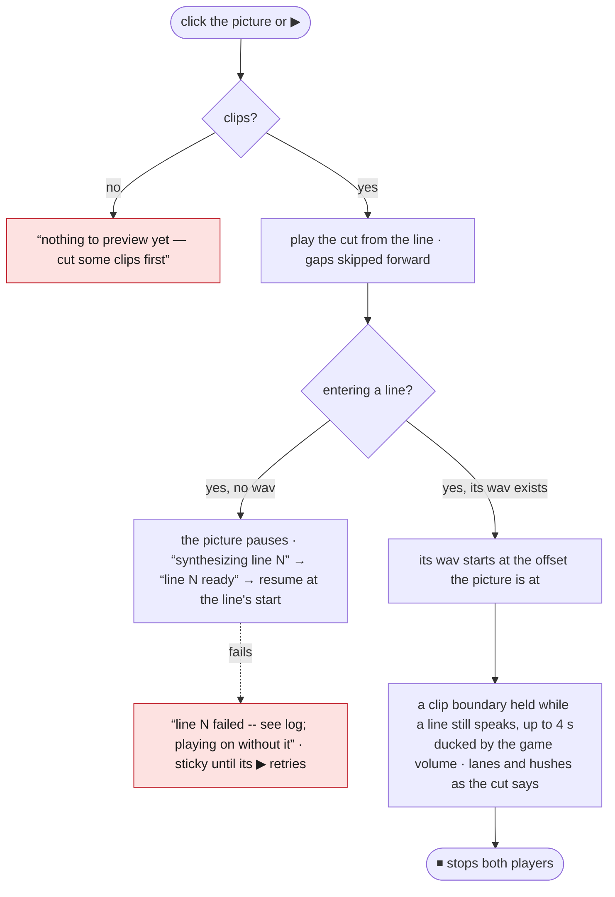
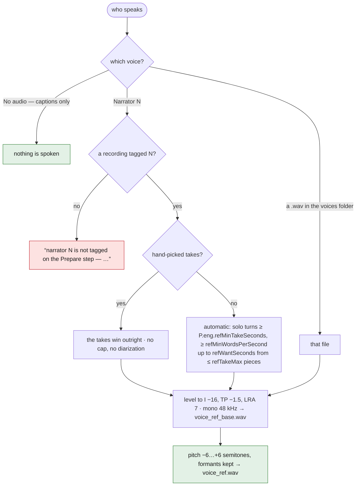
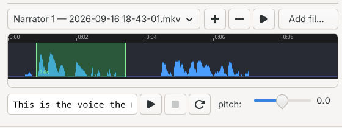
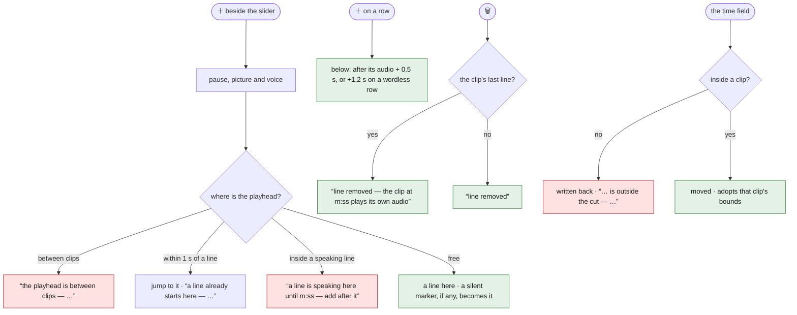

# 07 — Narrate

<!-- nav -->
[← 06 Effects](06-effects.md) · [↑ Contents](README.md) · [08 Produce →](08-produce.md)

**Flows:** [F4.1](#f41--write-and-speak) · [F4.2](#f42-the-narration-call) · [F4.3](#f43-fit-a-line-to-its-clip-the-renders-rule-mirrored-by-the-row-warnings) · [F4.4](#f44-speak-a-line-tts) · [F4.5](#f45-preview-the-cut-with-narration) · [F4.6](#f46-choose-the-voice-and-build-the-reference) · [F4.7](#f47-edit-lines)
<!-- /nav -->

One editable line per clip: what is said, in which voice, with what emotion. ▶ writes and speaks the lines. There is no narration switch: the page is always live, and a video has a narration exactly when its narration has lines with words (first rewrite: a Narration tick that greyed the page).

## 1. Screen



<sub>Screenshot of the prototype on a copy of the ETH lecture project. The project has narration off, so these four lines were written into the copy for the shot; their times, the “(~)” estimates and the warning are the app's own.</sub>

**1** Game audio (prototype and first rewrite: the Narration tick) · **2** preview · **3** back 3 s · ▶ · forward 3 s · **4** ＋ a line at the playhead · **5** slider over the cut, clock “session · cut/length” · **6** volume · **7** who speaks · **8** take ＋ − ▶ · **9** Add file… · **10** take band · **11** sample sentence · **12** sample ▶ ⏹ ⟳ · **13** pitch · **14** time field · **15** end time, “(~)” while estimated · **16** ▶ speak this line · **17** ↻ re-roll · **18** ＋ a line below · **19** 🗑 remove · **20** “[emotion] words” · **21** the fit warning · **22** Inputs readout

Prototype: the row's ＋ is the full-width sign U+FF0B, which only CJK fonts carry; on a machine without one it draws as a missing-glyph box. The rewrite uses the list-add icon.

- **Page**: split left and right by a draggable divider (opened with the left column 560 px wide; extra window width goes to the right). Left column, split top and bottom by a second draggable divider (opened with the upper part 420 px tall): above it, top to bottom, the game audio row, the preview, the transport row; below it, the voice picker. The transport row and the voice row each keep a gap of page (8 px) between themselves and the divider's line (first rewrite: both sat on the line, buttons glued to it from either side). Right column: the lines column.
- **Opening**: the page is the opened project's: its cut (clips, length, the clock's "/length"), its lines, its voice (the saved one; with none saved, the narrator Prepare tagged; with neither, the picker stays empty), the pitch and the takes. A project opened after another starts on its own, never on the previous one's lines or voice (the first rewrite filled the page only in tests, so a live page read "00:00/00:00" and "the playhead is between clips" over a project with a cut).
- **Game audio** (new here): the column's top line, at its right end, "Game audio:" with a slider 0..1 (step 0.02, default 0.22, tooltip "how loud the original game audio sits under the narration"): the level the recording plays at under a spoken line, in the preview and in the render. Stored with the encoder settings (`produce.game_volume`, which both read); always shown (first rewrite: greyed with narration off), and greyed with "Set by the profile ‹name› — change it in Profiles" when the project's profile sets it. Prototype and first rewrite: a row among Produce's encoder settings.
- **No narration switch** (new): nothing on the page switches the narration off. A video is narrated when its narration has lines with words; the render speaks those and nothing else (a narration with none renders without a voice), and Produce's Inputs says "no narration" for it. Nothing greys for it. An older project's `no_narration` is ignored. Prototype and first rewrite: a **Narration tick** ("Whether this video has a narration. Unticked, ▶ writes none, the lines already written are left alone, and Produce drops the game-volume slider…") whose off state greyed the lines, the preview and the voice picker, hid the game audio slider, refused ▶ and rendered without lines.
- **Preview**: finished frame (crop, zoom, stops, titles), narration mixed over the cut's sound; click = play/pause. The picture plays IN the page, through the same built-in player as Cut's F2.1 S5 (a `playbin` into the GTK4 sink, the prototype's `NewPlayer`): the recording under the line, at that recording's own second; paused or between plays it shows the frame under the line. A picture program named in Settings (`PICTURE_PLAYER`) or `NAIVEPOST_PICTURE_PLAYER` plays in a process of its own instead. Every voice the page plays (a line, the preview's voice, a sample, the take band's stretches) plays on the voice player (`VOICE_PLAYER`, `NAIVEPOST_VOICE_PLAYER`, else `gst-play-1.0`), spoken to in its own flags (new): `gst-play-1.0` gets `--no-position --no-interactive --videosink=fakesink --volume=<gain> -s <from> <file>` and, having no duration flag, a take band stretch on it is ended by the band's own clock at the stretch's end; ffplay gets `-nodisp -autoexit -loglevel quiet -volume <0-100> -ss <from> [-t <length>] -i <file>`. First rewrite: ffplay's flags went to the default `gst-play-1.0`, which refused them ("Unknown option -nodisp"), so a sample and the take band made no sound, and a line's `start=… gain=…` was read as two more file names, so a line always played from its top at full level. The preview's picture is looked for again whenever what it depends on lands: the session's recordings (at open the page holds stand-ins the cut implies, which have no frames), a frame folder's listing, a decoded still; a second with no still shows the dark plate and is looked for again on the next tick or seek, never held as the answer; and the player's frames are put up when ▶ starts it whatever the plate showed before (first rewrite: the one look at open found nothing and was held for good, and "nothing found" was spelled like "the player's frames are up", so the preview was black at rest and while playing). The tick reads the player's second and a jump of the line (a gap skipped, a seek) is sought in it, so line, clock and picture never drift; the clock and slider follow the line whether it moves by play, by a seek or by a row. The clock's middle field is where the line's second falls in the finished video, worked out from the cut's clips at every paint (in a removed stretch: the kept length before it), never kept as a number of its own (first rewrite: a second number walked only by the tick and the 3 s buttons, so after a row's cue, a slider drag or a wheel notch it read `00:12 · 00:00/00:20` at 12 s on a cut kept whole; and a row's cue repainted neither the clock nor the slider). Transport (one row under the preview, left to right): back 3 s, ▶/⏸ (⏸ while the preview plays, the same answer the run bar gives; sized for both faces, so the swap never moves the row), forward 3 s, ＋ new line at this second, slider on the cut's own clock ("what the edit removed is not on this bar…"; paused, wheel steps a frame), clock "session · cut/length", shared volume.
- **Lines column**: one row per entry, top to bottom, sorted by clip then offset. Row: a header line, left to right: time entry (mm:ss.s, session clock; typing moves within the clip; Enter/leave may move it to another clip; a time in a gap is refused and written back), status ("– end time", "(~)" while estimated, "(no line — this clip plays on its own audio)", "(caption — the viewer reads it; never spoken)", warnings "⚠ ~N s of speech, M s before the clip ends|the next line" and "⚠ this clip's lines run N s past it — the render will have them moved earlier[ and sped up]"), then at the header line's right end: ▶ speak this line — audition from 3 s ahead where those seconds are its own, then continue down the cut; five other cases, each in its own words: a press while speaking pauses; a wordless row "clip N has no line — playing it on its own audio" / "…and no recording covers it"; a caption "line N is a caption — read, never spoken; playing its moment" / "…and no recording covers its clip"; a synthesis in flight "still speaking line N for the first time — ⏹ gives up on it". A clip no recording covers speaks alone off the tick ("synthesizing… (first line after a cold start also loads the model)", then "entry N — no recording covers this clip, so the line plays on its own", failure "synthesis failed — see log"), ↻ re-roll (new take, same words), ＋ add a line below, 🗑 remove (clip plays its own audio). Under the header line, the row's full width: the text box, `[emotion] words`, `[top|center|bottom] words` for captions; may carry the line's second in the tag as `@N` (`[excited @65] Weee` moves the line, clamped out of the clip's last second) — write-only: the time field owns the number, the box never prints it back. Tooltip explains the tag, judge vs weighted mixes, the eight base emotions.
- **Voice picker**: three rows, top to bottom. Narrator 1's id is `own` (inventory voice ids, frozen; a `narrator1` the first rewrite wrote reads as the same voice and keys the same takes), and every part of the page asks one rule which slot an id names: the first rewrite had two, and the band's did not know `own`, so a project with no `voice.txt` showed Narrator 1 in the picker and hid the take band the sample is cut from. First row, left to right: unlabelled dropdown, tooltip "Who speaks the narration…" (No audio — captions only; Narrator 1, and 2..4 when a recording is tagged with them, each "Narrator N — everything they say in the cut"; every .wav in the voices folder); the take band's ＋ − ▶; "Add file…" (copies a recording into the voices folder). Second row: the **Take band** (narrator slot with a recording only): everything that narrator says in the cut, end to end — the stretches of EVERY recording tagged with that narrator that the cut keeps (the Cut page's green bars, on the camera row each clip shows), in the cut's order; a voices-folder file, or a narrator recording no kept clip shows, is that file whole (first rewrite: the first tagged recording alone, whole, so a narrator filmed in nineteen files was offered half a minute). A take is stored in the seconds of the recording it lies in, under that recording's name, and shows on the band where that second is kept; a take dragged across a seam is one take in each recording; picks outside what the cut keeps stay stored, unseen, and come back when the cut keeps them again. When the band's stretches change (another voice, the session's recordings measured, the cut edited) its takes are read again from `takes.json`. The band's waveform ("reading the recording…" while the envelope decodes); red ▶-start bar, drawn through the ruler too; faint red bar under the pointer; blue live selection; playhead while ▶ walks; each take shaded, labelled with its duration alone ("4.2s") when wider than 34 px; the ruler on the Cut page's tick ladder (the first of 0.2, 0.5, 1, 2, 5, 10, 30, 60, 120, 300, 600 s at least 70 px apart at this zoom), every tick labelled `mm:ss` (first rewrite: a tick every 30 s at any zoom, so a recording under half a minute had a bare ruler and zooming in added no mark); own scrollbar once the wheel zooms past fit: the band keeps its place and width in the page and the window keeps its size, zoomed in the lane is the whole recording at that zoom and the band shows one view of it, the wheel keeping the second under the pointer where it is (the first rewrite gave the scroller the zoomed width as its minimum, so every notch widened the window); Shift+wheel moves the scrollbar. Everything on the band (ruler, wave, takes, red bar, playhead) is in the band's own seconds, mapped to each recording's seconds stretch by stretch, every length probed once per file; a built voice reference is not what the band shows (the first rewrite took the ruler's length from it, so the red bar and ▶ meant different seconds). Drag selects; ＋ makes a take (≥ 0.4 s); − takes seconds back out (splitting takes); click sets the red bar; ▶ plays the recordings' own seconds from the bar, take by take, each piece from the recording it lies in (prototype `takeQueue`): a bar inside a take plays from the bar to that take's end, then each later take whole; with no take after the bar, the recording from the bar to its end ("playing the recording from m:ss — nothing is picked after it"); the red bar stays where it was put (it is where ▶ starts) and a white playhead walks with what sounds, jumping over what is not picked; ▶ wears ⏹ while it plays, a second press stops ("stopped playing the takes"), the last take's end says "takes played" (the first rewrite played the built reference, which does not exist before a line is spoken, so ▶ did nothing); wheel zooms; Shift+wheel pans; one mouse notch is one zoom step (×1.25 in, ÷1.25 out, GTK's dy of ±1; first rewrite: dy was divided by 50 as if it were pixels, so a notch zoomed by 0.4 % and the wheel seemed to do nothing), and Shift+wheel pans an eighth of the view the way the wheel turned (first rewrite: always toward the start); "With no takes the seconds are chosen for you." Third row, left to right: Sample: an entry (default "This is the voice the narration will be spoken in. It should stay clear and easy to follow for a couple of minutes."), ▶ speaks it, ⏹, ⟳ new take; pitch −6..+6 semitones on a slider at least 140 px wide (about 12 px a semitone; the first rewrite's was 34 px, a knob with no track) ("Shift the reference recording before it is cloned — a different speaker, not the same one transposed"), applied 400 ms after the last move.
- Inputs: "N clip(s) · mm:ss\[ · ⚠ N clip(s) unwritten, N line(s) off the cut]\[ · no timeline]"; "no cut yet — build one on the Cut step". Outputs: "narrate/ — narration.json, the voice reference and the synthesis cache".

## 2. Flows

### F4.1 ▶ Write and speak

<sub><!-- back -->[← F3.12](06-effects.md#f312-clamp-to-the-cut-as-applied) · [↑ 07 Narrate](#07--narrate) · [all flows](11-flow-index.md#3-all-flows) · [F4.2 →](#f42-the-narration-call)</sub>



S1 Refuse: busy; no cut ("no cut yet — build one on the Cut step first"); no session timeline ("run Transcript first — no session timeline"). S2 Pull half-typed rows; keep the previous file as `narration.prev.json`. S3 Save the project; job "narration" 1/2 — bar opens at "thinking about it", pulses every 150 ms until the first clip closes, then "writing N/M clips" as they stream; log ">>> narrate: <why> — writing N clip(s), one LLM call, then speaking them" where <why> is the staleness reason ("there is no narration yet" / "clip N has no narration — it is new, or the cut moved under it" / "the narration has lines for clips the cut no longer has") or "rewriting every line"; one model call ([F4.2](#f42-the-narration-call)). S4 Write a line for every clip without one, and for every clip when P.policy.narrationRewrite is on (prototype: always rewrote every line, though the Readme promised only the missing ones); keep the silent list — it holds the user's own "this clip plays its own audio" decisions (prototype: wiped it every run) ([`12-decisions.md` §3](12-decisions.md#3-where-the-prototype-overrules-the-model--and-where-that-decision-moves)); save; rebuild (the page's rows show the written lines the moment they land, not on the next visit; first rewrite: the window's held narration was updated and the rows were not, so ▶ looked as if it wrote nothing until the page was rebuilt); ">>> narration written for N clips"; "narration written — speaking it". S5 Captions-only voice → done ("narrate: captions only — N line(s) written, none spoken"). S6 Job "speaking" 2/2, one task per line: checkpoint; skip blank text or a cached wav; else synthesize ([F4.4](#f44-speak-a-line-tts)). "    narrate: N line(s) spoken, M already in the cache" — four-space indent, not `>>> `. S7 Done: status "narration ready and spoken — ▶ the preview hears it in place" / "narration ready — captions only, nothing spoken" / "<stage> stopped" / "<stage> failed — see log". (Prototype bug: written to the progress bar's hidden text, never shown; they belong on the status line.) Where it runs (new, [03 §1](03-shell.md#1-the-window)): S1 to S3 on the window thread (they read the page and paint the bar); the call, the save and the speaking pass on the run's worker, the stages, the written count and "speaking" landing as they happen. ▶ comes back at once, the bar stays open with ⏸ and ⏹ until the worker answers, and ⏹ reaches the call between two clips and the speaking pass between two lines. First rewrite: the whole pass inside the ▶ handler, so ⏹ could not be pressed while it ran.

### F4.2 The narration call

<sub><!-- back -->[← F4.1](#f41--write-and-speak) · [↑ 07 Narrate](#07--narrate) · [all flows](11-flow-index.md#3-all-flows) · [F4.3 →](#f43-fit-a-line-to-its-clip-the-renders-rule-mirrored-by-the-row-warnings)</sub>

```text
SYSTEM  house rules + the "narrate" prompt
        + the speech addendum, when the clips play what people said out loud
        + the captions addendum, for a captions-only voice
USER    User Context (+ the speech rule)
        THE CLIPS AND WHAT IS KNOWN ABOUT EACH:
        CLIP 7: 3:20–3:38 (18 s of footage at 2x, 9 s on screen, at most 13 words -- fewer is better, none is fine)
          [+0.4s] NARRATOR: …        lines within ±P.machine.narrationContextSeconds
          [+6.1s] EVENT: …
          [+2.0s] MARKED: boss fight   [+4.0s] CAPTION: …
        CLIP 8: an insert — "not footage: a graphic or clip inserted here … Narrate what is ON it, or say nothing"
```



System = house rules + the "narrate" prompt (+ speech addendum when the clips play what people said out loud: "THIS VIDEO PLAYS WHAT PEOPLE SAID OUT LOUD… never say one back: set it up before it lands, or react after it"; + captions addendum for a captions-only voice: write for the eye, emotion "", every entry has a placement). User = User Context (+ the speech rule) + "THE CLIPS AND WHAT IS KNOWN ABOUT EACH:" + per clip "CLIP n: a–b (X s[ of footage at Rx, Y s on screen], at most W words -- fewer is better, none is fine)" with its lines within ±4 s as "[+Ns] LABEL: text" (narrator's mic as NARRATOR; "(no lines over this clip: nothing said, nothing described)"), inserts described ("not footage: a graphic or clip inserted here … Narrate what is ON it, or say nothing"), effects as "[+Ns] MARKED: name" / "[+Ns] CAPTION: text". Word ceiling per clip = clamp(0.75 · seconds, P.policy.narrationMinWords 8, P.policy.narrationMaxWords 30). Thinking on; web tools offered. **Tools**: `write_line(clip, at, text, emotion, pos?)`, `leave_silent(clip)`, `finish` ([`02-services.md` §3.8](02-services.md#38-narration)). Tool validation: clip must be one given; `at` clamped inside the clip, never its last second; `pos` normalised. Prototype: `{"entries":[{start,end,at,text,emotion}]}` matched to clips by echoed bounds within 0.5 s scanning forward, three attempts, thinking off after a call that wrote nothing. Streaming progress = written clips / clips. Never served from the reply cache (the TTS cache is the cache).

### F4.3 Fit a line to its clip (the render's rule, mirrored by the row warnings)

<sub><!-- back -->[← F4.2](#f42-the-narration-call) · [↑ 07 Narrate](#07--narrate) · [all flows](11-flow-index.md#3-all-flows) · [F4.4 →](#f44-speak-a-line-tts)</sub>



Lines pack in order from max(P.eng.narrationLeadSeconds 0.3, at), never before the previous line's end + P.eng.narrationGapSeconds (0.3); need = packed end + P.eng.narrationTailSeconds (0.2). Over the clip: grow it by up to P.eng.narrationMaxExtendSeconds (4 s), never past the footage; still over: slide every line earlier, down to the lead; still over: speed up to P.eng.narrationMaxTempo (1.25×), then pack and slide earlier once more at the new tempo; only then log. Each step logged ("clip N: the narration does not fit where it was placed — moved X s earlier" / "clip N: narration X s does not fit Y s — sped up Zx"). Speech length = the wav's duration if it exists, else — **on the Narrate page only** — characters / the narration's own measured rate (default 15 chars/s, clamped 8..28). In the render a line with no synthesis has length 0, takes no room; its cue is held to the next line or the clip's end.

### F4.4 Speak a line (TTS)

<sub><!-- back -->[← F4.3](#f43-fit-a-line-to-its-clip-the-renders-rule-mirrored-by-the-row-warnings) · [↑ 07 Narrate](#07--narrate) · [all flows](11-flow-index.md#3-all-flows) · [F4.5 →](#f45-preview-the-cut-with-narration)</sub>



S1 Reference on disk ([F4.6](#f46-choose-the-voice-and-build-the-reference)). S2 Audio server health; TTS model served and able to clone. S3 Upload the reference every line (a server path dies with a restart). S4 POST /v1/audio/speech `{model, input: text, voice_ref: <server path>, language: "en", options: {emotion_alpha "0.85", seed, and either emotion_vector "<8 floats>" with emotion_alpha "1" (a weighted tag whose names are all known) or use_emotion_text "true" + emotion_text "<names>" (the judge)}}`. `language` = P.policy.ttsLanguage, which is P.policy.language (prototype: hard-coded "en"). S5 Reply under 1000 bytes or non-200 = failure; else write `narrate/tts/<hash>.wav`. S6 Emotion vocabulary: eight bases (happy, angry, sad, afraid, disgusted, melancholic, surprised, calm) with kin words, 21 named blends as recipes over the bases; weights 0..1; unknown names go to the judge as words; never an error. Where it runs (new, [03 §1](03-shell.md#1-the-window)): a row's ▶ or ↻ with no take on disk dials on a worker; the status line says "speaking line N… ⏹ gives up on it" and the page is busy (another row's ▶ says "still speaking line N for the first time — ⏹ gives up on it") until the take lands and plays from its lead-in. ⏹ on the preview gives up on it: the take is filed when it lands and not played. A take already on disk plays at once.

### F4.5 Preview the cut with narration

<sub><!-- back -->[← F4.4](#f44-speak-a-line-tts) · [↑ 07 Narrate](#07--narrate) · [all flows](11-flow-index.md#3-all-flows) · [F4.6 →](#f46-choose-the-voice-and-build-the-reference)</sub>



S1 Click the picture or ▶: play from the line, else the cut's start ("nothing to preview yet — cut some clips first"; "no recording covers the start of the cut" when the cue lands on nothing). S2 The tick follows the picture; gaps skipped forward (past the last clip → pause); a clip boundary held while a line still speaks, up to 4 s; entering a line starts its wav at the picture's offset; a line with no wav pauses the picture, synthesizes ("synthesizing line N" / "line N ready"), resumes at the line's start; a line failing while the picture waits sets "line N failed -- see log; playing on without it" and resumes where the picture froze, not at the line's start; a failed line is sticky per wav until its own ▶ retries it ("line N failed to synthesize — see log; its ▶ retries"), which first clears the failure. S3 Sound equals the render's: whole clip ducked by the game volume while a line speaks; lanes and hushes follow the cut; speed effects apply at seeks. S4 Seeks snap to the cut (gap target → previous clip's end going back, next clip's start going forward). S5 While playing, row selection follows the playhead; selecting a row seeks to its line's lead-in (3 s ahead unless the previous line still speaks there); only a person's selection seeks: the rows are rebuilt on every repaint with the selected line and the keyboard focus carried over, and a selection the rebuild makes by itself moves nothing (first rewrite: GTK selected the first row when the focused one was rebuilt, so after a click on a line every frame step or seek threw the preview back to the first line's lead-in). S6 ⏹ stops both players, hands ▶ back to the step; it is live while the preview plays or is held (every change of the preview's transport repaints the run bar; first rewrite: it stayed grey, so a playing preview could not be stopped from the bar). Where it runs (new, [03 §1](03-shell.md#1-the-window)): S2's dial for a missing take goes to a worker, once per line; the tick keeps beating with the picture paused on the wait and the status line saying the line is being synthesized, and the take, or its refusal, is picked up when it lands. A take landing after the preview stopped or moved on is only filed.

### F4.6 Choose the voice and build the reference

<sub><!-- back -->[← F4.5](#f45-preview-the-cut-with-narration) · [↑ 07 Narrate](#07--narrate) · [all flows](11-flow-index.md#3-all-flows) · [F4.7 →](#f47-edit-lines)</sub>





<sub>Screenshot of the prototype on the ETH lecture project.</sub> Drag across the wave, press ＋: a 2.6 s take, the status says “take added: 0:00–0:03 — 1 take(s), 2.6 s of reference (14 s is plenty)”.

S1 Pick a voice: captions only (nothing spoken); Narrator N (recording tagged on Prepare; "narrator N is not tagged on the Prepare step — tag a recording, or pick another voice"); a voices-folder file ("voice X is no longer in DIR — pick another"). Switching keeps what was synthesized (cache key carries the voice) and reports the switch: "no audio — the narration is written and timed, never spoken" / "voice: narrator N's — it is re-cut from the recording on the next line spoken" / "voice: <name> — ▶ beside the sample plays it" / "could not install that voice — see log". S2 Reference: hand-picked takes win outright (no cap, no diarization needed), the takes of every recording tagged with the narrator, recordings oldest first, each piece cut from the recording it lies in (first rewrite: only the one recording the build was handed, so picks made in the others were left out of the voice); else automatic from diarization turns and transcript: takes ≥ P.eng.refMinTakeSeconds (5), ≥ 2 s from other speakers, ≥ 1.5 words/s, up to P.machine.refWantSeconds (14) from ≤ 3 pieces; errors "nothing is tagged as narrator N on the Prepare step", "no diarization for X -- run Prepare, or pick the seconds by hand under the video", "no clean solo stretch found for the voice reference". S3 Level to −16 LUFS / −1.5 dBTP / LRA 7, mono 48 kHz pcm → `voice_ref_base.wav`; pitch-shift (rubberband, formants preserved) → `voice_ref.wav`. A wav header the server cannot read (extensible format, > 48 kHz) is logged ("voice reference <file> is not a wav the server reads -- cutting it again") and re-cut; a project with `voice_ref.wav` but no `voice_ref_base.wav` renames the former to the base. S4 Takes: ＋ on a selection ≥ 0.4 s ("take added: a–b"; "that is X s — a take has to be at least 0.4 s"), − subtracts seconds (splitting takes), ▶ walks takes from the red bar; takes sorted, merged when touching; changing takes, pitch or voice removes the shifted reference (and the base where needed). S5 Sample: speak the entry text in the voice (cached per voice and text; "sample in <voice>"; ⟳ = new take). Where it runs (new, [03 §1](03-shell.md#1-the-window)): the sample's ▶ and ⟳ synthesize on a worker ("synthesizing the sample…" until it lands; another press says "still synthesizing the last sample…"); sample ⏹ gives up on it, and a take landing after it is stopped at once. "Add file…" converts on a worker ("copying <file> into the voices folder…") and offers the voice when the copy lands.

### F4.7 Edit lines

<sub><!-- back -->[← F4.6](#f46-choose-the-voice-and-build-the-reference) · [↑ 07 Narrate](#07--narrate) · [all flows](11-flow-index.md#3-all-flows) · [F5.1 →](08-produce.md#f51--produce)</sub>



- **Add at the playhead** (＋ beside the slider): preview paused first, picture and voice. Between clips → "the playhead is between clips — the cut has nothing to narrate here"; within 1 s of a line → jump to it, "a line already starts here — edit it, or move the playhead"; inside a speaking line → "a line is speaking here until m:ss — add after it". If the clip's only entry is the empty "deliberately silent" marker, that entry moves to the playhead and becomes the line (no second row).
- **Add below** (＋ on a row): previous audio's end + 0.5 s for a row with words, else flat +1.2 s ("no room after this line — the clip ends first").
- **Move** (time field): into another clip adopts its bounds ("moved this line to the clip at m:ss.s — it now starts at m:ss.s"); a gap is refused and written back ("m:ss.s is outside the cut — this line stays in its clip (a–b), at m:ss.s"); never in the clip's last second. A move emptying the old clip marks it deliberately silent, like a delete.
- **Delete**: row goes. Clip remembered as deliberately silent only if that was its last line ("line removed — the clip at m:ss plays its own audio"); otherwise bare "line removed".
- **Re-roll**: roll + 1, a new take spoken; the old wav stays.
- **Text**: `[tag] words`; placement tag clears the emotion; emptying a box keeps the old emotion; autosaved 400 ms after typing; flushed on tab leave, window close, and before Produce reads the file.
- **Refit** on entering the tab: when the cut moved, lines keep their place against the video ("the cut moved — N line(s) followed their clips[, N sit on video the cut no longer has]").

## 3. Data

`narrate/narration.json` ([`01-project-and-files.md` §4](01-project-and-files.md#4-narratenarrationjson)); `narration.prev.json`; `voice.txt`, `pitch.txt`, `takes.json`, `voice_ref_base.wav`, `voice_ref.wav`, `tts/*.wav`, `samples/*.wav`.

## 4. Parameters used

Parameters ([10](10-parameters.md)): narrationMinWords, narrationMaxWords, narrationWordsPerSecond (0.75), narrationLead, narrationGap, narrationTail, narrationMaxExtend, narrationMaxTempo, narrationContextWindow (±4 s), ttsLanguage, refMinTakeSeconds, refPadSeconds (2), refWantSeconds, refTakeMax (3), refMinWordsPerSecond (1.5), takeMinSeconds (0.4), emotionAlpha (0.85), runInSeconds (3), speech rate defaults (15, 8..28). Engineering: tick 100 ms, seek debounce 120 ms, autosave 400 ms, band geometry, cache key format (frozen).

## 5. Rules

Entries always sorted; a line's clip bounds = the cut's numbers; `at` never in the last second; empty text is a deliberate answer; preview plays the cut, sound equals the render's; boundary held while a line speaks; a hold resumes at the line's start; failed synthesis sticky until retried; captions-only short-circuits everything that speaks; the run bar is the preview's transport only once the preview started; cache keys stable, nothing deletes old wavs; hand-picked takes never re-ranked; a voice not on offer leaves the picker empty rather than pointing at the wrong speaker.

## 6. Details confirmed against the code (verification pass)

- **[F4.1](#f41--write-and-speak)**: previous file copied aside only once a valid narration came back ("    the narration it replaced is kept at <path>"); silent list cleared with the replacement; a captions-only voice still opens and closes the "speaking 2/2" job so the bar finishes.
- **[F4.2](#f42-the-narration-call) validation**: every clip must be answered — a skipped clip ("clip N (a-b) got no entry") or no clip with a line ("every clip came back with no line at all") is refused; entries matched forward only ("an entry says X-Y, which matches no clip (or is out of order)"); several entries on one clip sorted by offset. With tools, these are `finish`'s answers.
- **Inputs tooltip**: names `cut/cut.json` (clips, minutes), the staleness sentence + "— ▶ writes the narration again", `prepare/transcript/session.tsv` with line count and the ±4 s rule, the session context verbatim, and "Spoken by <voice> at ±X.X semitones (narrate/voice_ref.wav)". A clip is "unwritten" when no entry sits on it and it is not deliberately silent; a line is "off the cut" when on video the cut no longer has.
- **Re-roll / sample refusals**: "clip N has no line to re-roll"; "no audio is chosen — a caption has no take to re-roll"; "line N: new take, speaking it"; "pick a voice first"; "no audio is chosen — there is no voice to sample"; "type a sample sentence to hear the voice"; "still synthesizing the last sample…"; "sample playing" / "sample paused — ▶ resumes, ⏹ starts over" / "sample stopped". Each sample logs ">>> sample[ take N]: <voice> at ±X semitones — \"text\"" then "    sample: <file> (N kB, spoken in T | spoken earlier)"; an under-sized answer "!!! sample: <file> is N bytes — no audio came back".
- **Reference build**: logged ">>> voice reference built: X s, N words | N hand-picked take(s) from <base>". Automatic ranking: speaker with the most turn time; solo turns (nobody else within refPadSeconds), narrowed to their words, ranked by words said, length as tie-break; takes under refMinWordsPerSecond dropped unless that leaves none.
- **"Add file…"** converts the recording to mono PCM wav in the voices folder under a sanitised base name, never overwriting (`name-2`, `name-3` …); the file name is the voice id in every project's cache keys.
- **Take band messages**: "drag across the wave first — ＋ makes the selection a take"; "drag across the takes you want gone — － removes those seconds"; "nothing is picked in those seconds"; "no takes left — the seconds are chosen for you again on the next line spoken"; "no takes yet — drag across the wave and press ＋"; "playing the recording from m:ss — nothing is picked after it"; "playing N take(s), X s from m:ss"; "takes played" / "stopped playing the takes"; commit status "<what> — N take(s), X s of reference (14 s is plenty). Re-cut on the next line spoken." `takes.json` keyed by recording base name, not slot, so re-tagging never moves anyone's takes; changing takes removes the built reference. The lane's envelope is read on a worker, never inside the draw: the first paint for a voice and its files says "reading the recording…" and the lane is drawn again when the peaks land; a failure is logged once, with its reason, when it lands (first rewrite: the decode ran inside the draw func, and its failure was logged on every paint).
- **Preview**: a gap is held only while the speaking line is within its clip's end + narrationMaxExtend; past the last clip both players pause; when the picture stops, narration stops too — except a line auditioned from its own ▶ over a clip with no footage, which speaks against a still frame.

<!-- nav -->
---
[← 06 Effects](06-effects.md) · [↑ top](#07--narrate) · [↑ Contents](README.md) · [08 Produce →](08-produce.md)
<!-- /nav -->
