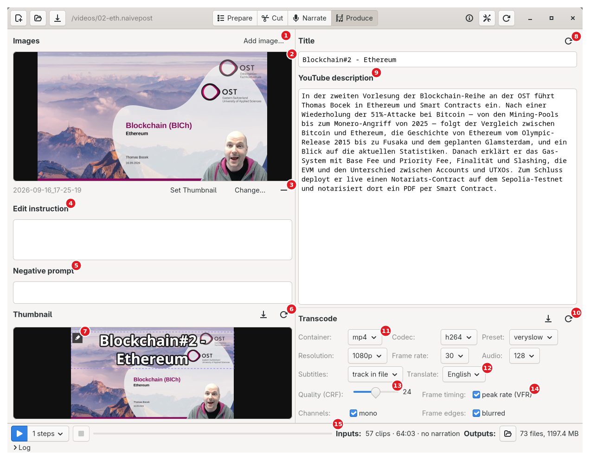
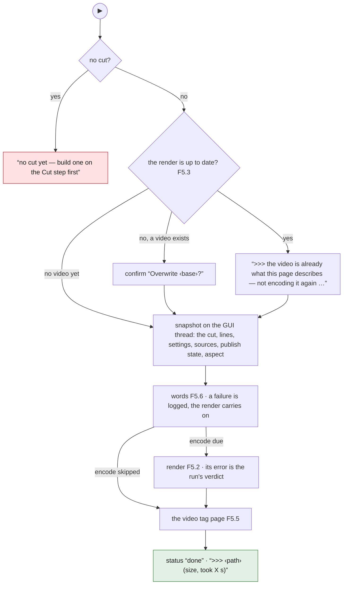
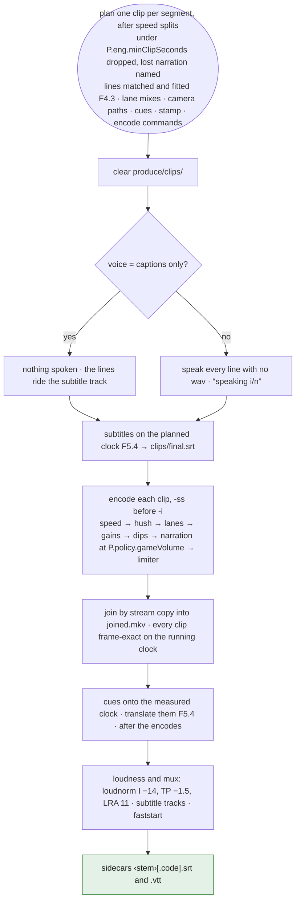
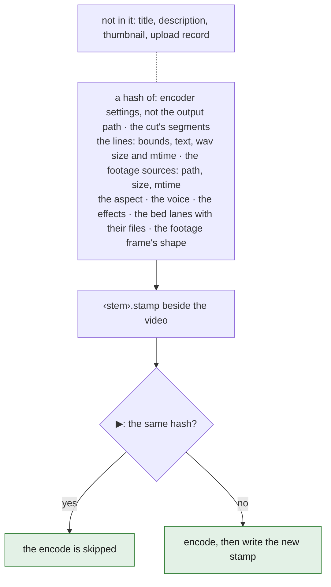
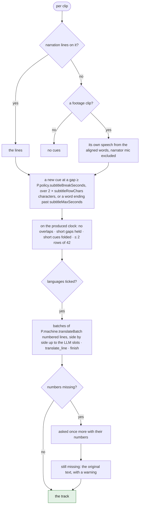
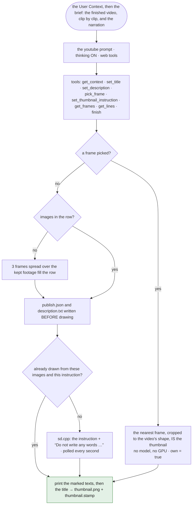
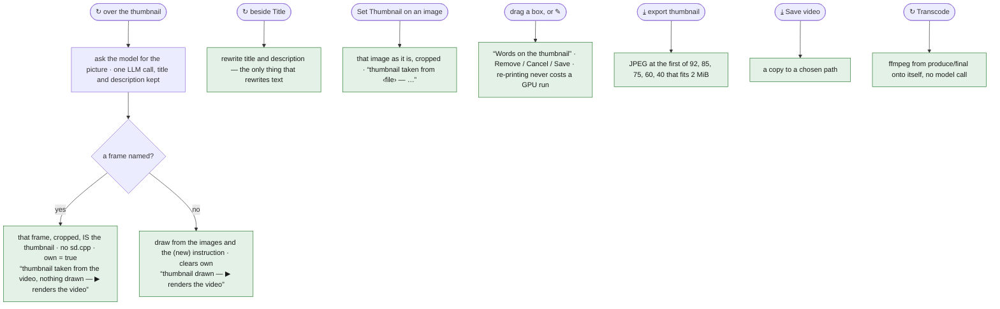
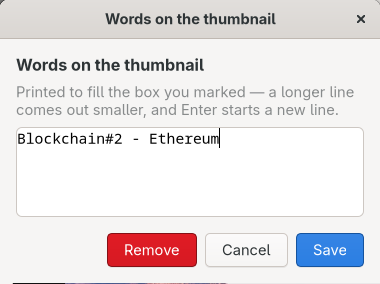

# 08 — Produce

<!-- nav -->
[← 07 Narrate](07-narrate.md) · [↑ Contents](README.md) · [09 The LLM client, tools, gate, cache, log →](09-llm-and-tools.md)

**Flows:** [F5.1](#f51--produce) · [F5.2](#f52-the-render) · [F5.3](#f53-what-up-to-date-means) · [F5.4](#f54-subtitles) · [F5.5](#f55-the-video-tag) · [F5.6](#f56-upload-text-and-thumbnail) · [F5.7](#f57-page-runs)
<!-- /nav -->

Renders the video; writes subtitles per language, title, description, thumbnail. The words half runs first and the render after it, one after the other on the run's worker; neither reads the other's files.

## 1. Screen



<sub>Screenshot of the prototype on the ETH lecture project.</sub> Narration is off in this project, so the Game audio slider is hidden.

**1** Add image… · **2** the base image the image model edits · **3** Set Thumbnail · Change… · remove (a reference slot also has Make base) · **4** Edit instruction · **5** Negative prompt · **6** Thumbnail: ⤓ export · ↻ redraw · **7** the thumbnail: drag a box to add words, ✎ to reword · **8** Title, ↻ suggest · **9** YouTube description · **10** Transcode: ⤓ save the video · ↻ encode again · **11** container · codec · preset · resolution · frame rate · audio · **12** Subtitles · Translate · **13** Quality (CRF) · **14** Frame timing (gone, see Encoder settings; the page puts Channels beside Quality) · Channels · Frame edges · **15** Inputs readout

- **Page**: split left and right by a draggable divider opened at half: two columns side by side, not one above the other. Left column, top to bottom: the Images heading ("Add image…" at its right end), the images row, Edit instruction, Negative prompt, the Thumbnail heading (⤓ and ↻ at its right end), the thumbnail. Right column (at least 360 px wide), top to bottom: the Title heading (↻ at its right end), the title entry, the YouTube description heading and box, a separator, then the encoder settings under their Transcode heading (⤓ and ↻ at its right end), in a scroller.
- **Opening**: the page is the opened project's: encoder rows and ticks from its `produce` record, title, description, instruction, negative prompt, images and thumbnail words from its `publish` record (filled from `produce/publish/publish.json` where the record is empty), the cut's clips and length, narration lines, language and voice. A project opened after another starts on its own; one with no settings starts on the defaults below.
- **Encoder settings** (labels, options, defaults and tooltips in [`inventory/produce.md`](inventory/produce.md) §A, normative): Container mp4/mkv/webm; Codec h264/h265/vp9; Preset ultrafast…veryslow (default `slow`; prototype: veryslow); Resolution 720p/1080p/original (short side; the cut's aspect sets the shape); Frame rate source/60/30/24; Audio 128/192/256/320 kbit/s; Subtitles burned in / track in file / none in the video (.srt and .vtt written beside the video regardless); Translate (per-language ticks in the settings list; session's own language never offered); (Game audio, how loud the recording plays under the narration, is set on the Narrate page, at the top of its left column ([07 §1](07-narrate.md#1-screen)) and stored with these settings; first rewrite and prototype: a row here, hidden with narration off); Quality CRF 14..34 (mark at 24); (Frame timing "peak rate (VFR)" is gone, dropped: on 08-dex (60 fps OBS recordings, 30 fps cap) its path, `-fpsmax 30` with no `fps` filter, gave every clip 2 extra frames, put the picture 31–62 ms behind the sound and made the final video 5.7 s longer than the cut, and it saved nothing: 15 real clips were 89.7 MB with it and 89.0 MB without, at the same 30 frames/s, and even dropping repeated frames (`mpdecimate`) saved 0.9%; first rewrite: a tick, off by default, the frame rate a ceiling rather than a target); Channels "mono"; Frame edges "blurred" (on: the picture fitted into the frame and laid sharp OVER a blurred blow-up of itself that covers the frame, `[backdrop][picture]overlay`, the prototype's backdrop; first rewrite: the two overlay inputs the other way round and the picture never fitted, so the blur covered it and every video came out one smear); laid out as label + control pairs in this order, left to right and then down, three on each of the first two lines, then Subtitles · Translate, Quality (CRF) · Channels, and Frame edges alone; each label sits directly left of its own control, and no label or control overlaps another. Choosing webm sets the codec to vp9 and Subtitles to "none in the video", from "burned in" as well as from "track in file"; it happens at that choice only, and the Codec and Subtitles rows stay free afterwards. Every change is kept in the project's `produce` record at once, in the window's session as well as the file (a profile's settings the same way), and every row reaches the render (the first rewrite kept none, and the render read only some rows; then it kept them in the file alone, so the next autosave of anything else, and every close, wrote back the settings the window opened with: a Translate tick was gone before the run, and no translation was made). When the project's profile set any encoder row, the settings block's tooltip is "Started from the profile <name> — a change here is this project's own". Output = `produce/final.<container>`, not asked. ↻ Transcode ("Encode the video again from the cut and these settings — no model call…"); ⤓ Save video (copy elsewhere).
- **Images row**: up to 8 slots side by side, left to right (a ninth is refused: "8 images is the most the image model takes — remove one first"); first (leftmost) = base the image model edits, others = references it can name ("the ship from the second image"); base shows a crop box when its shape differs from the video's (its own shape read off the file, the video's off the cut's aspect; laid over the base where it sits in its slot, centred on `publish.crop` as the render crops; the two are compared as pixel sizes, the video's being the thumbnail box at long side 1280, and the base's is read when the project opens from an entry that is a file path, so a `frame:` base wears no box; the box takes no drag, whatever its tooltip says, and nothing on the page writes `publish.crop`); per slot: Set Thumbnail (use as is, no model), Change…, remove; Make base on every non-base slot; empty state "No image — the thumbnail will be drawn from the instruction alone." **Edit instruction** and **Negative prompt** boxes; **Thumbnail** with ⤓ export (JPEG under 2 MB) and ↻ redraw; picture is the DRAWN thumbnail, never the base it was edited from: `thumbnail-plain.png` with the marked words printed over it live, else `thumbnail.png` as it stands (a run stopped between the two writes), else nothing yet (prototype `showShot`; the first rewrite showed the base). It is a text-overlay editor: drag a box → words printed to fill it, printed by the same code and the same lettering as the render's thumbnail and a Cut Text effect (the prototype's `drawFxText`: bold sans fitted to the box, lines centred, a dark edge composited once at 0.85 round white letters; each marked text in its own box, the title in its band; first rewrite: white letters with a soft shadow, and every marked text squeezed into a slice of the title band), scaled from the render's 1920 px, so the editor shows what the upload gets; every box is a fraction of the PICTURE where it sits fitted in the panel, so the drag, the dashed box and the printed words measure from one rectangle (the first rewrite measured the drag on the whole panel and a box on a letterboxed thumbnail landed below where it was drawn); every box, the title band included, is edited where it is seen (the prototype's `textOverlay`): the pointer names what a press does before it is pressed (the move hand inside a box, the resize arrows within 9 px of a border or corner), a drag from a box's middle moves it, a drag on its border moves that edge and leaves the far one where it was (never under 28 px), the topmost box under the press is the one taken, and the box and its words follow the hand while the drag lasts; a moved box snaps any of its edges or middle, a resized edge snaps itself, to the picture's edges and middles and every other box (10 px); a press that does not travel edits nothing; only a drag clear of every box draws a new one. ✎ to reword or remove (the ✎ chips are buttons listed under the picture, one per box); the title band is its own box with its own ✎ chip while the picture prints the title, which rewords the line ON THE PICTURE only (the video's title stays), and Remove takes the line off for good. Every edit (moved, resized, reworded, removed, placed) is kept in the project at once and printed onto `thumbnail.png` from `thumbnail-plain.png` on a worker, so ⤓ export and the upload carry what the plate shows with no run (the prototype's `recomposite`). First rewrite: the dashed borders were drawn but every press on one drew a new box, nothing could be moved, resized or reworded, the title had no ✎, and an edit reached `thumbnail.png` only on the next ▶. The dashed boxes floating over the picture take no pointer: the drag is the picture's (first rewrite: the layer holding them covered the whole picture and took every press, so no drag ever drew a box by hand).
- **Add image… and Change…** (new): each opens an image chooser (jpg, jpeg, png, webp, bmp) over the session's own frames (the first footage recording's frames folder, else the publish folder, else the project); Add image… appends the pick, Change… puts it in that slot's place; a closed chooser changes nothing. A picked file that is one of the session's frames is written as the moment it shows (`frame:<seconds>`), any other file as a path (`project:` inside the project, absolute outside). First rewrite: no chooser; Add image took the newest frame (or made up `produce/publish/frame-N.jpg`, a file that did not exist) and Change… a stand-in.
- **Plates** (the thumbnail and every image slot): each picture is decoded once on a worker, kept no longer than 1280 px a side, and painted from what is kept; a plate whose picture is still being decoded shows its ground, a missing or broken file its checkerboard, and a changed file (another size or time) is decoded again (new, [03 §1](03-shell.md#1-the-window); first rewrite: every full-size picture decoded on every paint, on the window thread). A slot whose entry is a moment (`frame:<seconds>`) shows the extracted frame nearest that second, by the same rule the request picks the file it sends; the frames folders are listed on a worker, every folder asked in one pass and the answer kept until a folder's stamp changes, and their landing repaints the plates (first rewrite: the entry was read as a file name, so every such slot showed its checkerboard).
- **The session's frames** (for the slots, the choosers, Set Thumbnail and the request alike): the frames folder of each footage recording of the project, named by the recording file's stem as Prepare writes it (first rewrite: the page looked under the cut's camera names, `cam0`, which Prepare never writes, so no frame was ever found there).
- **Title** entry (printed across the thumbnail the first time only; then separate) with ↻ suggest (fresh title and description; the only text rewriter); **YouTube description** box.
- Inputs: "N clip(s) · mm:ss\[ · no narration | · N to speak]\[ · no upload text]" ("no narration" when the narration has no line with words: there is no narration switch, [07 §1](07-narrate.md#1-screen); first rewrite: the Narration tick); tooltip: the cut's sentence, "Spoken first: “…”" or "nothing will be spoken", "Mixed recordings: …", "Voice: …", then "publish.json is written — ▶ replaces it" or "no publish.json yet — the upload text is written with the video". Outputs: count only ("61 files, 220 MB"; "0 files" when empty), no tooltip; folder button tooltip: "Open this project's output folder: <path> (produce/ — the finished video, the per-clip encodes, the thumbnail and the upload text)".

## 2. Flows

### F5.1 ▶ Produce

<sub><!-- back -->[← F4.7](07-narrate.md#f47-edit-lines) · [↑ 08 Produce](#08--produce) · [all flows](11-flow-index.md#3-all-flows) · [F5.2 →](#f52-the-render)</sub>



The run shows its stage on the status line and its encode on the bar: each clip's share of the bar is its time on screen, filled as the encoding ffmpeg says how far it has written (the `time=` of the stats line it prints every half second), so the bar moves through a clip and not only between clips (first rewrite: the bar counted clips, reported before each one, so "encoding clip 1 of 64" took the pulse away and stood at 0 % through the whole first clip, then crept by one 64th: the bar looked gone); ⏸ parks it ("paused — ▶ carries on") and ⏹ ends it between any two of the render's subprocesses, clips included. Stages on the status line: "writing the upload text and the thumbnail", "encoding clip i of n", "joining the clips", "writing subtitles and the finished file". S1 While a run is under way ▶ is its pause button, not a refusal; no cut → "no cut yet — build one on the Cut step first". S2 Render up to date ([F5.3](#f53-what-up-to-date-means) stamp) → encode skipped (">>> the video is already what this page describes — not encoding it again (↻ beside Transcode encodes anyway)", said in the log and as the run's closing status; a matching stamp with no video behind it encodes), and only the encode: the snapshot is taken and the words half (F5.6) and the tag page (F5.5) still run (first rewrite: the skip rewrote the tag page and stopped, so an up-to-date video never got its title, description or thumbnail); else if the video exists, confirm "Overwrite <base>?" ("<path> — size, age\n\nThe encode takes minutes and there is no undo for it."), Cancel the default response so Enter never replaces the render (first rewrite: Overwrite was the default). S3 Snapshot on the GUI thread (cut, lines, settings, sources, publish state, aspect); cut = the Cut page's own if it holds one (unsaved tweak still renders), else `cut/cut.json` — one function answers "what is the cut" for render, subtitles, brief and stamp. S4 startRun; unless the encode was skipped, one opening line: ">>> transcoding <file>: N clips at <container>/<codec> crf N — the thumbnail and the upload text are left as they are". Every run says this wording today, whether or not the words half goes on to write them: the flag it branches on stays false on the page state the run reads, so "… and the upload text and thumbnail written beside them" is never said, and "… and the thumbnail redrawn beside them" is never asked for. Two halves, one after the other: **words** ([F5.6](#f56-upload-text-and-thumbnail); failure logged "!!! the upload text and thumbnail failed: … -- the render carries on"), then **render** ([F5.2](#f52-the-render)). S5 After both: write the `<video>` tag page ([F5.5](#f55-the-video-tag)). S6 Render's error = run's verdict. Status "done" / "production stopped" / "production failed — see log"; on success two log lines, ">>> <file>  (<size>, took X s)" and "produced <file> — <size>, took X s", `<file>` being `produce/final.<ext>` and X the render half's own time (the words half before it not counted). Where it runs (new, [03 §1](03-shell.md#1-the-window)): S1 to S3 on the window thread (the gate reads the stamp and the frame's header, the snapshot reads the page); S4's opening line is said there too; both halves and S5's tag page walk on the run's worker, and so does the skip's tag page (its poster is an ffmpeg call). ▶ comes back at once and the bar stays open with ⏸ and ⏹ until the run's own ending closes it: ⏹ reaches the render between two steps and kills the encode it is waiting on. The words half has no stop: its model call and its draw run to their end first, and neither ⏸ nor ⏹ lands until they have. S2's question keeps the bar open while it stands; Cancel or × closes it with the question left said. First rewrite: the shell closed the bar before the render started and then ran the whole render inside the ▶ handler, so ⏹ could reach nothing.

### F5.2 The render

<sub><!-- back -->[← F5.1](#f51--produce) · [↑ 08 Produce](#08--produce) · [all flows](11-flow-index.md#3-all-flows) · [F5.3 →](#f53-what-up-to-date-means)</sub>



The plan (S3, S4's stale-sidecar delete, the stamp and every encode command) is made first, before S1 and S2 run. So a line S2 speaks had no take when its clip was planned: its speech counts as 0 s, it is logged "no synthesis for a line — it is captioned only", it is left out of this run's mix and the stamp weighs it unspoken, so the next ▶ encodes again and carries the voice. S1 Clear `produce/clips/` (its files; subfolders stay; "    produce: cleared N file(s) from produce/clips/ — K kinds of scratch file"). S2 Speak every line with words and without a wav (each take logged "spoken — <wav>" and "speaking i/n", a failed one "synthesis for Ns: …" and skipped; no stage of its own on the status line; there is no narration switch, so the lines that exist are what is spoken, and a narration with none renders without a voice: first rewrite, a Narration tick off rendered no lines) — unless voice is "captions only": nothing spoken, lines carried by the subtitle track alone (with Subtitles "none in the video" warn ">>> captions only and nothing in the video — the lines are in the .srt beside it"). S3 Plan one clip per cut segment (after speed-effect splits): footage (rate, clamped to the recording), copies (`copy:<s>`), inserts (missing file → "clip N: <file> is not there any more — skipped"), sounds over footage; clips under P.eng.minClipSeconds (0.5) dropped, log line naming any narration lost. Narration lines matched to clips (overlap ≥ half the shorter span) and fitted ([F4.3](07-narrate.md#f43-fit-a-line-to-its-clip-the-renders-rule-mirrored-by-the-row-warnings)). Sound plan for own-clock runs; lane mixes per clip (overlaps ≥ 0.1 s; no per-lane report, prototype: "<lane> is mixed into N of the M clips"); frame box per clip; camera paths; text, gain, hush, still cues. S4 Subtitles on the planned clock ([F5.4](#f54-subtitles)) → `clips/final.srt` (">>> subtitles: N cues from A spoken line(s) and B clip(s) of their own speech."); stale sidecars beside the video deleted by exact name, while planning: the own `final.srt`/`.vtt` only when this run has cues to rewrite them, a translation only for a language ticked now. S5 Encode each clip (job "clip": stems `c000_<stamp>`; -ss before -i, and footage read for as long as the clip takes of it with `-t` beside that seek (first rewrite: plain 1× footage had no length and ran on to the end of its recording); a footage clip opens the recording whose span holds its session second, its path resolved against the project, and seeks to the second inside that file (session second − that recording's start + its hand shift; first rewrite: every clip opened the first footage row unresolved, `project:sources/…`, at the session second); filter graph of [`06-effects.md` §4](06-effects.md#4-render-how-each-effect-becomes-ffmpeg) + burned subtitles (`subtitles=c%03d.srt`, a bare file name; those sheets are written while planning, so S1 clears them, and are numbered over the clips that have cues rather than over all clips); audio: speed → hush → lane bed → gains → seam dips → narration mix at P.policy.gameVolume → limiter −1 dBFS → 48 kHz `aformat`, wired as one labelled graph whose two outputs are mapped as the clip (`-map [v] -map [a]`): every heard lane is its own input (its file resolved against the project, `-ss` at the second it is at when the clip starts) mixed with the clip's own sound into the bed, every spoken line's take is its own input (tempo, 48 kHz, panned to the layout, delayed in whole ms) mixed over the bed turned down to the game volume, each `amix` there only when something joins it (`duration=first`, `normalize=0`), and a seam dip only where the sound rejoins the picture (first rewrite: the mixes were written into one chain with no file to mix, so ffmpeg refused every clip with "Cannot find an unused audio input stream", and every clip without a read head got `afade=t=out:st=0`, silent after 0.15 s) (the audio format filter; first rewrite: `format`, the video one, which ffmpeg refused with "Option not found"); codec args by codec/preset/CRF; frame rate per [`inventory/produce.md`](inventory/produce.md) §B: "source" adds nothing, any other rate is the `fps` filter (`fps=fps=<rate>` in the graph) plus `-fps_mode cfr`, the one path (on a frame grid, S5b, "source" too gets `fps=fps=<the recording's rate>` and `-fps_mode cfr`) (first rewrite: with the peak-rate (VFR) tick, `-fpsmax <rate>` alone with no `fps` filter, [§1](#1-screen); before that it sent `-fpsmax` beside `-fps_mode vfr`, which ffmpeg refuses as contradictory); every command logged as it runs, the program name once (first rewrite: "ffmpeg ffmpeg …")). Frame size mismatch vs the first clip, probed after the join, logged (join is a stream copy). S5b **Frame-exact clips** (new): every clip's picture holds the frames between where the video's running clock stands at its start and at its end, each rounded to the frame grid (the frame rate setting; "source" uses the rate of the recording the first footage clip opens, read with ffprobe; no rate read, no grid: the clips are cut by their seconds as before S5b), so a clip's half-frame of rounding is taken back by the next and the video is never more than half a frame off the cut, however many clips: `-frames:v N` on the output (the input read 0.1 s longer so the last frame exists) and `-fps_mode cfr`. Its sound starts on the picture's first frame (`aresample=async=1:first_pts=0` first) and ends on the same sample (`apad,atrim=end_sample=round(N/fps×48000)` last), and stays uncompressed (`pcm_s16le`) in a Matroska clip file (`c000_<stamp>.mkv`, whatever the final container) until the mux compresses it once. Measured (a flash and a click every second through the real commands; 15 real 08-dex clips): the video within 11 ms of a 159 s cut and within 10 ms of a 653 s one, picture and sound within 6 ms (first rewrite: each clip rounded on its own and carried an AAC track that ran to its own length and opened with 21 ms of encoder priming, about 11 ms a join, +0.31 s over those 15 clips and the sound drifting up to 0.3 s late along the video). S6 Join by stream copy ("joining") into `joined.mkv`. S7 Translate cues into ticked languages ([F5.4](#f54-subtitles); after the encodes so the encoder never idles behind the LLM gate). S8 Loudness + mux: the joined file once, then one input per subtitle track, every input before any output option; `-map 0:v -map 0:a -c:v copy -af aresample=async=1:first_pts=0,loudnorm=I=-14:TP=-1.5:LRA=11 -ar 48000` (an mp4 adds `,aresample=48000,atrim=start_sample=1024,asetpts=PTS-STARTPTS`: written without an edit list, it plays the AAC encoder's 1024 priming samples, so that many are trimmed and the priming takes their place; Matroska and WebM record the delay themselves, and the trim there made the sound 21 ms early — measured; new, first rewrite: an mp4's sound started 21 ms late), the audio codec at the page's bitrate and layout, subtitle tracks when "track in file" (mov_text in mp4, srt in mkv; never webm; each `-map <its input>:0`, tagged `-metadata:s:s:<n> language=…` and `title=…`), mp4 `-movflags +faststart+negative_cts_offsets -use_editlist 0` (first rewrite: the joined file opened twice, the tracks' `-i` after the output options, `-map s:<n>` and a global `s:<n>:language=` tag, and `-negative_cts_offsets on` as an option of its own, which ffmpeg refuses, so every mp4 mux failed). Every step's command carries `-y`: the video stands from the run before, and ffmpeg asks before overwriting. S9 Sidecars `<stem>[.code].srt` and `.vtt` per language; each logged. S10 Checkpoints: before each line spoken, before each clip, before the join, before translate and mux. The run writes the stamp ([F5.3](#f53-what-up-to-date-means)) once the render returns without error (">>> final.stamp: <hash>"); a press that skipped the encode writes none. A failed render logs "produce FAILED: <why>" before the ending.

### F5.3 What "up to date" means

<sub><!-- back -->[← F5.2](#f52-the-render) · [↑ 08 Produce](#08--produce) · [all flows](11-flow-index.md#3-all-flows) · [F5.4 →](#f54-subtitles)</sub>



Stamp = 16 hex characters, a hash of encoder settings (minus output path; the dropped VFR tick still hashes as off; plus the clip recipe `clips=frame-exact` (S5b), so every video made before frame-exact clips encodes once more), the cut's segments before speed splits, lines (bounds, text, wav size and mtime), footage sources (path, size, mtime), aspect, voice, effects, bed lanes (their file's size and mtime included), the first footage frame's shape; kept as `<stem>.stamp` beside the video. The gate weighs each line's take at the line's own roll, while the stamp a run writes weighs it at roll 0, so a project with a re-rolled line never reads as up to date. Not in it: title, description, thumbnail, upload record. Upload text is "written" when `produce/publish/publish.json` exists; deleting `publish/` starts it over.

### F5.4 Subtitles

<sub><!-- back -->[← F5.3](#f53-what-up-to-date-means) · [↑ 08 Produce](#08--produce) · [all flows](11-flow-index.md#3-all-flows) · [F5.5 →](#f55-the-video-tag)</sub>



S1 Cues per clip: its narration lines if any, else — footage clips only, never an insert, a freeze or a clip with no video — its own speech from the aligned words (narrator mic excluded), respelled from the fixed transcript, each word counted from its clip's start and held inside the clip (the list is on the session clock, a cue on the video's; first rewrite: the session seconds went on unshifted, every cue landed its clip's session start late, and a 9-minute video carried captions to 20:06 and reported that length); per word, new cue at a gap ≥ P.policy.subtitleBreakSeconds (0.6), over 2 × P.policy.subtitleRowChars (42) characters, or when the word would end past P.policy.subtitleMaxSeconds (6) from the cue's start; an empty cue extends the previous. S2 Produced clock: `clips/final.srt` is first written on the planned clock, then rewritten after the join on the clip lengths measured off the encoded files (`produce_subtitles::onto_measured`; if any clip cannot be measured the cues stay as planned), and translations and sidecars read that measured track; a burned sheet stays on its clip's own seconds (a clip's picture ends on a whole frame, so the join runs longer than the plan; first rewrite: the planned clock, and on a 76-minute video with 107 clips the subtitles were 7 s early by the end): no overlaps; gaps under 1.2 s held; cues under 0.8 s folded into the next; wrapped at 42 chars, ≤ 2 rows (a cue already holding line breaks, as a folded one does, is left as it is, however many rows that makes); `{\an8}`/`{\an5}` for top/centre. S3 Translation per ticked language, by its CODE: the page ticks names and the policy holds the session's code, so both are read as codes (`German` and `de` are `de`), the session's own language is never a translation whatever a profile ticked (a German video with English and German ticked is translated into English only, and the page's Translate row names only "English"), and each track is filed, tagged and muxed by its code (`final.de.srt`, ISO-639-2 `deu`, named German), asked for and logged by its name; with no `SUBTITLE_LANGUAGES` written the app's own three answer (en/eng/English, de/deu/German, fr/fra/French, the prototype's `subLangs`; first rewrite: the names went through as codes, so English was translated into English, the tracks were `final.English.srt` and every one was tagged `und`). Each translated sheet is written into `produce/clips/` once every ticked language is back and before the mux, when the mux carries tracks ("track in file"), and the mux reads it there; each language then logs ">>> subtitles: translating N lines into X" (first rewrite: the mux named the sidecars beside the video, written after it, and failed). Numbered batches of P.machine.translateBatch (150) lines (new; prototype sent all lines at once and repaired gaps). Before the walk, every language's first asks go out side by side up to the LLM server's slots and land in the cache the walk then reads (">>> subtitles: N batch(es), S at once -- the LLM server has the slots"; nothing of this for fewer than two asks or one slot); an answer that could not be stored is asked again by the walk, one at a time. Message "TRANSLATE THESE N LINES INTO X. Answer with N lines, numbered as they are here:" then the lines as `n<TAB>text`; no user context; thinking off; **Tools**: `translate_line(n, text)`, `finish` ([`02-services.md` §3.10](02-services.md#310-translate-per-batch-of-numbered-lines)); missing numbers re-asked once with original numbers; still missing → original text + warning, also when the server never answered (the language is not left out); each batch cached on its own, only when complete, and a re-ask never. Session's own language = track 0, never translated.

### F5.5 The `<video>` tag

<sub><!-- back -->[← F5.4](#f54-subtitles) · [↑ 08 Produce](#08--produce) · [all flows](11-flow-index.md#3-all-flows) · [F5.6 →](#f56-upload-text-and-thumbnail)</sub>

```html
<video poster="final.jpg" controls src="final.mp4" preload="none">
  <track src="final.vtt"    srclang="en" default>
  <track src="final.de.vtt" srclang="de">
</video>
```

<sub>`final.html`: the poster is the thumbnail as JPEG (`-q:v 2`); one track per `.vtt` on disk, the video's own language first and default. Rewritten even when the encode was skipped.</sub>

Poster `<stem>.jpg` (`-q:v 2`, the nearest step to quality 90) from `thumbnail.png`, else `thumbnail-plain.png`; tracks = `.vtt` files on disk, video's own language first and default; `<stem>.html` = bare `<video poster controls src preload="none">`, one `<track>` per language. Notes logged: container/codec not web-playable; subtitles need http, not file://.

### F5.6 Upload text and thumbnail

<sub><!-- back -->[← F5.5](#f55-the-video-tag) · [↑ 08 Produce](#08--produce) · [all flows](11-flow-index.md#3-all-flows) · [F5.7 →](#f57-page-runs)</sub>



S1 Brief: "THE FINISHED VIDEO: N clips, m:ss long." + "WHAT IS IN EACH CLIP:" + per clip "CLIP n (at m:ss in the video, X s): session a–b" (", the source runs at Nx here" added when its rate is not 1) with its `  SEEN +<s>: …` lines (the session's EVENT rows from `session.tsv`, on the session clock the clips are cut on; never a recording's own `events.tsv`, which counts from that recording's first second; an EVENT row is not also a `SAID:` line), `<s>` the middle of the event's stretch inside the clip in seconds from the clip's start (the offset a `frame: clip n +s` answer copies; the middle, because an event's first frame can be the fade into it — 09-news, an unstamped brief got a guessed "+11" and the fade into the title slide) (`  SEEN: nothing was seen` when no event overlaps it), `  SAID: <who>: …` and `  MARKED: <tag>: …` lines, + "THE NARRATION SPOKEN OVER IT, at its time in the finished video:" and the lines as `  m:ss: text` (or "(no narration has been written for this video)"). Unlike the narration brief ([F4.2](07-narrate.md#f42-the-narration-call)): no CAPTION lines. For long sessions the brief is bounded (P.machine.briefMaxChars, 120 kB): each clip folded to its first 3 lines of each kind and the narration to its first 3, each fold marked "(folded — read the rest with get_lines)"; the model reads more with `get_lines`. Every ▶ writes the brief to the log whole, after the call, also when the text is kept and nothing is asked. S2 System = "youtube" prompt (with the precedence rule when there is a User Context); the User Context block (as the window held it at the press, noted on the window's thread because the call runs on a worker; else `naivepost.json`) goes ahead of the brief in the user message, as on every other job: it is what says "pick a frame" or "draw it", what the title carries and how the description reads; thinking on; web tools offered. **Tools**: `get_context` (the User Context again), `set_title`, `set_description`, `pick_frame(clip, offset)`, `set_thumbnail_instruction(text, negative?)` (refused while the record's `own` is set), `get_frames(clip, at?)`, `get_lines(from, to)`, `finish` ([`02-services.md` §3.9](02-services.md#39-upload-text-and-thumbnail)); `get_context` and `get_events` are offered too but answered "no such tool for this job". Prototype: "TITLE: …", "THUMBNAIL: <instruction | frame: clip n +s>", then the description, peeled from prose. ▶ asks for the upload text once per project, as the prototype does (`needText = !written`): once `publish.json` exists it keeps the text and the picture the person chose ("    publish: the upload text is already written — kept (↻ beside the title asks again)"), and asks again only when there is nothing at all to make a thumbnail from (no chosen picture, no instruction, no images, no thumbnail) or when title and description are both empty; ↻ beside the title is the button that asks again (first rewrite: asked on every ▶, and the model's answer replaced the chosen frame and the typed title). The first title to exist is seeded as the picture's printed title and nothing seeds it twice (`TitleSeeded`); after that the picture's words are the person's. The prose is the answer and is always read (the prototype read nothing else): whatever it names wins over what a tool set, and when it carries labelled lines the description is what follows the last of them (a model drafting aloud before them, "Let me correct the hashtag list", is not the description). A `frame: clip n +s`, from the prose or the `pick_frame` tool, is that clip's SESSION start plus the offset, taken as the extracted frame nearest it (the prototype's `frameSecs`); a `frame:<seconds>` entry is a session second everywhere it is read (first rewrite: the prose was read only when no tool had answered, then only when none had written, so a model that looked at or picked a frame lost its title and description; and the frame was counted on the produced clock, so the thumbnail came out of another moment). S3 Picked frame: nearest extracted frame, cropped to the video's shape, is the thumbnail as is (no model, no GPU); row holds that frame only; `own` = true. When the run lands, what it wrote to `publish.json` (title, the printed title and whether it is seeded, description, instruction, the image row, `own`, the marked texts) is what the page shows, and the plates repaint (the prototype's `landPublish`; first rewrite: never read back, so the boxes stayed empty and the thumbnail plate kept its checkerboard). S4 An empty row and no frame picked (any run, not only the first): 3 frames evenly spread over the kept footage (spread over the video, named by their session second) fill the row ("    publish: no images chosen — taking 3 from the cut"). S5 Write `publish.json` and `description.txt` before drawing (failed draw keeps the thinking); an answered title becomes the printed line (`thumb_title`) only when nothing has seeded one, and ↻ beside Title is the one thing that replaces a seeded line; the title pass prints when this walk took or drew the picture, when the printed line changed on a picture not edited by hand (an own frame, or an edit instruction of their own), or when marked texts are being printed (prototype: printed only the first time a title existed, so a re-suggested title and the thumbnail disagreed until the user retyped it) ([`12-decisions.md` §3](12-decisions.md#3-where-the-prototype-overrules-the-model--and-where-that-decision-moves)). S6 With no edit instruction nothing is drawn and nothing is asked of the image model: the first image of the row is the thumbnail as it is, cropped to the video's shape with the title printed onto it, like a picked frame, and `own` is set in `publish.json` ("    publish: no edit instruction — the first image is the thumbnail as it is (nothing drawn)"; first rewrite: refused with "nothing to tell the image model", and the run went out with no thumbnail); only a row with no image at all still refuses so. Draw (unless `own`, or its own stamp says already drawn from these images and this instruction): instruction + "Do not write any words, letters, titles, logos or captions into the picture. Keep the <upper|middle|lower> part of the picture calm and uncluttered: a title will be printed across it afterwards."; frame = video's aspect at long side 1280; base cropped, references raw; sd.cpp request {prompt, negative_prompt, width, height, seed −1, ref_images, auto_resize_ref_image, png} (steps/cfg left to the server); empty instruction refused: "nothing to tell the image model — write an edit instruction first (▶ suggests one)"; poll every second: "drawing (<status>)" or "drawing (<status>, N ahead in the queue)"; result → `thumbnail-plain.png`. S7 Print marked texts, then title, onto `thumbnail.png` (a failed print: "    publish: could not print the words (<why>) — keeping the plain picture", and the words half fails); write `thumbnail.stamp`. S8 Whatever the answer leaves out keeps the previous value, description included ("    publish: no <title | description | title or description> in the answer — keeping what was there before", naming what is still empty).

### F5.7 Page runs

<sub><!-- back -->[← F5.6](#f56-upload-text-and-thumbnail) · [↑ 08 Produce](#08--produce) · [all flows](11-flow-index.md#3-all-flows) · [F6.1 →](09-llm-and-tools.md#2-tool-protocol-f61)</sub>





<sub>Screenshot of the prototype on the ETH lecture project.</sub>

- ↻ over the thumbnail: make the thumbnail again the way the prompt says, so a prompt that asks for a frame of the video never reaches sd.cpp. First one LLM call: the youtube job with the run's brief, asked as if no picture had been chosen yet (no own frame, no instruction, no images), so the model is free to answer either way; only its picture is kept, never its title or description. Its answer decides: a frame (`pick_frame` or "THUMBNAIL: frame: clip n +s") is taken as in F5.6 S3, the nearest extracted frame cropped to the video's shape with the words printed on it, the row holding that frame only and `own` set, no sd.cpp call, ending "thumbnail taken from the video, nothing drawn — ▶ renders the video"; an instruction replaces the one in the box and is drawn from the images as they stand (always draws; clears "own" once drawn), ending "thumbnail drawn — ▶ renders the video"; an answer naming neither keeps the images and instruction on the page ("    publish: the model named no frame and no instruction — using the images and instruction on the page") and goes on as the run would, the first image as it is when there is no instruction (F5.6 S6). A failed call or draw changes nothing. No cut → "no cut yet — the thumbnail is drawn from the cut's own frames"; an empty instruction is no longer refused before the call. Opens "publish: making the thumbnail again — one LLM call for the picture (a frame, or one sd.cpp call), title and description kept". The drawn picture is saved as `thumbnail-plain.png` before the words are printed back onto it, as in the run (F5.6 S6); a job that finishes with no image says so ("the drawing server finished job <id> with no image"). First rewrite: went straight to the reprint, so against a real sd.cpp every redraw ended "nothing has been drawn to print onto". Second rewrite: redrew from the standing images and instruction with no model call, so an instruction written before the prompt said "pick a frame" kept going to sd.cpp (09-dao, 2026-11-06: the server was down and the thumbnail never came).
- ↻ beside Title: rewrite title and description only, from the same brief as the run, and land them on the page; a new title also replaces the line printed on the picture. Images, instruction and the picture underneath are untouched. No cut → "no cut yet — build one on the Cut step first"; opens "publish: rewriting the title and description — one LLM call"; an answer with neither is an error ("the model answered with no title and no description"); ends "title and description rewritten — ▶ renders the video".
- Both end through one path: success re-prints the words onto the thumbnail; else "<what> failed — see log" or "<what> stopped", `<what>` being "the thumbnail" or "the text".
- Set Thumbnail on an image: use as is, cropped; no cut → the redraw's refusal; "thumbnail taken from <file> — the words are printed on it; ↻ draws over it".
- Words on the thumbnail: drag a box → dialog "Words on the thumbnail" (top to bottom: heading, dim explanation, the text box; buttons at the bottom right, left to right Remove, Cancel, Save); boxes snap to the picture's and each other's edges and middles, and move smoothly while Shift is held; re-printing costs a decode, never a GPU run.
- ⤓ export: JPEG at the first of qualities 92, 85, 75, 60, 40 fitting 2 MiB (last attempt written even if it still doesn't, with no word said; never rescaled); a save dialog opened on the default name `<project>-thumbnail.jpg` (beside the video), writing where the person answers, extension forced to `.jpg`; a closed dialog writes nothing (first rewrite: no dialog, always the default); "nothing to export yet — draw a thumbnail, or use one of the images"; ">>> exported <path> (<size>)". ⤓ Save video: default name `<project>.<container>`, "saving <file>…" then "saved <file> — <size>"; "nothing to save yet — ▶ renders the video first"; while a render runs, "finish the render first". `<file>` is the path answered.
- ⤓ Save video: a save dialog opened on `<project>.<container>` in the produce folder, the copy going where the person answers (first rewrite: no dialog, always the default). ↻ Transcode: no model call and no cut read, no question asked and no stamp written: ffmpeg with `produce/final.<container>` as both input and output and the row's codec, frame-rate and audio arguments, an mp4's faststart flags too (no subtitles); ffmpeg refuses to write a file onto its own input, so the press ends "the transcode failed — see log". Refused while a render runs ("wait for the current render to finish — ⊘ Cancel first"). Logs "transcode started — <file>, <container>/<codec>, <resolution>" and "transcode finished — <file>".
- Where they run (new, [03 §1](03-shell.md#1-the-window)): ↻ over the thumbnail, ↻ beside Title, Set Thumbnail, ⤓ export, ⤓ Save video and ↻ Transcode each walk on a worker: the press comes back at once with its button greyed (Set Thumbnail's stays live), a press made while one of them walks is ignored, and the ending lands on the status line (and the plates repaint) when the walk does. Set Thumbnail records the choice and repaints at once; the crop and the print are the worker's. The words dialog and a box dragged on the picture stay on the window thread for the edit itself; the re-print onto `thumbnail.png` that follows is a worker's. First rewrite: every one of them waited for the model, sd.cpp, ffmpeg or the copy inside the click.

## 3. Data

`produce/clips/` (encodes, final.srt, final.<code>.srt, concat.txt), `produce/final.<ext>` + `.stamp` + sidecars + `.jpg` + `.html`, `produce/publish/` ([`01-project-and-files.md` §5](01-project-and-files.md#5-producepublishpublishjson)).

## 4. Parameters used

Parameters ([10](10-parameters.md)): minClipSeconds, gameVolume (0.22), subtitle break/row chars/max/hold/min, translateBatch, narration fitting ([F4.3](07-narrate.md#f43-fit-a-line-to-its-clip-the-renders-rule-mirrored-by-the-row-warnings)), loudness target (−14 LUFS, −1.5 dBTP, LRA 11), limiter (−1 dBFS), thumbnail long side (1280), title band, publish frames (3, max 8), briefMaxChars. Project: encoder settings. Engineering: input ordering, faststart flags, sd.cpp timeouts, poster quality, export ladder.

## 5. Rules

- Join is a stream copy: all clips share one frame size and audio layout; -ss before -i; every clip's length is its frame count on the video's running clock (`-frames:v`, its sound trimmed to the same sample; S5b); -t on the output for inserts, sounds, freezes, rated clips only when no frame grid is known; adelay in whole milliseconds; input indices append-only; 0.5 s is the single clip floor; a dropped clip is always logged.
- Cues built for every subtitle mode; sidecars written whenever there is anything to say (no narration and no speech → none: "!!! nothing to put in a subtitle: no narration, and no speech in the clips"), stale ones deleted first (the own pair only when this run has cues); never an empty cue; translations read back by number; gaps re-asked once, then left in the original; own language never translated; webm carries no subtitle track.
- ▶ leaves an up-to-date video alone; upload text written once per project; `publish.json` laid down before drawing; thumbnail has its own stamp; ↻ over it always makes the picture again (the frame the model names, else a draw the stamp never skips); a chosen frame survives ▶; title seeded onto the picture once; re-printing words never costs a GPU run.
- The two halves touch no common file; all widget reads happen before the worker; `<video>` tag rewritten even when the encode was skipped.

## 6. Details confirmed against the code (verification pass)

- **Clip planning refusals**: "clip N copies footage at T s that falls in no recording — skipped"; "clip N copies past the end of <base> — shortened to X s"; "clip N at T s falls in no recording — its sound has no picture, skipped"; "clip N runs past the end of <base> — shortened to X s" (said when the filmed run a clip starts in ends before the clip does: X is that run's end less the clip's start, and <base> is the recording the clip starts in; first rewrite: compared the clip's length with the tape left after its end and named the first footage row, so a session whose tape covered every clip had each one "shortened"); an insert keeping the sound under it but finding no recording, or with no sound, "… — it plays silent". A clip uses its recording's first audio stream as its own sound only if that stream is among the source's selected `tracks`; else it is heard via the lane mix. Narration on a card or held frame (no session span) matched by exact bounds within 0.05 s. A line with no synthesis holds its cue to the next line or clip end. The planned 1× read head opens only where sound would drift ≥ 0.05 s; a card, held frame or clip on no recording closes the run. A moving camera forces a fixed frame grid ("<clip>: the moving camera needs a fixed frame rate — this clip is N fps"). Each spoken line: time-stretched, resampled, panned across the output layout (else a mono voice lands in one speaker), delayed by whole milliseconds.
- **Planning log lines** beyond the refusals: "clip N: the zoom goes deeper than ffmpeg's 10× — it is rendered at 10×"; "a stop at T s falls in no recording — its still is skipped"; "clip N at T s has no narration entry — it keeps its own audio"; "clip N: no synthesis for a line — it is captioned only".
- **produce/clips/ also holds**: per-clip burn cue files `c%03d.srt`, one generated title document per text cue `…_t%02d.svg`, a written copy of any parameterised static card, a `.frames/` folder per baked animation, the stream-copy `joined.mkv` (Matroska whatever the final container, new with frame-exact clips); its files are cleared at the start of every render, subfolders left.
- **Mux**: each subtitle track is its own input tagged with ISO-639-2 code and name so players name them; a language not in the list → tagged `und`, named by its upper-cased code; the own-language track reaches the mux with no language at all, so it is tagged `und` with an empty name; after a webm mux: "webm cannot carry an srt track — the subtitles are the files beside the video". Unknown stored subtitle mode reads as "none in the video" (an unknown answer must not letter somebody's picture); stored resolution no longer offered → default; a stored `vfr` (the dropped Frame timing tick) is ignored. Legacy `produce` keys: `subs: "sidecar"` → "none"; `subs_from` dropped; absent `game_vol` = default, stored 0 = silence; `bare` = negation of the blurred-edges tick.
- **Translation**: a cue's line breaks go out as " / "; a line left in the original gets them back as breaks, a translated line keeps whatever the model wrote, " / " included, and is then wrapped at output; missing lines named by number (">>> subtitles: <lang> came back missing line 7, 64, 92 -- asking again for N line(s)"; "!!! subtitles: <lang>: N line(s) left in the original (line 7, 92) -- the rest of the track is good"); answers read from `translate_line` calls, else from `n<TAB>text` lines (number, optional dot, then a tab or space); unreadable or unasked line skipped, never shifted; the last answer per number wins; the cache holds each batch's numbered lines, only when complete, keyed on the numbers too; ">>> subtitles: <lang> came from the cache -- the same lines were translated before" is said for every complete track, whether or not the cache answered it. Wrapping rebalances at the middle, never drops words; the track's last cue is extended to the readable minimum.
- **Frame boxes**: no aspect → thumbnail 16:9 at long side 1280; frame box derivable from nothing = chosen height (or 1080) at 16:9; both sides always even.
- **Publish**: legacy `base` index applied by moving that frame to the front; `title_off` read once; an older `<project>/publish/` folder is used only while `produce/publish/` does not exist. Deadlock breaker: text gate closed but no picture, no images, no instruction, no thumbnail → text asked again, unannounced. A picked frame leaves the instruction standing and undrawn; row holds that frame only ("    publish: the thumbnail is the frame at m:ss, as it is — no model, no GPU"; failure "    publish: <why> -- the thumbnail is drawn instead"). Prototype frame line: `frame: clip <n> +<seconds>` → that clip's start + offset, or a bare second / mm:ss; unknown clip or negative sum = no frame named — never "take the first one"; a `THUMBNAIL: frame: …` line is a frame, instruction discarded; labelled lines peel in either order, up to three, quotes stripped, a whole-reply fence removed first; with no `TITLE:` line, a first line directly above `THUMBNAIL:` (at most 120 chars, not ending in ":") is the title; a first description line under 40 chars ending in ":" is dropped. Candidate frames: middles of three equal bands over the kept footage (never first or last frame, never under an insert), written as moments and not checked against the frames on disk, each read as the extracted frame nearest it when used; no kept footage → "    publish: no frames extracted either — drawing from the instruction alone". Drawing: a missing base, like a missing reference, is skipped and logged ("    publish: <entry> is not there — sent without it"), and the next image then leads `ref_images`; request logged with size, base, image count, crop ("    publish: WxH editing <base>, N image(s) sent, base cropped to P% of its width around cx,cy" / "…drawn from the instruction alone, no images"); "already drawn" needs both thumbnail files and a stamp match (the row's entries as written and sorted, instruction, negative, aspect, own; so neither Make base, the crop nor a replaced file behind the same name asks for a draw); ↻ beside the title takes only the answer's title and description, a frame it names is ignored; printing failure keeps the plain picture and fails the words half. Title band is a box only while the picture carries words; its ✎ edits the picture's line; Remove keeps it off for good; typing the YouTube title never re-prints the picture. Text boxes: only the ✎ chip opens the dialog ("Printed to fill the box you marked — a longer line comes out smaller, and Enter starts a new line."); a new box under 28 px either way marks nothing, a press on a box travelling under 2 px edits nothing; a box reworded empty is removed, a new box saved empty is kept as an empty box that prints nothing; a reprint with nothing to print writes the plain picture out as `thumbnail.png`.
- **<video> tag**: tracks read off disk (tag rewritten even when the encode was skipped), own language first, rest by name, `default` on the first only; notes "no browser plays Matroska — render to mp4 or webm for a page" / "Firefox plays no h265 at all, and the others only where the machine decodes it in hardware — h264 is the one that plays everywhere"; no thumbnail logged ("    produce: no poster for the <video> tag (no thumbnail has been drawn yet)"); either way, or when ffmpeg fails on the poster, the tag is written without one; the two notes follow only a written tag, the http one only with tracks.
- **Stamp**: uncomputable or unwritable stamp never matches ("    produce: could not write the render stamp (…) — the next ▶ will encode again"); never fails the run.

<!-- nav -->
---
[← 07 Narrate](07-narrate.md) · [↑ top](#08--produce) · [↑ Contents](README.md) · [09 The LLM client, tools, gate, cache, log →](09-llm-and-tools.md)
<!-- /nav -->
